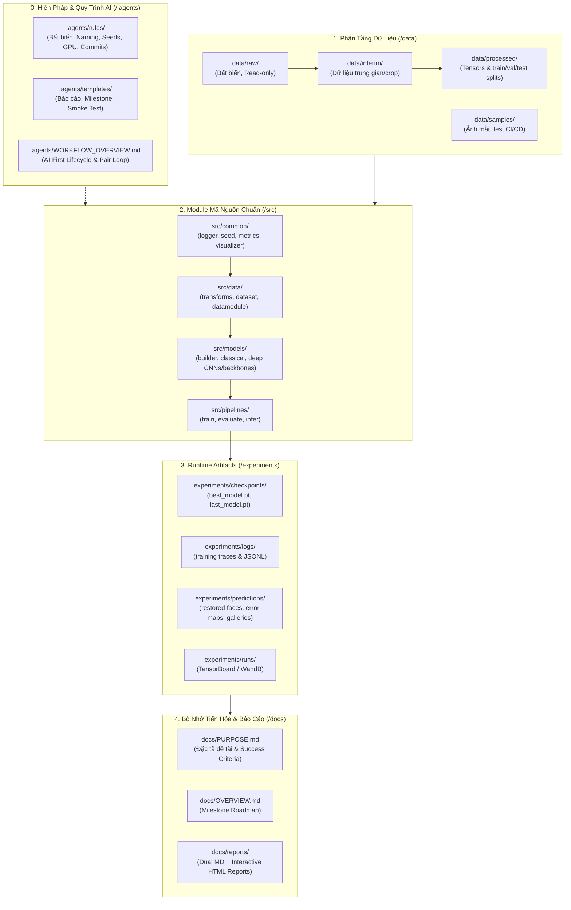

# UTH Computer Vision Coursework Workspace (`uth-cv-coursework`)

[](https://www.python.org/)
[](https://pytorch.org/)
[](https://github.com/astral-sh/ruff)
[](https://github.com/pre-commit/pre-commit)

- **Motivation/Background**: Không gian đồ án môn học Thị giác Máy tính (Computer Vision Coursework) tại Trường Đại học Giao thông Vận tải TP.HCM (UTH). Đề tài: "Xây dựng bộ dữ liệu khuôn mặt bị che khuất tổng hợp bằng mô hình Diffusion phục vụ bài toán phục hồi khuôn mặt" (Diffusion-Based Synthetic Occluded Face Dataset Generation for Facial De-occlusion).
- **Purpose**: Cung cấp kiến trúc Clean Architecture, cơ chế quản trị AI Agent bất biến (`/.agents`), chuẩn dữ liệu triplet $(I_{\text{clean}}, I_{\text{occ}}, M)$, quy trình huấn luyện script-only và hệ thống đánh giá phục hồi khuôn mặt (PSNR, SSIM, LPIPS, ArcFace ID similarity).
- **Overview Pipeline**: Tiếp nhận yêu cầu & đặc tả bài toán (`docs/PURPOSE.md`) -> Khảo sát dữ liệu (`notebooks/exploratory/`) -> Đóng gói module sinh triplet & mô hình phục hồi (`src/data/`, `src/models/`) -> Huấn luyện & lưu checkpoint (`scripts/run_pipeline.sh`) -> Đánh giá phục hồi & lập báo cáo kỹ thuật (`docs/reports/`).
- **Detailed Plan**: §1 Kiến trúc Hệ thống Tổng thể; §2 Cấu trúc Thư mục Dự án; §3 Hệ thống Quản trị AI-First (`/.agents`); §4 Hướng dẫn Cài đặt & Vận hành; §5 Bảng Lệnh Tự Động Hóa Makefile.
- **References**: `.agents/rules/FOLDER_STRUCTURE.md`, `.agents/rules/MD_CONVENTION.md`, `.agents/AI_REFERENCE.md`, `docs/PURPOSE.md`, `docs/OVERVIEW.md`.
- **Created**: 2026-11-02T07:22:00+07:00
- **Last Updated**: 2026-11-02T07:22:00+07:00

---

## 1. 🏗️ Kiến trúc Hệ thống Tổng thể (Architecture Overview)

Dự án áp dụng mô hình phân tách trách nhiệm nghiêm ngặt (Separation of Concerns - SoC):



---

## 2. 🗂️ Cấu trúc Thư mục Dự án (Directory Layout)

```text
uth-cv-coursework/
├── .agents/                            # Hệ thống hiến pháp & Second Brain cho AI Agent
│   ├── README.md                      # Cổng nhận thức trung tâm & bảng điều phối phản xạ
│   ├── rules/                         # Các quy tắc kỹ thuật bất biến (Coding, PyTorch, Commit, v.v.)
│   ├── templates/                     # Biểu mẫu báo cáo, kiểm toán, roadmap và smoke checklist
│   ├── AI_FIRST_LIFECYCLE.md          # 9 giai đoạn phát triển vĩ mô (Define -> Document)
│   ├── AGENT_INTERACTION_LOOP.md      # Chu trình tương tác vi mô 7 bước (Pair-Programming)
│   ├── AI_REFERENCE.md                # 5 bất biến CV/DL (Shapes, Color spaces, Boxes, Seeds, GPU)
│   ├── TESTING_STRATEGY.md            # Chiến lược kiểm thử Smoke test (< 5s) vs Normal test
│   └── TROUBLESHOOTING.md             # Quy trình 5 bước phân tích nguyên nhân gốc rễ (RCA)
├── configs/                           # Quản lý cấu hình tập trung (YAML)
│   ├── config.yaml                    # Master config entrypoint
│   ├── dataset/                       # Cấu hình dataset, kích thước ảnh, augmentations
│   ├── model/                         # Cấu hình kiến trúc mô hình & siêu tham số
│   └── experiment/                    # Cấu hình thực nghiệm & tracking
├── data/                              # Dữ liệu phân tầng (Ignored by Git ngoại trừ samples)
│   ├── raw/                           # Dữ liệu thô nguyên bản không chỉnh sửa
│   ├── interim/                       # Dữ liệu trung gian sau tiền xử lý
│   ├── processed/                     # Dữ liệu chuẩn hóa sẵn sàng cho DataLoader
│   ├── samples/                       # Ảnh mẫu tối thiểu phục vụ kiểm thử nhanh
│   └── README.md                      # Hướng dẫn tầng dữ liệu & data dictionary
├── docs/                              # Bộ nhớ dự án & Báo cáo kỹ thuật (Evolving Memory)
│   ├── README.md                      # Mục lục tài liệu dự án
│   ├── PURPOSE.md                     # Bản đặc tả đề tài đồ án phục hồi khuôn mặt & tiêu chí đánh giá
│   ├── OVERVIEW.md                    # Lộ trình đồ án (Roadmap) & quản lý milestone
│   ├── coursework/                    # Tài liệu đề bài, barem điểm & hướng dẫn đồ án
│   ├── phases/                        # Đặc tả kỹ thuật từng giai đoạn (Phase Specs)
│   ├── progress/                      # Bảng theo dõi tiến độ công việc Kanban
│   ├── experiments/                   # Báo cáo thực nghiệm chuyên sâu (5W1H)
│   ├── reports/                       # Báo cáo tổng kết đồ án (Markdown + Interactive HTML)
│   └── shared/                        # Quy trình vận hành chuẩn (SOPs) & hướng dẫn
├── experiments/                       # Nơi lưu trữ artifacts sinh ra khi chạy (Ignored by Git)
│   ├── checkpoints/                   # Trọng số mô hình (*.pt, *.pth, best_model.pt)
│   ├── logs/                          # File log thực thi huấn luyện & lịch sử JSONL
│   ├── predictions/                   # Kết quả dự đoán trực quan, visualization plots
│   └── runs/                          # Sự kiện theo dõi TensorBoard / WandB
├── notebooks/                         # Thư mục Jupyter Notebook tương tác (NO heavy training)
│   ├── exploratory/                   # Khảo sát phân bố dữ liệu (EDA) & trực quan hóa mẫu
│   ├── coursework/                    # Minh họa giải thuật, demo kết quả định tính
│   └── README.md                      # Quy chuẩn Cell 0/Cell 1 & tách biệt Notebook vs Báo cáo
├── requirements/                      # Quản lý dependencies theo từng lớp môi trường
│   ├── base.txt                       # Core dependencies (Torch, OpenCV, NumPy, Matplotlib)
│   ├── deeplearning.txt               # Advanced toolkits (Albumentations, Timm, Torchmetrics)
│   ├── dev.txt                        # Development & testing (Pytest, Ruff, Black, Mypy)
│   └── tracking.txt                   # Experiment tracking (TensorBoard, WandB)
├── requirements.txt                   # Proxy trỏ tới base.txt & dev.txt
├── scripts/                           # Shell scripts tự động hóa pipeline
│   ├── setup_env.sh                   # Khởi tạo virtualenv & cài đặt trọn gói
│   ├── download_weights.sh            # Tải trọng số pre-trained cho backbone
│   └── run_pipeline.sh                # Điều phối pipeline (train/eval/infer)
├── src/                               # Package mã nguồn chính thức (Clean Architecture)
│   ├── __init__.py
│   ├── common/                        # Tiện ích dùng chung (logger, seed, metrics, visualizer)
│   ├── data/                          # Transforms, Dataset & DataModule
│   ├── models/                        # Kiến trúc mô hình (builder, classical, deep)
│   └── pipelines/                     # Pipeline thực thi (train, evaluate, infer)
├── tests/                             # Bộ kiểm thử tự động với Pytest
│   ├── conftest.py                    # Fixtures dữ liệu và synthetic tensors
│   ├── test_data.py                   # Kiểm thử DataModule & Dataset
│   ├── test_models.py                 # Kiểm thử forward pass & tensor shapes
│   ├── test_transforms.py             # Kiểm thử logic chuẩn hóa ảnh
│   └── test_pipelines.py              # Kiểm thử smoke test & utilities
├── .editorconfig                      # Chuẩn hóa format văn bản & thụt đầu dòng
├── .gitattributes                     # Cấu hình Git LFS cho checkpoints và media
├── .gitignore                         # Loại trừ file tạm, cache, trọng số & dữ liệu thô
├── AGENTS.md                          # Ràng buộc hiến pháp gốc cho AI Agent (Root Workspace Charter)
├── GEMINI.md                          # Symlink trỏ tới AGENTS.md phục vụ Google Antigravity/Gemini
├── Makefile                           # Trình điều khiển tự động hóa dòng lệnh
├── pyproject.toml                     # Cấu hình package, Ruff, Black, isort, Pytest
├── pytest.ini                         # Cấu hình phân tầng test runner
└── SETUP.md                           # Cẩm nang cài đặt môi trường nhanh
```

---

## 3. 🧠 Hệ thống Quản trị AI-First (`/.agents`)

Dự án tích hợp bộ quy chuẩn kỹ thuật độc lập tại thư mục `.agents/`:
- **Cold-Start Protocol**: AI Agent khi bắt đầu làm việc chỉ cần đọc `.agents/` để tiếp nhận toàn bộ tư duy kỹ thuật, ranh giới module và cam kết bất biến.
- **5 Bất biến CV/DL bắt buộc**:
  1. *Tensor Shapes*: Ghi rõ shape `(B, C, H, W)` hoặc `(H, W, C)` trong docstrings.
  2. *Color Spaces*: Chuyển đổi rõ ràng giữa OpenCV (`BGR`) và Matplotlib/PyTorch (`RGB`).
  3. *Bounding Boxes*: Sử dụng tường minh một trong các chuẩn `xyxy`, `xywh`, hoặc `cxcywh`.
  4. *Reproducibility*: Sử dụng hàm seed tập trung `src.common.seed.seed_everything()`.
  5. *GPU Hygiene*: Không hardcode device, quản lý bộ nhớ VRAM với AMP `autocast()`.

---

## 4. 🚀 Hướng dẫn Cài đặt & Vận hành (Quickstart)

```bash
# 1. Khởi tạo môi trường ảo và cài đặt thư viện
make install
make install-dev

# 2. Chạy kiểm thử smoke test tức thì (< 5s)
make test-smoke

# 3. Chạy pipeline huấn luyện mẫu
make run
```

---

## 5. 🛠️ Bảng Lệnh Tự Động Hóa Makefile

| Lệnh | Mục đích |
| :--- | :--- |
| `make help` | Hiển thị danh mục các lệnh hỗ trợ |
| `make install` | Cài đặt dependencies cơ bản (`requirements.txt`) |
| `make install-dev` | Cài đặt trọn bộ công cụ lập trình, kiểm thử và theo dõi |
| `make format` | Tự động căn chỉnh và format code với Ruff và Black |
| `make lint` | Kiểm tra chất lượng code và bắt lỗi vi phạm quy chuẩn |
| `make type-check` | Chạy kiểm tra kiểu tĩnh với Mypy |
| `make test` | Chạy toàn bộ bộ kiểm thử với Pytest |
| `make test-smoke` | Chạy bộ kiểm thử nhanh Smoke Test (< 5 giây) |
| `make run` | Khởi chạy pipeline huấn luyện mẫu |
| `make clean` | Dọn sạch cache, file tạm Python và build artifacts |
