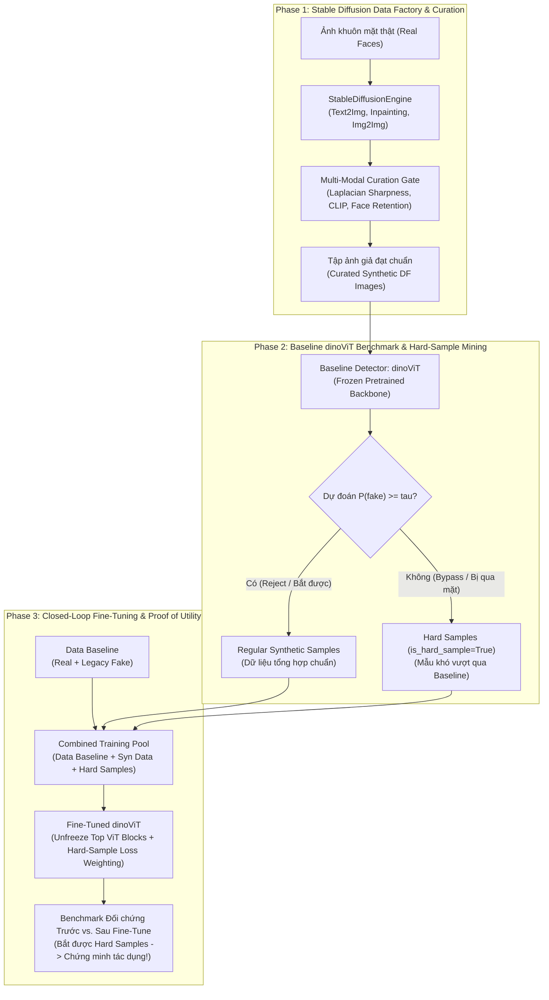

# UTH Computer Vision Coursework Workspace (`uth-cv-coursework`)

[](https://www.python.org/)
[](https://pytorch.org/)
[](https://github.com/astral-sh/ruff)
[](https://github.com/pre-commit/pre-commit)

- **Motivation/Background**: Không gian đồ án môn học Thị giác Máy tính (Computer Vision Coursework) tại Trường Đại học Giao thông Vận tải TP.HCM (UTH). Đề tài: "Xây dựng bộ dữ liệu ảnh khuôn mặt Deepfake tổng hợp bằng Stable Diffusion, Khai phá Mẫu khó (Hard-Sample Mining) và Tinh chỉnh mô hình DINO ViT (`dinoViT`) phục vụ bài toán phát hiện Deepfake" (Topic 11, Hugging Face CV Course Unit 10).
- **Purpose**: Cung cấp kiến trúc Clean Architecture khép kín gồm: (1) Phase 1 — Sinh dữ liệu ảnh giả `Synthetic DF` từ ảnh thật qua Stable Diffusion (Text2Img, Inpainting, Img2Img) & Curation Gate; (2) Phase 2 — Đánh giá qua Baseline `dinoViT` để phân tách mẫu bị bắt (`Reject`) và mẫu vượt qua mô hình (`Bypass` $\rightarrow$ thu thập thành **Hard Samples**); (3) Phase 3 — Fine-tune `dinoViT` trên tổ hợp `Data Baseline + Synthetic Data + Hard Samples` để chứng minh tác dụng thực tiễn của dữ liệu tổng hợp.
- **Overview Pipeline**: Ảnh thật (`data/raw`) + Stable Diffusion (`generate_deepfake_images.py`) -> Curation Gate (`curate_image_dataset.py`) -> Baseline `dinoViT` Benchmark & Bypass Mining (`mine_hard_samples.py`) -> Fine-tune `dinoViT` trên `Baseline + Syn + Hard Samples` (`train_image_detector.py`) -> Đối chứng trước/sau Fine-tune (`evaluate_image_benchmark.py`).
- **Detailed Plan**: §1 Kiến trúc Vòng lặp Khép kín 3 Pha; §2 Cấu trúc Thư mục Dự án; §3 Hệ thống Quản trị AI-First (`/.agents`); §4 Hướng dẫn Cài đặt & Vận hành; §5 Bảng Lệnh Tự Động Hóa Makefile.
- **References**: `.agents/rules/FOLDER_STRUCTURE.md`, `.agents/rules/MD_CONVENTION.md`, `.agents/AI_REFERENCE.md`, `docs/PURPOSE.md`, `docs/OVERVIEW.md`.
- **Created**: 2026-11-02T07:22:00+07:00
- **Last Updated**: 2026-11-08T17:45:00+07:00

---

## 1. 🏗️ Kiến trúc Vòng lặp Khép kín 3 Pha (Closed-Loop Architecture)

Đề tài vận hành theo chu trình đối kháng khép kín nhằm **chứng minh trực tiếp tác dụng của dữ liệu tổng hợp Stable Diffusion**:



---

## 2. 🗂️ Cấu trúc Thư mục Dự án (Directory Layout)

```text
uth-cv-coursework/
├── .agents/                            # Hệ thống hiến pháp & Second Brain cho AI Agent
├── configs/                           # Quản lý cấu hình tập trung (YAML)
│   ├── config.yaml                    # Master config entrypoint
│   ├── dataset/deepfake_image.yaml    # Cấu hình 2D dataset, identity-disjoint & hard-sample oversampling
│   ├── generation/stable_diffusion.yaml # Cấu hình Stable Diffusion & Curation thresholds
│   └── detection/detector_baseline.yaml # Cấu hình dinoViT, bypass threshold & fine-tuning
├── data/                              # Dữ liệu phân tầng (raw, interim, processed, samples)
├── docs/                              # Bộ nhớ dự án & Báo cáo kỹ thuật (Evolving Memory)
│   ├── README.md                      # Mục lục tài liệu dự án
│   ├── PURPOSE.md                     # Bản đặc tả đề tài (SD + dinoViT + Hard Sample) & KPIs
│   ├── OVERVIEW.md                    # Lộ trình đồ án (Roadmap) & quản lý milestone
│   ├── coursework/                    # Tổng quan tài liệu & đặc tả taxonomy dữ liệu
│   ├── phases/                        # Đặc tả kỹ thuật 3 pha (Synthesis, Mining, Fine-tuning)
│   ├── progress/                      # Bảng theo dõi tiến độ PROJECT_ROADMAP.md
│   ├── experiments/                   # Giao thức thực nghiệm đối chứng (EXPERIMENT_PROTOCOL.md)
│   └── reports/                       # Báo cáo tổng kết đồ án & Slide thuyết trình (MD + HTML)
├── experiments/                       # Checkpoints, logs, predictions
├── notebooks/                         # Jupyter Notebooks chỉ phục vụ EDA & Visualization
├── requirements/                      # Quản lý dependencies theo từng lớp môi trường
├── scripts/                           # Shell scripts điều phối pipeline (run_pipeline.sh)
├── src/                               # Package mã nguồn chính thức (Clean Architecture)
│   ├── common/                        # logger, seed, metrics (ROC-AUC, bypass_rate, hard_sample_recall), checkpoint
│   ├── data/                          # ImageMetadata, ImageSample, DeepfakeImageDataset, DeepfakeImageDataModule
│   ├── models/                        # StableDiffusionEngine, DinoViTBackbone, DeepfakeImageDetector
│   └── pipelines/                     # generate_deepfake_images, curate_image_dataset, mine_hard_samples, train_image_detector, evaluate_image_benchmark
└── tests/                             # Bộ kiểm thử tự động với Pytest (Smoke & Normal tests)
```

---

## 3. 🚀 Hướng dẫn Vận hành Nhanh (Quickstart)

```bash
# 1. Chạy kiểm thử smoke test tức thì (< 5s) và toàn bộ test suite
make test-smoke
make test

# 2. Thực thi lần lượt 3 Pha của đề tài qua Pipeline Runner:
bash scripts/run_pipeline.sh generate   # Phase 1a: Sinh ảnh Synthetic DF bằng Stable Diffusion
bash scripts/run_pipeline.sh curate     # Phase 1b: Lọc chất lượng qua Curation Gate
bash scripts/run_pipeline.sh mine       # Phase 2: Đánh giá qua Baseline dinoViT -> tách Bypass Hard Samples
bash scripts/run_pipeline.sh train      # Phase 3a: Fine-tune dinoViT trên Baseline + Syn + Hard Samples
bash scripts/run_pipeline.sh eval       # Phase 3b: Đánh giá Benchmark chứng minh tác dụng
```

---

## 4. 🛠️ Bảng Lệnh Tự Động Hóa Makefile

| Lệnh | Mục đích |
| :--- | :--- |
| `make help` | Hiển thị danh mục các lệnh hỗ trợ |
| `make install` | Cài đặt dependencies cơ bản (`requirements.txt`) |
| `make install-dev` | Cài đặt trọn bộ công cụ lập trình, kiểm thử và theo dõi |
| `make format` | Tự động căn chỉnh và format code với Ruff và Black |
| `make lint` | Kiểm tra chất lượng code và bắt lỗi vi phạm quy chuẩn |
| `make test` | Chạy toàn bộ bộ kiểm thử với Pytest |
| `make test-smoke` | Chạy bộ kiểm thử nhanh Smoke Test (< 5 giây) |
| `make run` | Khởi chạy pipeline huấn luyện tinh chỉnh `dinoViT` |
| `make clean` | Dọn sạch cache, file tạm Python và build artifacts |
