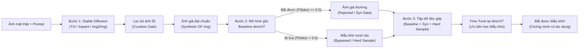

# OVERVIEW.md — Tổng Quan Hệ Thống 3 Bước Khép Kín

- **Motivation/Background**: Giúp mọi thành viên trong nhóm và người đọc nắm bắt nhanh toàn bộ cách hoạt động của hệ thống chỉ trong vài phút đọc.
- **Purpose**: Mô tả bức tranh tổng thể nối liền Bước 1 (Sinh ảnh SD), Bước 2 (Tìm mẫu khó qua `dinoViT`) và Bước 3 (Huấn luyện lại để chứng minh tác dụng).
- **Overview Pipeline**: Đầu vào (Ảnh thật + Prompt) -> Bước 1: Stable Diffusion & Lọc ảnh lỗi -> Bước 2: Chấm bằng `dinoViT` gốc (`Reject` vs. `Bypass`) -> Bước 3: Gộp `Baseline + Syn + Hard Sample` & Fine-Tune `dinoViT`.
- **Detailed Plan**: §1 Sơ đồ toàn hệ thống; §2 Vai trò của từng mô-đun trong code; §3 Ba chế độ so sánh kết quả (`D0 / D1 / D2`).
- **References**: [PURPOSE.md](PURPOSE.md), [PHASE_01_DIFFUSION_SYNTHESIS_SPEC.md](phases/PHASE_01_DIFFUSION_SYNTHESIS_SPEC.md), [PHASE_02_DINOVIT_HARD_SAMPLE_MINING_SPEC.md](phases/PHASE_02_DINOVIT_HARD_SAMPLE_MINING_SPEC.md).
- **Created**: 2026-11-02T07:30:00+07:00
- **Last Updated**: 2026-11-08T18:37:00+07:00

---

## 1. Sơ Đồ Hoạt Động Của Toàn Hệ Thống

---

## 2. Hệ Thống Được Chia Thành Các Phần Nào Trong Code?

1. **Tạo và lọc ảnh giả (`src/models/synthesis/` & `src/data/curation_gate.py`)**:
   - Tạo ảnh khuôn mặt giả bằng 3 cách của Stable Diffusion.
   - Kiểm tra tự động để loại bỏ ảnh bị mờ, ảnh không rõ mắt-mũi-miệng hoặc ảnh sai nội dung mô tả.

2. **Mô hình phát hiện `dinoViT` và tìm mẫu khó (`src/models/detector/` & `src/pipelines/mine_hard_samples.py`)**:
   - Dùng mạng Vision Transformer (`DinoViTBackbone`) chia bức ảnh thành các ô vuông nhỏ (patch) để nhìn tổng thể toàn khuôn mặt và đưa ra xác suất ảnh giả $P(\text{fake}) \in [0, 1]$.
   - Chạy kiểm tra toàn bộ ảnh giả mới tạo: ảnh nào có điểm $P(\text{fake}) < 0.5$ nghĩa là đánh lừa được mô hình gốc $\rightarrow$ tự động đánh dấu `is_hard_sample = True` và lưu vào file mẫu khó.

3. **Gộp dữ liệu và huấn luyện lại (`src/data/image_datamodule.py` & `src/pipelines/train_image_detector.py`)**:
   - Gộp 3 nguồn dữ liệu: **Dữ liệu gốc (`baseline`) + Ảnh sinh mới (`synthetic`) + Mẫu khó (`hard_sample`)**.
   - Giữ tất cả ảnh phát sinh từ cùng một người thật (`source_real_id`) nằm chung một tập (Train hoặc Test) để kết quả kiểm tra hoàn toàn trung thực.
   - Khi huấn luyện lại `dinoViT`, các **Mẫu khó (`Hard Sample`)** được lặp lại nhiều hơn và tính điểm phạt cao hơn nếu đoán sai, giúp mô hình sửa đúng điểm yếu của mình.

---

## 3. Ba Chế Độ Thử Nghiệm Để Chứng Minh Tác Dụng (`D0`, `D1`, `D2`)

Để chứng minh rõ ràng với giảng viên rằng bộ dữ liệu mới và nhóm mẫu khó thực sự có ích, nhóm đặt 3 chế độ huấn luyện lên bàn cân cùng điều kiện:

| Chế độ | Dữ liệu dùng để huấn luyện `dinoViT` | Mục đích so sánh |
| :--- | :--- | :--- |
| **`D0` (Gốc)** | Chỉ dùng **Dữ liệu gốc (`Data Baseline`)** | Xem mô hình gốc ban đầu bị bỏ lọt (`Bypass`) bao nhiêu ảnh giả từ Stable Diffusion. |
| **`D1` (+ Ảnh mới)** | **Dữ liệu gốc + Ảnh sinh mới thông thường (`Syn Data`)** | Xem việc chỉ thêm ảnh tổng hợp bình thường giúp cải thiện được bao nhiêu. |
| **`D2` (+ Mẫu khó)** | **Dữ liệu gốc + Ảnh sinh mới + Mẫu khó (`Hard Sample`)** | Chứng minh khi học thêm các **Mẫu khó từng vượt rào**, mô hình bắt lại được chúng và đạt điểm cao nhất. |
