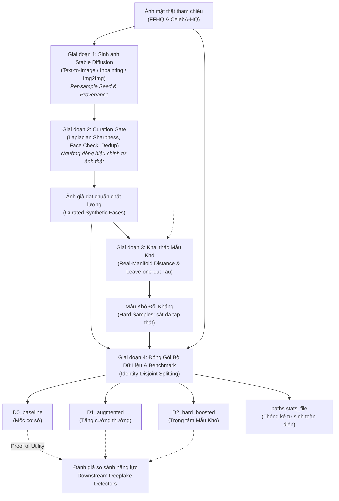

# OVERVIEW.md — Tổng Quan Kiến Trúc Dataset Factory & Benchmark

- **Motivation/Background**: Cung cấp cái nhìn toàn cảnh về kiến trúc hệ thống tạo bộ dữ liệu tổng hợp khuôn mặt và bộ benchmark đối kháng theo định hướng **Dataset-First**.
- **Purpose**: Mô tả chi tiết các giai đoạn: Sinh ảnh Stable Diffusion -> Lọc chất lượng Curation Gate -> Khai thác Mẫu Khó Real-Manifold -> Đóng gói Benchmark $D_0, D_1, D_2$ -> Đánh giá Proof of Utility.
- **Overview Pipeline**: `data/raw/` -> `src/pipelines/generate_deepfake_images.py` -> `src/pipelines/curate_image_dataset.py` -> `src/pipelines/mine_hard_samples.py` -> `scripts/organize_topic_dataset.py` -> `data/benchmarks/` -> `paths.stats_file`.
- **Detailed Plan**: §1 Sơ đồ kiến trúc toàn hệ thống; §2 Cấu trúc mã nguồn & trách nhiệm từng mô-đun; §3 Ba bộ dữ liệu benchmark đối chứng ($D_0, D_1, D_2$); §4 Báo cáo thống kê tự sinh.
- **References**: [PURPOSE.md](PURPOSE.md), `configs/dataset_factory.yaml`, `.agents/rules/ZERO_HARDCODE_RULE.md`.
- **Created**: 2026-11-02T07:30:00+07:00
- **Last Updated**: 2026-11-09T15:15:00+07:00

---

## 1. Sơ Đồ Kiến Trúc Toàn Hệ Thống

---

## 2. Tổ Chức Mã Nguồn & Trách Nhiệm Mô-đun

1. **Sinh dữ liệu ảnh giả (`src/pipelines/generate_deepfake_images.py` & `src/models/diffusion/`)**:
   - Vận hành động cơ Stable Diffusion hỗ trợ đầy đủ 3 cơ chế: `Text-to-Image`, `Inpainting`, và `Image-to-Image`.
   - Sinh seed tất định qua hàm băm `sample_seed(base_seed, image_id, variant)` bằng CRC32 chống trùng lặp.
   - Ghi nhận đầy đủ nguồn gốc tham số vào `ImageMetadata.generation`.

2. **Bộ lọc chất lượng tự động (`src/pipelines/curate_image_dataset.py` & `src/common/metrics.py`)**:
   - Kiểm tra độ sắc nét ảnh bằng toán tử Laplacian, tự động hiệu chỉnh ngưỡng tối thiểu qua quantile thực nghiệm của tập ảnh thật (`curation.reference_quantile_sharpness`).
   - Kiểm tra cấu trúc khuôn mặt và loại bỏ ảnh trùng lặp thông qua hàm băm nội dung cryptographic SHA-256 (`file_sha256`).
   - Xuất biên bản kiểm định chi tiết tới `paths.curation_report`.

3. **Khai thác Mẫu Khó khách quan (`src/models/evaluators/hardness.py` & `src/pipelines/mine_hard_samples.py`)**:
   - Sử dụng mô hình nền tảng thị giác (`hardness.backbone_id`) để chiếu ảnh vào không gian biểu diễn sâu.
   - Phương pháp `Real-Manifold Proximity`: đo khoảng cách cosine top-$k$ tới tập ảnh thật tham chiếu (đã loại bỏ ảnh nguồn gốc).
   - Ngưỡng quyết định $\tau$ được tự động tính toán từ phân bố kiểm tra chéo leave-one-out giữa các ảnh thật.

4. **Đóng gói phân vùng danh tính & thống kê (`src/data/splits.py` & `scripts/organize_topic_dataset.py`)**:
   - Phân chia tập dữ liệu theo cơ chế `identity-disjoint`: tính toán một lần duy nhất cho toàn bộ nhóm danh tính thật và phái sinh.
   - Cố định tập kiểm thử `test.jsonl` giống hệt nhau giữa cả 3 giai đoạn đối chứng $D_0, D_1, D_2$.
   - Tự động kết xuất báo cáo thống kê độc lập `paths.stats_file` mà không ghi cứng số liệu.

---

## 3. Ba Bộ Dữ Liệu Benchmark Đối Chứng ($D_0, D_1, D_2$)

Bộ benchmark được cấu hình linh hoạt trong `configs/dataset_factory.yaml` phục vụ đánh giá năng lực phát hiện Deepfake:

| Bộ dữ liệu | Nguồn dữ liệu huấn luyện (`train_sources`) | Ý nghĩa khoa học |
| :--- | :--- | :--- |
| **`D0_baseline`** | Ảnh khuôn mặt cơ sở (`baseline`) | Xác lập điểm số đường cơ sở ban đầu của mô hình khi chưa được tiếp cận dữ liệu phái sinh. |
| **`D1_augmented`** | Ảnh cơ sở + Toàn bộ ảnh mặt giả (`baseline` + `synthetic`) | Đánh giá mức độ cải thiện khi chỉ tăng cường dữ liệu tổng hợp diện rộng mà không chọn lọc độ khó. |
| **`D2_hard_boosted`** | Ảnh cơ sở + Ảnh giả + Nhân đôi Mẫu Khó (`baseline` + `synthetic` + `hard_sample`) | Kiểm chứng luận điểm cốt lõi: Tập trung vào các Mẫu Khó giúp mô hình phát hiện Deepfake nhạy bén hơn hẳn. |

---

## 4. Báo Cáo Thống Kê & Minh Bạch Khoa Học

Mọi chỉ số tổng kết về số lượng mẫu, tỷ lệ thông qua bộ lọc curation, tỷ lệ mẫu khó theo chế độ sinh, và phân bố nhân khẩu học được tính toán động và lưu trữ tại `paths.stats_file`. Các notebook phân tích và tài liệu trình bày đều truy xuất thông tin trực tiếp từ tệp này, đảm bảo tính nhất quán và hoàn toàn không phụ thuộc vào các số liệu ghi cứng.
