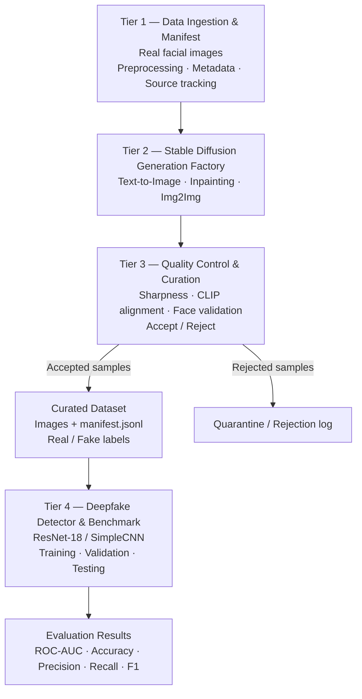

# Stable Diffusion-Based Synthetic Facial Image Dataset Generation for Deepfake Detection
## 5-Minute Presentation — Problem Definition & System Design

> **Presentation purpose:** Define the research problem, establish the dataset scope, explain the proposed generation pipeline, and show how the resulting dataset will be evaluated for Deepfake Detection.
>
> **Presentation duration:** 5 minutes  
> **Suggested format:** 6 slides  
> **Project status:** Proposed research and system design; metrics and thresholds are targets to validate, not achieved results.

---

# Slide 1 — Research Background & Problem Definition
**Time: 45 seconds**

## Slide content

### The problem
- Deepfake generation techniques are evolving from traditional GAN-based methods toward Diffusion Models.
- Detectors trained on existing manipulation patterns may not generalize well to newer generation methods.
- Existing Deepfake datasets do not necessarily cover the range of facial content and manipulation patterns produced by Stable Diffusion.

### Research problem
**Can Stable Diffusion be used to generate a controlled and diverse synthetic facial image dataset that improves the training and evaluation of Deepfake Detection models?**

### Motivation
Build a reproducible data-generation pipeline that can produce, filter, label, and organize synthetic facial images for downstream detection experiments.

## Speaker notes

Deepfake generation is evolving, and detection models need data that represents different types of facial manipulation. A detector may perform well on the data it was trained on but perform less reliably when it encounters unfamiliar generation methods.

My project focuses on this data problem. I want to investigate whether Stable Diffusion can be used to generate controlled synthetic facial images and whether these images can provide useful additional training data for Deepfake Detection.

The goal is not simply to generate realistic faces. The goal is to build a structured dataset and evaluate whether it is useful for detection.

## Suggested visual

A simple contrast:
- Left: conventional real facial image.
- Center: Stable Diffusion-generated or manipulated facial image.
- Right: Deepfake Detection model.

Use a short caption: **New generation methods require broader detection data.**

---

# Slide 2 — Research Objectives & Scope
**Time: 40 seconds**

## Slide content

### Main objective
Develop a Stable Diffusion-based pipeline for generating and curating synthetic facial images, then evaluate their usefulness for Deepfake Detection.

### Three generation modes

| Mode | Input | Intended output |
|---|---|---|
| Text-to-Image (T2I) | Random latent noise + text prompt | Entirely synthetic facial images |
| Facial Inpainting | Real image + facial mask + prompt | Locally edited facial regions |
| Image-to-Image (Img2Img) | Real image + prompt + denoising strength | Transformed facial appearance or attributes |

### Project scope
- **Data domain:** 2D facial images.
- **Generation model:** Stable Diffusion through Hugging Face Diffusers.
- **Dataset output:** Real and generated/manipulated facial images with metadata.
- **Downstream task:** Binary Real/Fake image classification.
- **Baseline detector:** ResNet-18; SimpleCNN can be used for lightweight tests.

### Out of scope
- Video-level temporal detection.
- Building a new diffusion architecture from scratch.
- Developing a complete real-world Deepfake security product.

## Speaker notes

The system will focus on facial images rather than video. I plan to use three Stable Diffusion generation modes.

First, Text-to-Image creates new synthetic faces from text prompts. Second, Inpainting edits selected facial regions, such as the eyes or mouth. Third, Image-to-Image transforms an existing face while retaining some of its original structure.

These modes provide different types of synthetic data. The downstream task is binary image classification, using Real and Fake labels. Video-level temporal consistency is outside the current scope.

## Suggested visual

Three columns, each showing:
1. Prompt → generated face.
2. Original face + mask → edited face.
3. Original face → transformed face.

Use arrows to make the input and output of each mode clear.

---

# Slide 3 — Dataset Design
**Time: 55 seconds**

## Slide content

### Data sources
- **Real facial images:** CelebA-HQ and/or FFHQ as candidate source datasets.
- **Generated images:** Stable Diffusion outputs from T2I, Inpainting, and Img2Img.
- The final source dataset and usable sample counts will be confirmed after checking access, licensing, data quality, and preprocessing requirements.

### Dataset organization

| Data group | Content | Internal subtype |
|---|---|---|
| Real | Original facial images | `real` |
| Fake / manipulated | Stable Diffusion outputs | `sd_text2img`, `sd_inpaint`, `sd_img2img` |

### Metadata for every image
- `image_id`: unique image identifier.
- `label`: binary label (`0 = Real`, `1 = Fake`).
- `manipulation_type`: generation method.
- `prompt`: generation prompt, if applicable.
- `source_real_id`: source image ID for Inpainting / Img2Img.
- `file_path`: image location.
- `bbox`: facial bounding box, when available.

### Dataset split
- Train: 70%
- Validation: 15%
- Test: 15%
- Fixed random seed: 42.
- Keep each source identity and all its derived images in the same split to reduce identity leakage.

## Speaker notes

For the real-image source, I am considering CelebA-HQ or FFHQ. These images will be preprocessed and used as the real data pool. Stable Diffusion will generate the synthetic samples through the three modes described earlier.

Each image will have a binary label and additional metadata describing how it was obtained. This is important because I need to trace an image back to its source and generation settings.

For Inpainting and Img2Img, images derived from the same source identity must remain in the same train, validation, or test partition. Otherwise, the detector may memorize identities instead of learning manipulation-related features.

## Suggested visual

Show a dataset tree:

```text
dataset/
├── real/
│   └── real_*.png
├── fake/
│   ├── sd_t2i_*.png
│   ├── sd_inpaint_*.png
│   └── sd_img2img_*.png
└── manifest.jsonl
```

Add a small metadata example beside the tree.

---

# Slide 4 — Proposed System Architecture
**Time: 95 seconds**

## Slide content

### Four-tier architecture



### Tier responsibilities

| Tier | Main responsibility | Output |
|---|---|---|
| 1. Data Ingestion | Load, preprocess, identify, and index source images | Standardized source data |
| 2. Generation Factory | Generate images using three Stable Diffusion modes | Candidate synthetic images |
| 3. Quality & Curation | Check image quality, prompt alignment, and face validity | Accepted images + rejection reports |
| 4. Detection & Benchmark | Train and evaluate a detector on the curated dataset | Detection metrics and checkpoints |

### Quality-control signals
- **Laplacian variance:** image sharpness.
- **CLIP similarity:** image-prompt semantic alignment.
- **Face detection / landmark validation:** whether a usable face is present.

### Technical implementation
- Python, PyTorch, Hugging Face Diffusers.
- PNG image storage and JSONL metadata manifest.
- YAML configuration for dataset, generation, and detector settings.
- FP16 inference and memory-saving options for constrained GPUs.

## Speaker notes

The proposed system has four independent tiers.

The first tier ingests real facial images, preprocesses them, and records their metadata. The second tier is the generation factory. It uses Stable Diffusion to produce new faces or manipulate existing facial images through T2I, Inpainting, and Img2Img.

The third tier is the quality-control stage. Not every generated image should enter the dataset. I will check sharpness, semantic alignment between the image and its prompt, and whether the face structure is valid. Images that fail these checks will be rejected or quarantined.

Accepted images are saved together with their metadata in a JSONL manifest. The fourth tier uses this curated dataset to train and evaluate a Deepfake Detection model.

The architecture separates data ingestion, generation, curation, and detection so that each part can be tested or changed independently.

## Suggested visual

Use the architecture diagram as the main visual. Keep the four tiers visually distinct. Put the three generation modes inside Tier 2 and the three quality checks inside Tier 3.

---

# Slide 5 — Detection Experiment & Evaluation
**Time: 45 seconds**

## Slide content

### Main experiment

| Experiment | Training data |
|---|---|
| Baseline | Real + existing Deepfake data |
| Proposed | Baseline data + Stable Diffusion synthetic data |

### Evaluation metrics

| Evaluation target | Metrics |
|---|---|
| Detection performance | ROC-AUC, Accuracy, Precision, Recall, F1-score |
| Generated-data quality | FID, CLIP similarity, Laplacian variance, face detection rate |
| Generalization | Performance on a held-out test set and, where available, unseen manipulation sources |

### Main research question
**Does adding Stable Diffusion-generated facial data improve Deepfake Detection performance and generalization compared with the baseline?**

## Speaker notes

To evaluate the dataset, I plan to compare two training settings. The baseline uses real and existing Deepfake data. The proposed setting adds Stable Diffusion-generated samples.

Both settings should use the same detector architecture, training protocol, and independent test data so that the comparison is meaningful.

I will measure detection performance using ROC-AUC, Accuracy, Precision, Recall, and F1-score. I will also evaluate the generated data itself using image-quality and semantic-alignment indicators.

The key question is not whether the system can generate images. It is whether adding those images improves detection performance, especially on data that the model has not seen during training.

## Suggested visual

A two-branch experiment diagram:

```text
                 Same detector architecture
                           |
              +------------+------------+
              |                         |
          Baseline                  Proposed
       Real + Deepfake       Real + Deepfake + SD
              |                         |
              +------------+------------+
                           |
                  Held-out test set
                           |
                  Compare metrics
```

---

# Slide 6 — Expected Outcomes & Project Contribution
**Time: 20 seconds**

## Slide content

### Expected outcomes
1. A reproducible Stable Diffusion-based facial image generation pipeline.
2. A curated facial image dataset with binary labels and generation metadata.
3. A quality-control process for filtering generated samples.
4. A baseline Deepfake Detection experiment evaluating the contribution of synthetic data.

### Expected contribution
**A systematic approach to generating and evaluating synthetic facial image data for improving Deepfake Detection research.**

## Speaker notes

In summary, this project aims to deliver a reproducible generation pipeline, a structured and curated facial image dataset, and an experimental evaluation of its usefulness for Deepfake Detection.

The main contribution is not only the generated images, but the complete process for generating, validating, organizing, and evaluating them.

---

# Presentation Summary

| Slide | Topic | Time |
|---|---|---:|
| 1 | Research Background & Problem Definition | 45 sec |
| 2 | Research Objectives & Scope | 40 sec |
| 3 | Dataset Design | 55 sec |
| 4 | Proposed System Architecture | 95 sec |
| 5 | Detection Experiment & Evaluation | 45 sec |
| 6 | Expected Outcomes & Contribution | 20 sec |
| **Total** | | **300 sec / 5 min** |

---

# Important Technical Clarifications Before Making the Slides

These points are important for keeping the presentation scientifically defensible.

## 1. Synthetic facial images are not automatically Deepfakes

Text-to-Image generates an entirely synthetic face. It does not necessarily manipulate an existing real person. Inpainting and Img2Img use a real source image and can introduce localized or broader changes.

For the presentation, keep the three generation modes as separate subtypes in the metadata. If the downstream experiment uses binary labels, explicitly state the operational definition of the Fake class. Do not imply that every AI-generated face is equivalent to a face-swap Deepfake.

## 2. Distinguish dataset provenance from binary classification labels

The proposed manifest uses:
- `label = 0`: Real.
- `label = 1`: Fake / generated or manipulated.

The `manipulation_type` field preserves the more detailed origin:
- `real`
- `sd_text2img`
- `sd_inpaint`
- `sd_img2img`

This makes binary classification possible while retaining the information needed for subtype analysis. However, the research must still justify whether T2I samples belong in the Fake class for the specific detection task.

## 3. Avoid identity leakage

For Inpainting and Img2Img, all derivatives of a source identity must stay in the same data split as that source. A random image-level split is not sufficient when multiple manipulated images come from the same original person.

T2I images have no source identity in the same sense, so they need a separate assignment policy.

## 4. Treat thresholds as preliminary configuration values

The architecture documents include candidate thresholds such as:
- Laplacian variance ≥ 50.0.
- CLIP similarity ≥ 0.28 or 0.30.
- Face confidence ≥ 0.85.
- Face retention target ≥ 95%.

These values are not universal standards. Their suitability depends on image resolution, preprocessing, metric implementation, and the selected face detector. Present them as initial thresholds to calibrate on a validation sample, not as proven quality guarantees.

## 5. Do not claim that Stable Diffusion has no detectable artifacts

Stable Diffusion and GANs have different generation mechanisms and artifact distributions. It is too strong to claim that diffusion images have no spectral artifacts or that all GAN-based detectors necessarily fail on them.

A defensible statement is that detectors may overfit to generator-specific cues and can lose performance when evaluated on unfamiliar generators or manipulation methods. The project will investigate this generalization issue experimentally.

## 6. Keep the experiment controlled

To attribute any performance change to the added synthetic data:
- Use the same detector architecture and training protocol for both experiments.
- Keep the test set independent from generation and training.
- Prevent source-identity overlap between train, validation, and test.
- Report per-subtype results where possible, not only one aggregate score.
- Compare multiple runs or report variability if resources permit.

---

# References

1. Hugging Face, *Computer Vision Course — Unit 10: Stable Diffusion for Data Generation*.  
   https://huggingface.co/learn/computer-vision-course/unit10/datagen-diffusion

2. Rombach et al. (2022), *High-Resolution Image Synthesis with Latent Diffusion Models*, CVPR 2022.

3. Frank et al. (2020), research on detecting generated images through frequency analysis, ICML 2020.

4. Durall et al. (2020), research on uncovering frequency biases in generated images, CVPR 2020.

5. FaceForensics++, Celeb-DF, DFDC — candidate benchmark datasets for Deepfake research. Their suitability and access conditions should be checked before final dataset selection.
