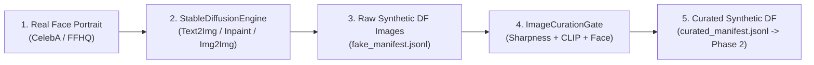

# Phase 1: Stable Diffusion Facial Deepfake Synthesis & Multi-Modal Curation Specification

- **Motivation/Background**: Specifies the Phase 1 generative data factory that transforms clean real facial portraits into photorealistic synthetic Deepfake images (`Synthetic DF img`) across 3 manipulation modes, followed by automated quality curation.
- **Purpose**: Serve as the engineering blueprint for `src/models/diffusion/stable_diffusion_engine.py`, `src/pipelines/generate_deepfake_images.py`, and `src/pipelines/curate_image_dataset.py`.
- **Overview Pipeline**: Real face ingestion (`manifest.jsonl`) -> Stable Diffusion generation (`sd_text2img`, `sd_inpaint`, `sd_img2img`) -> Multi-modal quality curation (Laplacian sharpness, CLIP alignment, Face confidence) -> Curated synthetic manifest (`curated_manifest.jsonl`).
- **Detailed Plan**: §1 Phase 1 Pipeline Overview; §2 Three Stable Diffusion Manipulation Modes; §3 Automated Multi-Modal Quality Curation Gates; §4 Output Manifest Contract for Phase 2.
- **References**: `docs/PURPOSE.md`, `docs/coursework/TAXONOMY_AND_DATA_SPEC.md`, `configs/generation/stable_diffusion.yaml`.
- **Created**: 2026-11-04T08:18:00+07:00
- **Last Updated**: 2026-11-08T17:48:00+07:00

---

## 1. Phase 1 Pipeline Overview

---

## 2. Three Stable Diffusion Manipulation Modes (`StableDiffusionEngine`)

Implemented in `src/models/diffusion/stable_diffusion_engine.py`:

1. **Mode A — Text-to-Image (`generate_text2img` / `sd_text2img`)**:
   - Synthesizes an entirely new facial identity from Gaussian latent noise $z_T \sim \mathcal{N}(0, \mathbf{I})$ conditioned on a portrait prompt.
2. **Mode B — Facial Inpainting (`generate_inpaint` / `sd_inpaint`)**:
   - Modifies local facial regions (eyes, mouth, expression) within binary mask $M \in \{0, 1\}^{1 \times H \times W}$ while strictly preserving unmasked identity context:
     $$I_{\text{inpaint}} = (1 - M) \odot I_{\text{real}} + M \odot I_{\text{generated}}$$
3. **Mode C — Image-to-Image Morphing (`generate_img2img` / `sd_img2img`)**:
   - Injects partial latent noise controlled by denoising strength $S \in [0.4, 0.75]$ to alter skin texture and subtle biometric features while retaining global head pose.

---

## 3. Automated Multi-Modal Quality Curation Gates (`ImageCurationGate`)

Why Curation is Essential Before Phase 2: If Stable Diffusion produces blurry or anatomically broken faces, the Baseline `dinoViT` detector might reject them merely due to obvious distortion rather than genuine deepfake detection. Our 3 programmatic gates in `src/pipelines/curate_image_dataset.py` guarantee high visual realism:

1. **Laplacian Variance Sharpness (`compute_laplacian_sharpness`)**:
   $$\text{Var}(\nabla^2 I_{\text{gray}}) \times 1000.0 \ge 50.0$$
   Prunes over-smoothed or blurry VAE reconstructions.
2. **CLIP Semantic Alignment (`compute_clip_similarity_proxy`)**:
   $$\cos(\mathbf{e}_{\text{img}}, \mathbf{e}_{\text{prompt}}) \ge 0.28$$
   Ensures the synthesized manipulation adheres to the target facial prompt.
3. **Facial Landmark Retention (`face_detected = True`, confidence $\ge 0.85$)**:
   Discards any generation where facial geometry collapsed.

---

## 4. Output Manifest Contract for Phase 2

Curated synthetic images are exported to `data/processed/curated_manifest.jsonl` with `label=1` and `data_source="synthetic"`, ready to be tested against the Baseline `dinoViT` model in Phase 2 (`src/pipelines/mine_hard_samples.py`).
