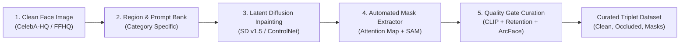

# Phase 1: Diffusion-Based Occlusion Synthesis Pipeline Specification

- **Motivation/Background**: Outlines the end-to-end generative pipeline that synthesizes photo-realistic facial occlusions paired with clean ground-truth faces and automatic sub-pixel accurate occlusion masks.
- **Purpose**: Serve as the engineering blueprint for `src/pipelines/generate_synthetic.py` and generative modules in `src/data/`.
- **Overview Pipeline**: Clean portrait loading -> Stochastic bounding region generation -> Prompt synthesis -> Stable Diffusion Inpainting -> Cross-attention & SAM boundary extraction -> Triplet quality curation -> Standardized triplet export.
- **Detailed Plan**: §1 Algorithmic Pipeline Overview; §2 Generative Diffusion Architecture; §3 Automated Mask Extraction & Boundary Refinement; §4 Prompt Engineering & Stochastic Occlusion Placement; §5 Automated Quality Filtering Gates (including Identity Invariance).
- **References**: `docs/PURPOSE.md`, `docs/coursework/TAXONOMY_AND_DATA_SPEC.md`, DiffuMask (CVPR 2023), SAM (ICCV 2023), ArcFace (CVPR 2019).
- **Created**: 2026-11-04T08:18:00+07:00
- **Last Updated**: 2026-11-05T18:30:00+07:00

---

## 1. Algorithmic Pipeline Overview

The data factory operates as a 5-stage automated assembly line generating synchronized **Triplets $(I_{\text{clean}}, I_{\text{occ}}, M_{\text{occ}})$**:

---

## 2. Generative Diffusion Architecture

- **Base Generative Model**: Stable Diffusion Inpainting v1.5 (`runwayml/stable-diffusion-inpainting`) or SDXL Inpainting (`diffusers/stable-diffusion-xl-1.0-inpainting-0.1`).
- **Conditioning Inputs**:
  - Clean source face $I_{\text{clean}}$ and its latent representation $z_0 = \mathcal{E}(I_{\text{clean}})$.
  - Inpainting binary guidance region $M_{\text{guide}} \in \{0, 1\}^{H \times W}$.
  - Text Prompt $y$ (e.g. *"a person wearing dark black modern sunglasses, high quality, photorealistic, 8k"*).
- **Denoising Dynamics**:
  At each reverse diffusion step $t = T, \dots, 1$, the unmasked latent space is conditioned by preserving the original unoccluded face:
  $$\hat{z}_t = (1 - M_{\text{latent}}) \odot z_{t,\text{orig}} + M_{\text{latent}} \odot z_{t,\text{denoised}}$$
  This guarantees that facial identity, eyes (when not occluded), and background skin outside the bounding region remain mathematically identical to the clean ground-truth face $I_{\text{clean}}$.

---

## 3. Automated Mask Extraction & Boundary Refinement

Because the inpainting guidance region $M_{\text{guide}}$ is an approximate geometric bounding box, it cannot be used directly as the ground-truth mask (it contains clean skin background inside the box).

To produce pixel-perfect masks autonomously, we employ a 2-stage refinement:

### Stage 3.1: Cross-Attention Activation Map
Extract the cross-attention map between spatial latent queries $Q$ and target text token keys $K_{\text{token}}$ corresponding to the occlusion object:
$$A_{\text{token}} = \frac{1}{|L|} \sum_{l \in L} \text{Softmax}\left(\frac{Q_l K_{l,\text{token}}^T}{\sqrt{d}}\right)$$
Thresholding $A_{\text{token}} \ge \tau_{\text{attn}}$ isolates the coarse object center.

### Stage 3.2: Sub-pixel Snapping with SAM (Segment Anything Model)
Using the bounding box $M_{\text{guide}}$ and high-activation points from $A_{\text{token}}$ as spatial prompts, **SAM-ViT-B** segments the exact object boundary:
$$M_{\text{refined}} = \text{SAM}\left(I_{\text{occ}}, \text{point\_prompts}=\operatorname{argmax}(A_{\text{token}}), \text{box\_prompt}=\operatorname{bbox}(M_{\text{guide}})\right)$$
$M_{\text{refined}}$ is saved as an 8-bit PNG binary mask $\{0, 255\}$ (or category ID $\in \{1, 2, 3, 4, 5\}$).

---

## 4. Prompt Engineering & Stochastic Occlusion Placement

| Occlusion Category | Target Anatomical Region | Prompt Template Variations |
| :--- | :--- | :--- |
| **Mask (Class 1)** | Lower half (nose tip to chin) | `"a person wearing a blue surgical mask, medical grade"`, `"wearing an N95 respirator mask, snug fit"` |
| **Eyeglasses (Class 2)** | Upper mid (eyes, nose bridge) | `"wearing black designer sunglasses, reflection"`, `"wearing tortoiseshell reading glasses, clear lenses"` |
| **Hand (Class 3)** | Cheeks, chin, or forehead | `"a hand covering mouth in surprise"`, `"fingers resting gently against cheek, natural skin"` |
| **Object (Class 4)** | Lower mouth / side profile | `"holding a black professional microphone close to lips"`, `"drinking from a paper coffee cup"` |
| **Apparel (Class 5)** | Lower jaw, neck, hair | `"wearing a thick knitted wool winter scarf wrapped high"`, `"long hair strands blowing across face"` |

---

## 5. Automated Quality Filtering Gates

Each candidate triplet $(I_{\text{clean}}, I_{\text{occ}}, M_{\text{refined}})$ is verified against 4 programmatic quality criteria:

1. **Facial Identity Retention**:
   The generated image $I_{\text{occ}}$ must detect a face with confidence $\ge 0.85$ via lightweight face detection (YuNet / RetinaFace). If the diffusion model corrupted facial anatomy into an unrecognizable blob, the triplet is discarded.
2. **CLIP Alignment Score**:
   $$\text{CLIP\_Score}(I_{\text{occ}}, y) = \cos(\mathbf{e}_{\text{img}}, \mathbf{e}_{\text{text}}) \ge 0.28$$
   Ensures the requested occlusion object was actually synthesized.
3. **Geometric Area Sanity**:
   The refined mask area must satisfy $0.05 \le \frac{\sum (M > 0)}{512 \times 512} \le 0.65$. Triplets with empty masks or completely obscured faces are rejected.
4. **Identity Invariance Outside Mask**:
   $$\text{ID\_Sim}_{\text{valid}} = \cos\left( \mathcal{F}_{\text{ArcFace}}\left(I_{\text{clean}} \odot (1 - M)\right), \, \mathcal{F}_{\text{ArcFace}}\left(I_{\text{occ}} \odot (1 - M)\right) \right) \ge 0.88$$
   Guarantees diffusion synthesis did not introduce identity drift in the unoccluded facial structure.

Rejected samples are logged with error codes to `data/synthetic_diffusion/rejected_log.json` to enable yield rate tracking.
Curated triplets are saved to `data/synthetic_diffusion/clean/`, `data/synthetic_diffusion/occluded/`, and `data/synthetic_diffusion/masks/`.
