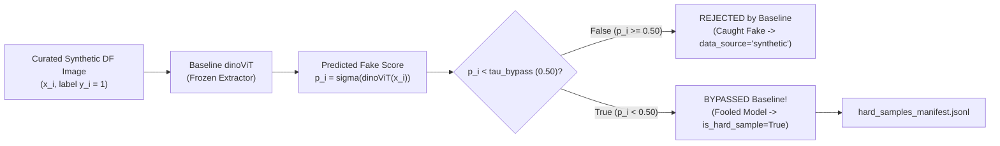

# Phase 2: Baseline dinoViT Benchmark & Bypass Hard-Sample Mining Specification

- **Motivation/Background**: Formalizes the Phase 2 architecture and algorithmic protocol directed by the course instructor: evaluating Phase 1 Stable Diffusion synthetic Deepfake images against a **Baseline DINO ViT (`dinoViT`)** detector to separate rejected samples from **bypassed Hard Samples**.
- **Purpose**: Serve as the technical specification for `DinoViTBackbone`, `DeepfakeImageDetector` (`src/models/detector/image_detector.py`), and `mine_hard_samples.py` (`src/pipelines/mine_hard_samples.py`).
- **Overview Pipeline**: Curated Synthetic DF (`curated_manifest.jsonl`) -> Frozen Baseline `dinoViT` forward pass -> Probability thresholding ($P(\text{fake}) \lessgtr \tau_{\text{bypass}}$) -> Partition into `Rejected` (caught) vs. `Bypassed` (`is_hard_sample=True`) -> Export `hard_samples_manifest.jsonl` for Phase 3 fine-tuning.
- **Detailed Plan**: §1 Architectural Specification of `DinoViTBackbone`; §2 Reject vs. Bypass Decision Formulation; §3 Hard-Sample Mining Pipeline Contract; §4 Phase 3 Fine-Tuning Hand-Off.
- **References**: `docs/PURPOSE.md`, `configs/detection/detector_baseline.yaml`, `src/models/detector/image_detector.py`, `src/pipelines/mine_hard_samples.py`.
- **Created**: 2026-11-08T17:48:00+07:00
- **Last Updated**: 2026-11-08T17:48:00+07:00

---

## 1. Architectural Specification of `DinoViTBackbone`

Implemented in `src/models/detector/image_detector.py`:
- **Patch Tokenization**: Input RGB tensor $X \in \mathbb{R}^{B \times 3 \times H \times W}$ is partitioned into non-overlapping patches of size $P \times P$ ($P = 16$) via `nn.Conv2d(3, D, kernel_size=16, stride=16)`, yielding $N = (H/P)\times(W/P)$ tokens of dimension $D = 192$.
- **Dynamic 2D Positional Interpolation**: Bicubic/bilinear interpolation adapts the learnable positional grid $\mathbf{E}_{\text{pos}}$ to any input resolution $(H, W)$.
- **Self-Attention & `[CLS]` Aggregation**: A learnable `[CLS]` token $\mathbf{x}_{\text{cls}} \in \mathbb{R}^{1 \times 1 \times D}$ is prepended and processed through $L = 4$ Pre-Norm Transformer Encoder layers (`MultiheadAttention` + `GELU` MLP). The output `[CLS]` token is $\ell_2$-normalized:
  $$\mathbf{f}_{\text{dino}}(X) = \frac{\text{LN}(\mathbf{z}_L^{\text{cls}})}{\|\text{LN}(\mathbf{z}_L^{\text{cls}})\|_2} \in \mathbb{R}^{B \times D}$$
- **Classification Head**: Maps $\mathbf{f}_{\text{dino}}(X)$ through `Dropout(0.3) -> Linear(D, 64) -> GELU -> Linear(64, 1)` to produce binary logit $z_i$ and fake probability $p_i = \sigma(z_i) \in [0, 1]$.

---

## 2. Reject vs. Bypass Decision Formulation



For each curated synthetic DF sample $x_i$ (where ground-truth $y_i = 1$):
1. **Rejected (Caught by Baseline)**:
   $$p_i = P_{\text{baseline}}(\text{fake} \mid x_i) \ge \tau_{\text{bypass}} \implies \text{is\_hard\_sample} = \text{False}, \quad \text{data\_source} = \text{"synthetic"}$$
2. **Bypassed (Hard Sample)**:
   $$p_i = P_{\text{baseline}}(\text{fake} \mid x_i) < \tau_{\text{bypass}} \implies \text{is\_hard\_sample} = \text{True}, \quad \text{data\_source} = \text{"hard\_sample"}$$
   Because this synthetic image passed all Phase 1 visual quality gates AND fooled the Baseline `dinoViT` detector into classifying it as a Real face, it exposes a concrete vulnerability in the baseline detector.

---

## 3. Hard-Sample Mining Pipeline Contract (`mine_hard_samples.py`)

```python
def mine_hard_samples(
    model: nn.Module,
    synthetic_metadata: List[ImageMetadata],
    cache: Optional[Dict[str, torch.Tensor]] = None,
    bypass_threshold: float = 0.5,
    batch_size: int = 16,
    device: Union[str, torch.device] = "cpu",
    annotated_manifest_path: Optional[Path] = None,
    hard_manifest_path: Optional[Path] = None,
) -> HardSampleMiningReport:
```

Outputs `HardSampleMiningReport`:
- `total_synthetic`: Total Phase 1 curated synthetic DF images evaluated.
- `rejected_count`: Number of synthetic images caught by Baseline `dinoViT`.
- `bypassed_hard_count`: Number of synthetic images that bypassed Baseline `dinoViT`.
- `bypass_rate`: $\text{bypassed\_hard\_count} / \text{total\_synthetic} \in [0.0, 1.0]$.
- `hard_sample_ids`: List of `image_id` strings for all mined hard samples.

---

## 4. Phase 3 Fine-Tuning Hand-Off

In Phase 3 (`src/pipelines/train_image_detector.py`), `combine_training_manifests()` merges:
1. `data/raw/manifest.jsonl` (`Data Baseline`)
2. `data/processed/curated_manifest.jsonl` (`Synthetic Data`)
3. `data/processed/hard_samples_manifest.jsonl` (`Mined Hard Samples`)

The top transformer blocks of `dinoViT` are unfrozen (`model.unfreeze_backbone(unfreeze_last_n_blocks=2)`), and training applies both **2x Hard-Sample Oversampling** in `DeepfakeImageDataModule` and **2.0x Hard-Sample Loss Weighting** in `train_deepfake_image_detector()`.
