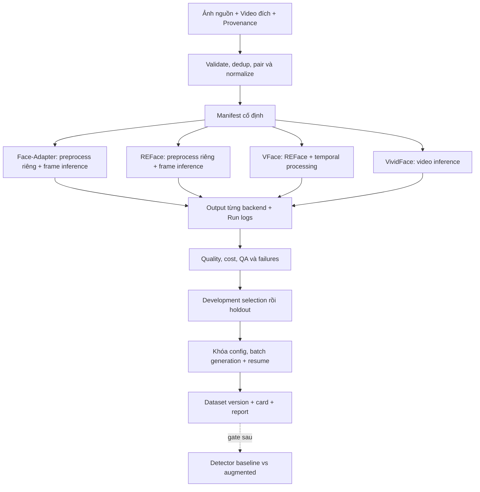

# DESIGN — Kiến trúc SD video

- **Motivation/Background**: Video cần contracts theo thời gian và adapter đúng từng upstream.
- **Purpose**: Đặc tả bảy thành phần DESIGN trước implementation.
- **Overview Pipeline**: Data -> Backend adapters -> Evaluation -> Selection -> Dataset -> Conditional detector.
- **Detailed Plan**: §1 Architecture; §2 Modules/folders; §3 Dataflow; §4 Interfaces; §5 Jobs; §6 Milestones; §7 Risks.
- **References**: [Purpose](../PURPOSE.md), [Lifecycle](../../.agents/AI_FIRST_LIFECYCLE.md), [Protocol](../experiments/SD_VIDEO_BASELINE_PROTOCOL.md).
- **Created**: 2026-11-07T14:12:25+07:00
- **Last Updated**: 2026-11-07T14:21:07+07:00

---

[STATUS: ACTIVE]

## 1. Architecture system

Các nhánh độc lập, không nối generator tuần tự. VFace chia sẻ REFace backbone: không phải bốn họ nền độc lập; so REFace–VFace không tự là ablation một biến nếu còn khác config.

## 2. Modules và folder structure

Giữ skeleton; [.agents](../../.agents/README.md) chỉ chứa governance generic.

- [src/data](../../src/data/): probe/decode, schema, manifests, pairing và group split.
- [src/models](../../src/models/): wrappers, load/unload, I/O adapters; upstream pin và môi trường riêng khi cần.
- [src/common](../../src/common/): logger, stable hash/seed, timing, metrics, QA, job state.
- [src/pipelines](../../src/pipelines/): prepare, run_backend, benchmark, curate/export; detector train/evaluate phase sau.
- [configs](../../configs/): future YAML data/backend/experiment; [master config](../../configs/config.yaml) vẫn generic scaffold, chưa chạy video.
- [requirements](../../requirements/): locks theo backend/GPU, không ép mọi repo chung env.
- [experiments](../../experiments/): outputs/logs/configs/metric artifacts, không commit weights/video lớn.
- [notebooks](../../notebooks/): Kaggle client gọi script; [tests](../../tests/): CPU contracts và GPU integration riêng.

Đây là trách nhiệm dự kiến, không tuyên bố module video executable đã tồn tại.

## 3. Dataflow

Decode theo presentation timestamp, chọn đoạn 5s, resample CFR 10 FPS và lưu mapping input time -> canonical frame. Không chỉ đổi header FPS khiến clip chạy nhanh/chậm.

Detection/landmarks/crop/alignment/mask/parsing/flow theo từng upstream. Không bắt buộc tracker hoặc cùng mask. Một người có thể association nhẹ; mất mặt phải báo, không dán ở tọa độ cũ vô điều kiện.

Cache gắn input hash, preprocess revision và config; lưu transforms cho paste-back, sizes và padding. Model frame nạp một lần/process; model video dùng chunk hợp lệ, kiểm tra continuity tại biên. Không dùng original bù lỗi để báo successful swap.

## 4. Interfaces / API và tensor contracts

- Frame RGB uint8 `(H,W,3)`; clip canonical `(T,H,W,3)`, T=50. BGR OpenCV phải đổi rõ.
- Frame tensor `(B,3,Hm,Wm)`; video `(T,3,Hm,Wm)` hoặc `(B,T,3,Hm,Wm)` theo backend. Dtype/range/normalization/device riêng.
- Mask nếu có: uint8 `(H,W)`, 255=sửa, 0=giữ; chuyển convention tại adapter. Không nhầm class mask với inpaint mask.
- Bbox `xyxy` pixel, landmarks `(K,2)` có frame_id/hệ tọa độ/transform.
- `prepare(sample, backend_config) -> PreparedSample`: validate + conditioning cache.
- `load(backend_config) -> BackendHandle`: revisions, device/precision, fail-fast.
- `infer(handle, prepared, run_config) -> InferenceResult`: output/coverage/timing/errors.
- `evaluate(result, references, metric_config) -> MetricRecord`: không đo được trả null + reason.
- `export(accepted_results, manifest) -> DatasetVersion`: checksum/card/source permissions.

**Sample:** sample_id, source_identity_id, target_identity_id, source_path/hash, parent_video_id/hash, start/end, canonical FPS/frame count, group_id/split, consent/license reference.

**Run:** job_id, sample_id, backend/code revision, checkpoint hash/revision, preprocess version/cache key, resolved config, seed, actual steps/scheduler/size/chunks/precision/offload, hardware/env, status, output hash, failed frame IDs, timing, QA/metric coverage.

Cùng seed không tạo cùng noise giữa model. Stable IDs dùng SHA-256, không Python hash() thay đổi theo process.

## 5. Job lifecycle

Job key = input hashes + backend revision + config hash + seed. States pending/running/completed/failed; output tạm -> validate -> atomic finalize. Chỉ skip completed có hash/checks hợp lệ, không dựa folder tồn tại.

Resume cấp job bắt buộc; frame/chunk resume chỉ khi upstream hỗ trợ và conditioning tương đương. Ghi metadata cả khi OOM/no-face/dependency failure. Mock namespace riêng cho CPU tests, không fallback production.

Tách download/load/preprocess/generate/postprocess/end-to-end. CUDA timing synchronize đúng; subprocess phải đo VRAM các model workers/devices, không dùng peak parent làm peak model. Ghi cache cold/warm, processed frames/chunk overlap. Generation và detector train chạy riêng.

## 6. Milestones

[Roadmap](../progress/SD_VIDEO_ROADMAP.md): design -> input integrity -> feasibility -> comparison -> selection/holdout -> dataset -> conditional detector -> report.

Fine-tune chỉ khi có failure hypothesis và data/training/license/compute support; không phải baseline bắt buộc. Config tuning không phải cập nhật weights.

## 7. Technical risks & mitigation

- CUDA/dependency/attention incompatibility: env riêng + upstream sample; public weights chưa chứng minh Kaggle support.
- Flicker/occlusion/profile: subgroup QA và coverage, không hứa mọi clip đều đạt.
- Unfair comparison: upstream-default và tuned-budget riêng; không ép cùng steps nếu không tương đương.
- Không có swap GT: ID so source, pose/expression so target; không lấy PSNR toàn mặt làm mục tiêu.
- Leakage: connected components của identities và parent clips trong pairing graph; không random-split frames.
- Ít người/nhiều seeds: báo unique identities/pairs, không coi variants độc lập.
- Scope bloat: detector phase sau, fine-tune optional, không thêm generator ngoài SD.

---

## References & Technical Documentation

### Official API Docs

[Diffusers](https://huggingface.co/docs/diffusers/index), [PyTorch](https://docs.pytorch.org/docs/stable/index.html).

### Technical Standards

[FFmpeg](https://ffmpeg.org/ffmpeg.html), [JSON Lines](https://jsonlines.org/).

### CV Conventions

[Face-Adapter](https://github.com/FaceAdapter/Face-Adapter), [REFace](https://github.com/Sanoojan/REFace), [VFace](https://github.com/Sanoojan/VFace), [VividFace](https://github.com/deepcs233/VividFace).

### Internal Architecture Links

[DEFINE](../PURPOSE.md), [PROTOCOL](../experiments/SD_VIDEO_BASELINE_PROTOCOL.md), [ROADMAP](../progress/SD_VIDEO_ROADMAP.md), [REPORT](../reports/SD_VIDEO_DEFINE_AND_DESIGN.md).
