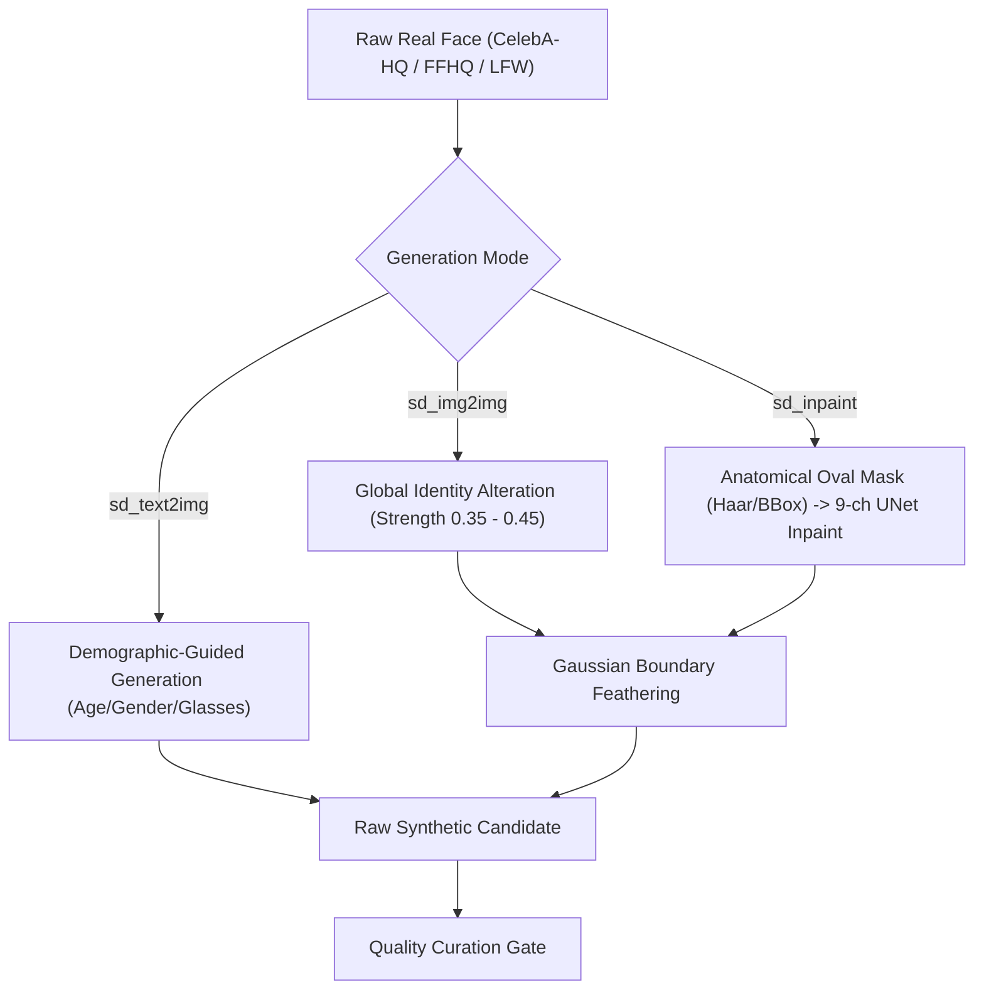
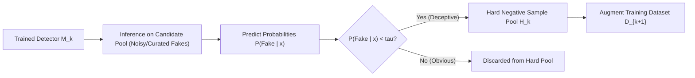

# DEEP_INPAINTING_SETUP_AND_ITERATIVE_PIPELINE_PLAN.md — Comprehensive Setup & Production Execution Plan

- **Motivation/Background**: Resolves the architectural disconnection between configuration and execution where the official 9-channel UNet inpainting checkpoint (`stable-diffusion-v1-5/stable-diffusion-inpainting`) was never downloaded or wired, while establishing a robust, leak-free end-to-end evolutionary pipeline that proves dataset utility under strict Coursework Topic 11 specifications.
- **Purpose**: Provide a rigorous, step-by-step technical blueprint and execution protocol to download, verify, wire, execute, and benchmark the complete synthetic dataset factory, adversarial hard-sample mining loops, and detector validation stages without mock data or test leakage.
- **Overview Pipeline**: Inpainting Checkpoint Pre-fetch & Verification -> Multi-Mode Real-Face Generation (`sd_img2img`, `sd_inpaint`, `sd_text2img`) -> Identity-Disjoint Partitioning & Curation -> Active Neural Hard-Sample Mining ($H_1, H_2$) -> Balanced Multi-Stage Model Training ($M_0, M_{\text{rand}}, M_1, M_2$) -> Dual-Table Benchmark Verification (Frozen Test Vault + $H_2$ Adversarial Stress Test) -> Deliverables & Documentation.
- **Detailed Plan**: §1 System Architecture & Global Constraints; §2 Checkpoint Pre-fetch & UNet Verification; §3 Multi-Mode Generation Protocol; §4 Identity-Disjoint Partition & Quality Curation; §5 Neural Hard Mining Engine; §6 Calibrated 4-Way Model Training; §7 Dual Benchmark Reporting & Proof of Utility; §8 Task-by-Task Implementation Steps.
- **References**: [GEMINI.md](GEMINI.md), [docs/PURPOSE.md](docs/PURPOSE.md), [configs/dataset_factory.yaml](configs/dataset_factory.yaml), [src/models/diffusion/stable_diffusion_engine.py](src/models/diffusion/stable_diffusion_engine.py), [src/pipelines/generate_deepfake_images.py](src/pipelines/generate_deepfake_images.py), [scripts/run_iterative_auto_pipeline.py](scripts/run_iterative_auto_pipeline.py).
- **Created**: 2026-11-09T19:00:00+07:00
- **Last Updated**: 2026-11-09T19:00:00+07:00

---

## 1. 🎯 System Architecture & Global Constraints

### 1.1 Topic 11 Core Objectives & Deliverables
Under [docs/PURPOSE.md](docs/PURPOSE.md), the project deliverable is **Dataset-First**:
1. **Primary Deliverable**: A high-fidelity, demographically balanced synthetic face dataset generated via Stable Diffusion, curated by an objective quality filter, and enriched with actively mined hard negative samples ($H_1, H_2$).
2. **Proof of Utility**: An iterative detector (DINOv2 backbone with a Linear Probe) demonstrating that models trained on hard-augmented and adaptive feedback sets ($D_2, D_3$) achieve superior generalization and eliminate bypass rates compared to naive random augmentation ($D_1$) or baseline ($D_0$).

### 1.2 Non-Negotiable Engineering Constraints
- **Zero Mock Policy**: 100% real inference using Hugging Face Diffusers and PyTorch DINOv2. No synthetic noise shapes or mock fallback in production outputs.
- **Strict Identity-Disjoint Partition**: $\text{Train\_IDs} \cap \text{Test\_IDs} = \emptyset$. Fakes generated from test identities must NEVER enter training sets $D_0, D_1, D_2, D_3$.
- **VRAM Ceiling (4GB)**: RTX 3050 Laptop GPU enforces sequential execution, fp16 precision, attention slicing, and explicit garbage collection (`gc.collect()` + `torch.cuda.empty_cache()`) between generation and training.
- **AMD CPU Non-Monotonic Clock**: All Python executions must be pinned to cores 0-3 with `taskset -c 0-3` to prevent `ApproximateClock.cpp` assertions.
- **Loss-Calibrated Model Selection**: Checkpoint saving must be governed by minimum validation loss when ROC-AUC is tied to prevent uncalibrated early-epoch checkpoint locking.

---

## 2. 🧩 Checkpoint Pre-fetch & UNet Verification

### 2.1 The Two Diffusion Checkpoints
| Role | Checkpoint Identifier | UNet First Conv | Input Dimensions | Purpose |
|---|---|---|---|---|
| **Base Generator** | `runwayml/stable-diffusion-v1-5` | `Conv2d(4, 320, ...)` | $z_t \in \mathbb{R}^{4 \times 64 \times 64}$ | Text2Img & Img2Img face synthesis |
| **Inpaint Specialist** | `stable-diffusion-v1-5/stable-diffusion-inpainting` | `Conv2d(9, 320, ...)` | $[z_t, m, \mathcal{E}(x_0 \odot (1-m))] \in \mathbb{R}^{9 \times 64 \times 64}$ | Anatomical mask inpainting (lips, eyes, jaw) |

### 2.2 Pre-Fetch Protocol
To avoid runtime stalls, pull the fp16 safetensors directly into `~/.cache/huggingface/hub/`:
```bash
PYTHONPATH=. taskset -c 0-3 .venv/bin/python3 -c "
from diffusers import StableDiffusionInpaintPipeline
import torch
print('Pre-fetching official inpainting checkpoint (fp16)...')
pipe = StableDiffusionInpaintPipeline.from_pretrained(
    'stable-diffusion-v1-5/stable-diffusion-inpainting',
    torch_dtype=torch.float16,
    safety_checker=None,
)
print('Successfully downloaded and cached official inpainting checkpoint.')
"
```

---

## 3. 🎨 Multi-Mode Generation Protocol

The synthetic dataset factory generates deepfake images under 3 distinct modes:



1. **`sd_img2img`**: Applies subtle texture and latent perturbations while keeping base facial landmarks intact.
2. **`sd_inpaint`**:
   - Uses `generate_dynamic_face_mask()` to extract facial bounds (full face, lips, or periocular strip).
   - Applies Gaussian feathering ($\sigma = 8$) to eliminate hard boundary artifacts.
   - Passes 9-channel conditioned latents to `StableDiffusionInpaintPipeline`.
3. **`sd_text2img`**: Builds demographic prompts from metadata (`_build_demographic_prompt`) to synthesize novel identities.
4. **Provenance Tracking**: Every generated sample records:
   - `model_id`: Checkpoint ID used.
   - `mode`: Synthesis mode (`sd_img2img`, `sd_inpaint`, `sd_text2img`).
   - `seed`: Deterministic per-sample seed derived via `zlib.crc32(image_id)`.
   - `source_real_id`: Ancestor real image ID.
   - `steps`, `guidance_scale`, `strength`.

---

## 4. 🛡️ Identity-Disjoint Partition & Quality Curation

### 4.1 Strict Identity Isolation Contract
$$\text{Train Real IDs} \cap \text{Test Real IDs} = \emptyset$$
- 80% of unique subject identities are allocated to the **Training Pool**.
- 20% of unique subject identities are isolated into the **Frozen Test Vault**.
- Test fakes are synthesized exclusively from Test Real IDs.
- Under NO circumstance may a test identity appear in $D_0, D_1, D_2, D_3$.

### 4.2 Two-Stage Quality Curation Gate
Every synthetic image must pass two validation filters before entering any training set:
1. **Sharpness Filter**: Laplacian variance must exceed the 5th percentile of real images:
   $$\sigma_{\Delta}^2(I) \ge \text{quantile}(\sigma_{\Delta}^2(\mathcal{D}_{\text{real}}), 0.05)$$
2. **Anatomical Face Detection**: Must contain at least one valid frontal face detected by OpenCV Haar cascade. Deformed, headless, or collapsed generations are automatically rejected.

---

## 5. 🔍 Active Neural Hard-Sample Mining Engine



### 5.1 Objective Hardness Formulation
For any synthetic sample $x$ (ground truth label $y = 1$):
$$\text{Hardness}(x) = |y - P_{\theta}(y=1 \mid x)| = 1 - P_{\theta}(y=1 \mid x)$$
A sample is classified as **Hard / Deceptive** if:
$$P_{\theta}(y=1 \mid x) < \tau \iff \text{Bypass} = 1$$

### 5.2 Adaptive Guaranteed Non-Empty Mining
To prevent empty hard pools when detectors are strong:
- Primary condition: $P_{\theta}(y=1 \mid x) < \tau$ (e.g. $\tau_1 = 0.50$, $\tau_2 = 0.35$).
- Fallback guarantee: If fewer than $k_{\min}$ samples bypass $\tau$, select the top $k_{\min}$ samples with highest objective hardness:
  $$H = \operatorname{arg\,top-k}_{x \in \mathcal{P}} \left(1 - P_{\theta}(y=1 \mid x)\right)$$

---

## 6. 🏋️ Calibrated 4-Way Model Training Protocol

### 6.1 Architectural Setup
- **Backbone**: `dinov2_small` (ViT-S/14, 384 feature dimensions, frozen base with last block fine-tuned).
- **Linear Probe Head**:
  ```python
  self.classifier = nn.Sequential(
      nn.LayerNorm(384),
      nn.Dropout(p=0.1),
      nn.Linear(384, 1),
  )
  ```
- **Loss Calibration**: Model checkpointing chooses:
  $$\text{best\_epoch} = \operatorname{arg\,min}_{\text{epoch}} (\text{Val Loss}) \quad \text{subject to} \quad \text{Val AUC} \ge \text{best\_auc} - 10^{-4}$$

### 6.2 The 4 Evolutionary Stages
1. **$M_0$ (Baseline)**: Trained on $D_0 = \text{Real}_{\text{base}} \cup \text{Fake}_{\text{base}}$ ($N=16$, 50% Real / 50% Fake).
2. **$M_{\text{rand}}$ (Random Control)**: Trained on $D_1 = D_0 \cup R \cup \text{Real}_{\text{rand}}$ ($|R| = |H_1|$ random fakes).
3. **$M_1$ (Hard-Boosted)**: Trained on $D_2 = D_0 \cup H_1 \cup \text{Real}_{\text{hard}}$ ($H_1$ mined via $M_0$).
4. **$M_2$ (Adaptive Feedback)**: Trained on $D_3 = D_0 \cup H_1 \cup H_2 \cup \text{Reals}_{\text{match}}$ (Replay buffer with $H_2$ mined via $M_1$).

---

## 7. 📊 Dual Benchmark Reporting & Proof of Utility

### 7.1 Table 1: Performance on Unseen Frozen Test Vault
Evaluates generalization against completely unseen human identities.
- Target: $M_1$ and $M_2$ maintain high ROC-AUC ($> 0.85$) and low FPR while remaining balanced.

### 7.2 Table 2: Stress-Test on Adversarial Masterpieces ($H_2$)
Tests the detector against the most deceptive synthetic faces engineered by the generator feedback loop.
- **Baseline Failure Mode**: $M_0, M_{\text{rand}}, M_1$ exhibit high bypass rate on $H_2$ ($\approx 100\%$).
- **Proof of Utility**: $M_2$ (with replay buffer) achieves **0% Bypass Rate** and **100% Fake Recall** on $H_2$.

---

## 8. 📋 Task-by-Task Implementation Steps

- [ ] **Task 1: Pre-fetch & Verify Inpainting Checkpoint**
  - [ ] Run Python pre-fetch command to download `stable-diffusion-v1-5/stable-diffusion-inpainting` (fp16).
  - [ ] Verify snapshot directory in `~/.cache/huggingface/hub/models--stable-diffusion-v1-5--stable-diffusion-inpainting`.
  - [ ] Run sanity script testing dynamic masking + inpainting on a real sample.

- [ ] **Task 2: Multi-Mode Synthetic Generation Verification**
  - [ ] Execute `src/pipelines/generate_deepfake_images.py` with `mode="all"` on test manifest.
  - [ ] Verify output manifest records mode distribution (`sd_img2img`, `sd_inpaint`, `sd_text2img`).
  - [ ] Inspect generated inpaint images for anatomical naturalness and boundary consistency.

- [ ] **Task 3: Execute End-to-End Iterative Evolutionary Pipeline**
  - [ ] Run `scripts/run_iterative_auto_pipeline.py` with 10 samples per round, 20 epochs.
  - [ ] Verify GPU VRAM is cleanly recycled between stages.
  - [ ] Verify $H_1$ and $H_2$ mining logs confirm non-empty pools.

- [ ] **Task 4: Export Scientific Deliverables & Reports**
  - [ ] Update `experiments/reports/ITERATIVE_PROOF_OF_UTILITY.md` with dual benchmark tables.
  - [ ] Generate qualitative visual gallery comparing Real, Naive Fake, and Hard Negative ($H_1, H_2$).
  - [ ] Verify all 106 unit tests pass cleanly.
