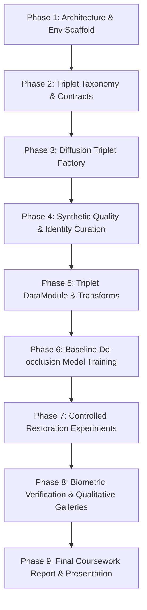

# Project Roadmap: 9-Phase AI-First Lifecycle

- **Motivation/Background**: Establishes the macro-milestone tracking framework guiding the development of the "Diffusion-Based Synthetic Occluded Face Dataset Generation for Facial De-occlusion" project.
- **Purpose**: Provide visible traceability across all engineering phases from initial scaffolding through research paper and coursework report delivery.
- **Overview Pipeline**: Phase 1 Scaffolding -> Phase 2 Triplet Taxonomy & Contracts -> Phase 3 Diffusion Triplet Generation -> Phase 4 Quality & Identity Curation -> Phase 5 Triplet DataModule -> Phase 6 De-occlusion Baseline Model -> Phase 7 Controlled Restoration Experiments -> Phase 8 Qualitative Galleries & Biometric Audit -> Phase 9 Coursework Deliverables.
- **Detailed Plan**: §1 Macro Timeline Overview; §2 Phase-by-Phase Deliverables & DoD Checklists; §3 Risk Mitigation & Blockers.
- **References**: `.agents/AI_FIRST_LIFECYCLE.md`, `docs/PURPOSE.md`, `docs/coursework/TAXONOMY_AND_DATA_SPEC.md`, `docs/phases/PHASE_02_DEOCCLUSION_BASELINE_SPEC.md`.
- **Created**: 2026-11-04T08:24:00+07:00
- **Last Updated**: 2026-11-05T18:30:00+07:00

---

## 1. Macro Timeline Overview

---

## 2. Phase-by-Phase Deliverables & DoD Checklists

### [x] Phase 1: Architecture & Specifications Scaffolding
- [x] Initial repository structure formatted (`src/`, `tests/`, `configs/`, `docs/`).
- [x] Locked project purpose and requirements in `docs/PURPOSE.md`.
- [x] Literature review and academic gap analysis in `docs/coursework/LITERATURE_REVIEW.md`.

### [x] Phase 2: Triplet Taxonomy & Data Contracts
- [x] 6-class occlusion taxonomy established in `docs/coursework/TAXONOMY_AND_DATA_SPEC.md`.
- [x] Synchronized triplet contract $(I_{\text{clean}}, I_{\text{occ}}, M)$ defined.
- [x] Lossless PNG uint8 mask contract locked; JPEG strictly prohibited.
- [x] Dataset configuration file created in `configs/dataset/occlusion_synthetic.yaml`.

### [ ] Phase 3: Diffusion Triplet Factory (`src/pipelines/generate_synthetic.py`)
- [ ] Implement clean portrait loading and category prompt selection.
- [ ] Implement Stable Diffusion inpainting conditioning preserving $I_{\text{clean}}$ outside $M_{\text{guide}}$.
- [ ] Implement cross-attention extraction and SAM boundary snapping.
- [ ] Produce minimal working spike generating 10 synchronized triplets $(I_{\text{clean}}, I_{\text{occ}}, M)$.

### [ ] Phase 4: Synthetic Quality & Identity Curation
- [ ] Implement Face Detection Retention filter ($\ge 0.85$ confidence).
- [ ] Implement CLIP score filter ($\ge 0.28$).
- [ ] Implement mask area bounds check ($[0.05, 0.65]$).
- [ ] Implement Identity Invariance Gate (ArcFace cosine similarity outside mask $\ge 0.88$).
- [ ] Batch-synthesize and curate 8,000 training and 1,000 validation triplets.

### [ ] Phase 5: Modular Triplet DataModule & Transforms (`src/data/`)
- [ ] Implement `OcclusionTripletDataset` supporting synchronized clean, occluded, and mask transforms.
- [ ] Implement vectorized augmentations (RandomHorizontalFlip, ColorJitter, RandomAffine).
- [ ] Implement `OcclusionTripletDataModule` returning pinned GPU DataLoaders.
- [ ] Unit tests in `tests/test_data.py` validating triplet tensor shapes and dtypes.

### [ ] Phase 6: Baseline De-occlusion Model Training (`src/models/` & `src/pipelines/train.py`)
- [ ] Implement mask-guided restoration architecture in `src/models/deep/deocclusion.py`.
- [ ] Implement composite loss ($\mathcal{L}_{\text{hole}} + \mathcal{L}_{\text{valid}} + \mathcal{L}_{\text{perc}} + \mathcal{L}_{\text{style}} + \mathcal{L}_{\text{id}}$).
- [ ] Implement restoration metrics: PSNR, SSIM, LPIPS, and ArcFace Identity Similarity in `src/common/metrics.py`.
- [ ] Execute baseline training pipeline saving `best_model.pt` and `last_model.pt`.

### [ ] Phase 7: Controlled Restoration Experiments
- [ ] Run EXP-0 (Classical Inpainting), EXP-1 (2D Cut-and-Paste Triplets), and EXP-2 (Proposed Diffusion Triplets).
- [ ] Run Identity Loss ablation ($\mathcal{L}_{\text{id}}$ enabled vs disabled).
- [ ] Benchmark on official paired evaluation benchmark and unseen real-world test portraits.

### [ ] Phase 8: Biometric Verification & Qualitative Galleries
- [ ] Generate qualitative restoration galleries: `[Occluded | Mask | Restored | Clean GT | Error Map]`.
- [ ] Generate PSNR, SSIM, LPIPS, and ArcFace ID similarity distribution charts across occlusion classes.
- [ ] Evaluate downstream biometric face verification accuracy on de-occluded portraits.

### [ ] Phase 9: Final Coursework Report & Presentation
- [ ] Author academic technical report in `docs/reports/REPORT.md` (and interactive HTML).
- [ ] Verify 100% compliance with coursework rubric.
- [ ] Prepare presentation slide deck summarizing research contributions.

---

## 3. Risk Mitigation & Blockers

| Identified Risk | Impact | Mitigation Strategy |
| :--- | :---: | :--- |
| **GPU VRAM exhaustion during diffusion generation** | Medium | Run diffusion batch generation offline using fp16 latents; process single image at a time during synthesis. |
| **Identity drift in unoccluded facial skin** | High | Enforce latent background replacement in diffusion and verify with ArcFace Identity Invariance Gate ($\ge 0.88$). |
| **Facial distortion under large masks** | High | Integrate ArcFace identity loss ($\mathcal{L}_{\text{id}}$) with $\lambda_{\text{id}}=0.5$ and multi-scale perceptual loss. |
| **Boundary seam between restored and context pixels** | Medium | Compute both hole loss ($\lambda_{\text{hole}}=6.0$) and valid loss ($\lambda_{\text{valid}}=1.0$), combined with boundary transition smoothing. |
