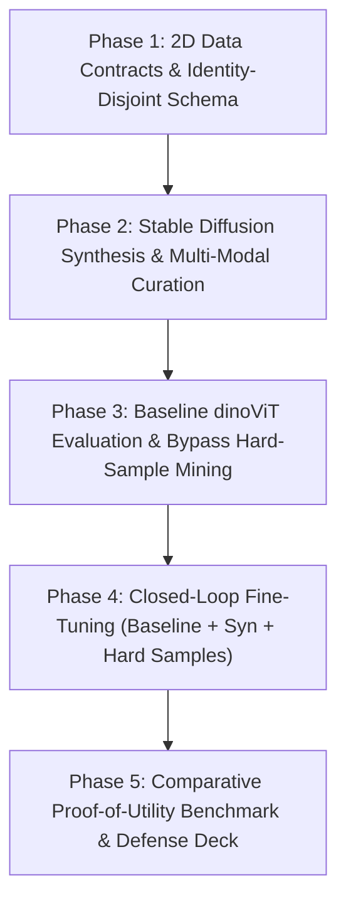

# Project Roadmap: Closed-Loop Stable Diffusion + dinoViT Hard-Sample Mining (`docs/progress/PROJECT_ROADMAP.md`)

- **Motivation/Background**: Establishes the macro-milestone tracking framework guiding the development of the instructor-refined coursework project: "Stable Diffusion-Based Synthetic Facial Dataset Generation with DINO ViT Hard-Sample Mining for Deepfake Detection" (Topic 11).
- **Purpose**: Provide visible traceability across all engineering phases from data synthesis and baseline bypass mining to `dinoViT` fine-tuning and coursework defense.
- **Overview Pipeline**: Phase 1 Data Contracts -> Phase 2 SD Generation & Curation -> Phase 3 `dinoViT` Baseline & Hard-Sample Mining -> Phase 4 Closed-Loop Fine-Tuning (`Baseline + Syn + Hard`) -> Phase 5 Comparative Benchmark & Report.
- **Detailed Plan**: §1 Closed-Loop Timeline Overview; §2 Phase-by-Phase Deliverables & DoD Checklists; §3 Risk Mitigation & Quality Assurance.
- **References**: `docs/PURPOSE.md`, `docs/OVERVIEW.md`, `GEMINI.md`.
- **Created**: 2026-11-07T00:05:00+07:00
- **Last Updated**: 2026-11-08T17:45:00+07:00

---

## 1. Closed-Loop Timeline Overview

---

## 2. Phase-by-Phase Deliverables & DoD Checklists

### [x] Phase 1: 2D Image Contracts & Hard-Sample Schema (`src/data/`)
- [x] Define `ImageMetadata` (with `is_hard_sample`, `baseline_score`, `data_source`) and `ImageSample` in `src/data/image_schema.py`.
- [x] Implement `DeepfakeImageDataset` and `DeepfakeImageDataModule` with Identity-Disjoint partitioning and Hard-Sample oversampling.
- [x] Unit tests validating 2D tensor shapes `(B, 3, H, W)`, identity grouping, and oversampling.

### [x] Phase 2: Stable Diffusion Generation & Curation Factory (`src/models/diffusion/` & `src/pipelines/`)
- [x] Implement `StableDiffusionEngine` supporting Text2Img, Inpainting, and Img2Img (`sd_text2img`, `sd_inpaint`, `sd_img2img`).
- [x] Implement `ImageCurationGate` filtering synthetic images by Laplacian sharpness ($\ge 50.0$), CLIP alignment ($\ge 0.28$), and face detection confidence.
- [x] Implement CLI batch pipelines `generate_deepfake_images.py` and `curate_image_dataset.py`.

### [x] Phase 3: Baseline `dinoViT` Benchmark & Bypass Hard-Sample Mining (`src/models/detector/` & `src/pipelines/mine_hard_samples.py`)
- [x] Implement `DinoViTBackbone` and `DeepfakeImageDetector(backbone="dino_vit")` with `freeze_backbone()` and `unfreeze_backbone()`.
- [x] Implement `mine_hard_samples.py` to pass curated synthetic DF images through frozen Baseline `dinoViT`:
  - Classify $P(\text{fake}) \ge 0.50$ as **Rejected** (caught by baseline).
  - Classify $P(\text{fake}) < 0.50$ as **Bypassed** $\rightarrow$ flag `is_hard_sample=True` and export `hard_samples_manifest.jsonl`.

### [x] Phase 4: Closed-Loop Fine-Tuning & Comparative Benchmark (`src/pipelines/train_image_detector.py` & `evaluate_image_benchmark.py`)
- [x] Implement `combine_training_manifests()` merging `Data Baseline + Synthetic Data + Hard Samples`.
- [x] Implement weighted hard-sample fine-tuning in `train_image_detector.py` (`hard_sample_loss_weight=2.0`, `unfreeze_last_n_blocks=2`).
- [x] Implement `compare_baseline_vs_finetuned()` quantifying `roc_auc_gain`, `hard_sample_recall_gain`, and `bypass_rate_reduction`.

### [x] Phase 5: Coursework Documentation & Defense Presentation (`docs/reports/`)
- [x] Update all technical specifications in `docs/coursework/`, `docs/phases/`, and `docs/experiments/`.
- [x] Update Master Define & Design Report (`SYSTEM_DEFINE_AND_DESIGN_REPORT.md`) and 11-slide presentation deck (`presentation_5min_define_and_design.html`).
