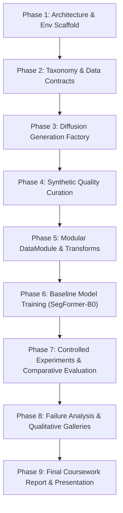

# Project Roadmap: 9-Phase AI-First Lifecycle

- **Motivation/Background**: Establishes the macro-milestone tracking framework guiding the development of the "Diffusion-Based Synthetic Facial Occlusion Dataset Generation for Fine-Grained Occlusion Segmentation" project.
- **Purpose**: Provide visible traceability across all engineering phases from initial scaffolding through research paper and coursework report delivery.
- **Overview Pipeline**: Phase 1 Scaffolding -> Phase 2 Data Contracts -> Phase 3 Generative Pipeline -> Phase 4 Data Curation -> Phase 5 Dataset Loaders -> Phase 6 Baseline Model -> Phase 7 Controlled Experiments -> Phase 8 Qualitative Analysis -> Phase 9 Coursework Deliverables.
- **Detailed Plan**: §1 Macro Timeline Overview; §2 Phase-by-Phase Deliverables & DoD Checklists; §3 Risk Mitigation & Blockers.
- **References**: `.agents/AI_FIRST_LIFECYCLE.md`, `docs/PURPOSE.md`, `docs/coursework/TAXONOMY_AND_DATA_SPEC.md`.
- **Created**: 2026-11-04T08:24:00+07:00
- **Last Updated**: 2026-11-04T08:24:00+07:00

---

## 1. Macro Timeline Overview

---

## 2. Phase-by-Phase Deliverables & DoD Checklists

### [x] Phase 1: Architecture & Specifications Scaffolding
- [x] Initial repository structure formatted (`src/`, `tests/`, `configs/`, `docs/`).
- [x] Locked project purpose and requirements in `docs/PURPOSE.md`.
- [x] Literature review and academic gap analysis in `docs/coursework/LITERATURE_REVIEW.md`.

### [x] Phase 2: Taxonomy & Data Contracts
- [x] 6-class occlusion taxonomy established in `docs/coursework/TAXONOMY_AND_DATA_SPEC.md`.
- [x] Lossless PNG uint8 mask contract locked; JPEG strictly prohibited.
- [x] Dataset configuration file created in `configs/dataset/occlusion_synthetic.yaml`.

### [ ] Phase 3: Diffusion Generation Factory (`src/pipelines/generate_synthetic.py`)
- [ ] Implement clean portrait loading and category prompt selection.
- [ ] Implement Stable Diffusion inpainting conditioning.
- [ ] Implement cross-attention extraction and SAM boundary snapping.
- [ ] Produce minimal working spike generating 10 paired samples with automated masks.

### [ ] Phase 4: Synthetic Quality Curation
- [ ] Implement Face Detection Retention filter ($\ge 0.85$ confidence).
- [ ] Implement CLIP score filter ($\ge 0.28$).
- [ ] Implement mask area bounds check ($[0.05, 0.65]$).
- [ ] Batch-synthesize and curate 8,000 training and 1,000 validation pairs.

### [ ] Phase 5: Modular DataModule & Transforms (`src/data/`)
- [ ] Implement `OcclusionDataset` supporting synchronized image and mask transforms.
- [ ] Implement vectorized augmentations (RandomHorizontalFlip, ColorJitter, RandomAffine).
- [ ] Implement `OcclusionDataModule` returning pinned GPU DataLoaders.
- [ ] Unit tests in `tests/test_data.py` validating tensor shapes and dtypes.

### [ ] Phase 6: Baseline Model Training (`src/models/` & `src/pipelines/train.py`)
- [ ] Implement `SegFormerB0` model builder in `src/models/deep/segformer.py`.
- [ ] Implement composite loss `CrossEntropyLoss + DiceLoss`.
- [ ] Implement `mIoU` and `BoundaryIoU` in `src/common/metrics.py`.
- [ ] Execute baseline training pipeline saving `best_model.pt` and `last_model.pt`.

### [ ] Phase 7: Controlled Experiments & Comparative Evaluation
- [ ] Run EXP-0 (Real Lower-Bound), EXP-1 (2D Cut-and-Paste), and EXP-2 (Proposed Diffusion).
- [ ] Run boundary refinement ablation (No SAM vs SAM).
- [ ] Benchmark on official unseen test split (`data/real_eval/`).

### [ ] Phase 8: Failure Analysis & Qualitative Galleries
- [ ] Generate qualitative prediction comparison gallery figures in `experiments/gallery/`.
- [ ] Generate confusion matrix and class-wise IoU breakdown charts.
- [ ] Document failure modes (e.g. transparent eyeglasses lenses, extreme side profiles).

### [ ] Phase 9: Final Coursework Report & Presentation
- [ ] Author academic technical report in `docs/reports/REPORT.md`.
- [ ] Verify 100% compliance with coursework rubric.
- [ ] Prepare presentation slide deck summarizing research contributions.

---

## 3. Risk Mitigation & Blockers

| Identified Risk | Impact | Mitigation Strategy |
| :--- | :---: | :--- |
| **GPU VRAM exhaustion during diffusion generation** | Medium | Run diffusion batch generation offline using fp16 latents; process single image at a time during synthesis. |
| **Class imbalance in tiny accessories (thin glasses)** | High | Use class-weighted Cross-Entropy combined with Soft Dice Loss configured in `configs/model/segformer_baseline.yaml`. |
| **Boundary leakage in transparent glasses** | High | Apply SAM point-prompt guided boundary snapping over raw attention thresholding. |
