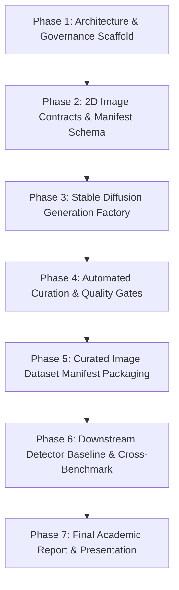

# Project Roadmap: AI-First Lifecycle for Stable Diffusion Deepfake Dataset

- **Motivation/Background**: Establishes the macro-milestone tracking framework guiding the development of the "Stable Diffusion-Based Synthetic Facial Image Dataset Generation for Deepfake Detection" coursework project (Topic 11).
- **Purpose**: Provide visible traceability across all engineering phases from initial scaffolding through research paper and coursework report delivery.
- **Overview Pipeline**: Phase 1 Scaffolding -> Phase 2 2D Image Data Contracts -> Phase 3 Stable Diffusion Factory -> Phase 4 Automated Curation -> Phase 5 Dataset Packaging -> Phase 6 Downstream Detector Benchmark -> Phase 7 Final Coursework Report.
- **Detailed Plan**: §1 Macro Timeline Overview; §2 Phase-by-Phase Deliverables & DoD Checklists; §3 Risk Mitigation & Blockers.
- **References**: `docs/PURPOSE.md`, `docs/OVERVIEW.md`, `GEMINI.md`.
- **Created**: 2026-11-07T00:05:00+07:00
- **Last Updated**: 2026-11-07T00:05:00+07:00

---

## 1. Macro Timeline Overview

---

## 2. Phase-by-Phase Deliverables & DoD Checklists

### [x] Phase 1: Architecture & Specifications Scaffolding
- [x] Initial repository structure formatted (`src/`, `tests/`, `configs/`, `docs/`).
- [x] Locked project purpose and requirements in `docs/PURPOSE.md`.
- [x] Comprehensive execution plan and ledger established in `docs/plans/`.

### [ ] Phase 2: 2D Image Contracts & Manifest Schema (`src/data/`)
- [ ] Define `ImageSample` dataclass and JSONL metadata schema in `src/data/image_schema.py`.
- [ ] Implement `DeepfakeImageDataset` and `DeepfakeImageDataModule` yielding `(B, 3, H, W)`.
- [ ] Unit tests validating 2D image tensor shapes, labels, and dataloader.

### [ ] Phase 3: Stable Diffusion Generation Factory (`src/models/diffusion/` & `src/pipelines/`)
- [ ] Implement `StableDiffusionEngine` supporting Text2Img, Inpainting, and Img2Img.
- [ ] Implement deterministic mock mode for headless CI/CD execution without GPU downloads.
- [ ] Implement CLI batch pipeline `generate_deepfake_images.py`.
- [ ] Unit tests verifying synthesis pipeline and shape invariants.

### [ ] Phase 4: Automated Curation & Quality Gates (`src/common/metrics.py` & `src/pipelines/`)
- [ ] Implement vectorized Laplacian variance sharpness metric.
- [ ] Implement CLIP score proxy for text-image alignment.
- [ ] Implement batch curation pipeline `curate_image_dataset.py` pruning flawed images.
- [ ] Unit tests for image metrics and curation decision logic.

### [ ] Phase 5: Curated Image Dataset Manifest Packaging
- [ ] Partition curated images into standardized `train`, `val`, and `test` splits ($70/15/15$).
- [ ] Generate comprehensive JSONL manifest containing image paths, manipulation types, and labels.
- [ ] Publish dataset statistics (Real vs Fake balance, resolution distributions).

### [ ] Phase 6: Downstream Detector Baseline & Cross-Benchmark (`src/models/detector/` & `src/pipelines/`)
- [ ] Implement `DeepfakeImageDetector` (ResNet-18 / 2D CNN).
- [ ] Implement resumable training pipeline in `src/pipelines/train_image_detector.py`.
- [ ] Implement benchmark evaluation suite in `src/pipelines/evaluate_image_benchmark.py`.
- [ ] Quantify detection performance (ROC-AUC, Accuracy, F1).

### [ ] Phase 7: Final Academic Report & Presentation
- [ ] Author academic technical report in `docs/reports/REPORT.md`.
- [ ] Produce comparative performance tables.
- [ ] Prepare presentation slide deck.
