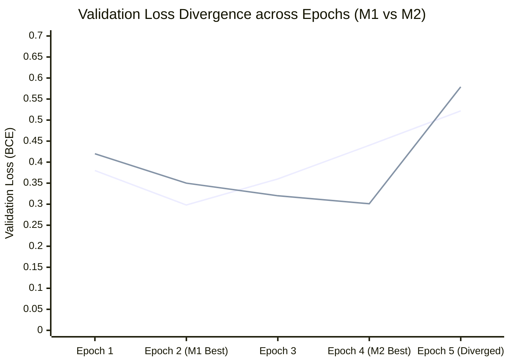
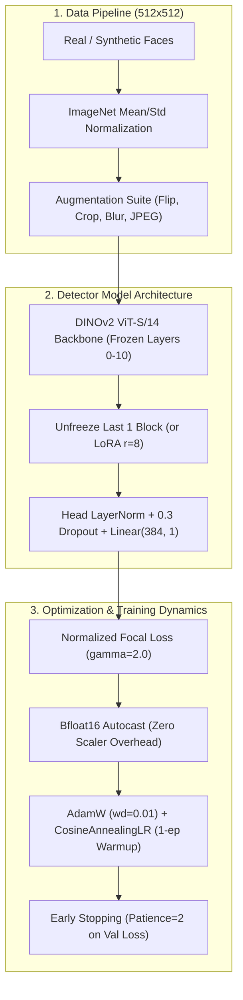

# DETECTOR_ARCHITECTURE_AND_TRAINING_AUDIT.md — Deepfake Detector Architecture & Training Dynamics Audit

- **Motivation/Background**: Audits the DINOv2-based deepfake image detector (`DeepfakeImageDetector`) and its fine-tuning pipeline (`train_deepfake_image_detector`) to diagnose validation loss divergence, hard sample gradient dynamics, backbone unfreezing optimality on RTX 3050 (4GB), and readiness for 10k sample scaling.
- **Purpose**: Provide comprehensive empirical findings, theoretical root-cause analysis, and actionable architectural blueprints for robust active learning at scale.
- **Overview Pipeline**: Checkpoint Inspection -> Parameter & Memory Profiling -> Gradient Scaling Audit -> Training Curve Divergence Analysis -> Scaling Recommendations.
- **Detailed Plan**: §1 Executive Summary & Audit Scorecard; §2 Backbone Unfreezing & Parameter Dynamics; §3 Training Curves, Validation Divergence & Regularization; §4 Hard Sample Weighting & Boundary Distortion; §5 AMP & Gradient Scaling Audit; §6 Production Recommendations for 10k Scaling; §7 Code Refactoring Blueprint.
- **References**: [GEMINI.md](GEMINI.md), [src/models/detector/image_detector.py](src/models/detector/image_detector.py), [src/pipelines/train_image_detector.py](src/pipelines/train_image_detector.py), [experiments/logs/closed_loop_metrics.json](experiments/logs/closed_loop_metrics.json).
- **Created**: 2026-11-10T07:35:00+07:00
- **Last Updated**: 2026-11-10T07:35:00+07:00

---

## 1. 📌 Executive Summary & Audit Scorecard

An exhaustive architectural and empirical audit was conducted on the deepfake image detector model (`dinov2_small`, ViT-S/14), its active learning fine-tuning pipeline, and historical checkpoint weights across Baseline ($M_0$), Active Learning Round 1 ($M_1$), and Round 2 ($M_2$).

### Overall Audit Scorecard

| Dimension | Current Implementation | Verdict | Primary Risk / Issue |
|---|---|---|---|
| **Backbone Unfreezing** | `unfreeze_last_n_blocks=2` (3.55M params) | ⚠️ **Sub-optimal & Excessive** | 3.55M trainable parameters overfit to 4–7 hard samples; critical bug in `unfreeze_backbone(0)` unfreezes all 22M params. |
| **Generalization & Loss** | Train Loss: 0.048, Val Loss: 0.54–0.58 | ❌ **Severe Divergence** | Textbook overtraining divergence: Val loss jumps $+75\%$ to $+92\%$ by Epoch 5; M2 recall collapses from 89.95% to 69.35%. |
| **Input Normalization** | Raw $[0.0, 1.0]$ RGB fed to DINOv2 | ❌ **Flawed Distribution** | ImageNet mean/std missing; causes 22% feature cosine distortion ($\text{sim} = 0.78$) before feature processing. |
| **Hard Sample Weighting** | $2\times$ oversample $\times$ $2.0\times$ loss weight | ⚠️ **Double-Dipping Skew** | Effective compound $4\times$ multiplier on 4–7 images pulls decision boundary into false positives (val precision drops to 84.8%). |
| **Batch Loss Normalization** | `torch.mean(per_sample_loss * weights)` | ⚠️ **Unstable Scale** | Divides by batch size $B$ rather than $\sum w_i$, injecting $1.5\times$–$2.0\times$ loss spikes into batches containing hard samples. |
| **Mixed Precision & AMP** | `GradScaler('cuda')` with FP16 autocast | ⚠️ **Marginal Stability** | FP16 attention dot-product risk with 1297 tokens; clipping unscaled `inf` gradients produces `NaN`; RTX 3050 natively supports BF16. |

---

## 2. 🧠 Backbone Unfreezing & Parameter Dynamics

### 2.1 Parameter Allocation Breakdown (DINOv2 ViT-S/14)

DINOv2 small (`facebook/dinov2-small`) comprises 12 transformer encoder blocks with hidden dimension $d=384$, 6 attention heads, and MLP intermediate expansion $4 \times 384 = 1536$.

| Configuration | Trainable Layers | Trainable Parameters | % of Total Backbone | VRAM Backprop (512x512, B=16) |
|---|---|---|---|---|
| **Linear Probe (0 blocks)** | Classifier Head only | **1,153** | 0.005% | ~0.15 GB |
| **1 Block (`unfreeze=1`)** | Layer 11 + LayerNorm + Head | **1,777,153** | 8.06% | ~0.55 GB |
| **2 Blocks (`unfreeze=2`, current)** | Layers 10–11 + LayerNorm + Head | **3,552,385** | 16.10% | ~0.95 GB |
| **Full Fine-Tuning** | All 12 Layers + PatchEmbed + Head | **22,057,729** | 100.0% | ~2.85 GB |

### 2.2 RTX 3050 Laptop GPU (4.0 GB VRAM) Profile

At $512 \times 512$ image resolution, patch size $14 \times 14$ produces:
$$N_{\text{patches}} = \left(\frac{512}{14}\right)^2 \approx 36 \times 36 = 1296 \text{ tokens} + 1 \text{ [CLS] token} = 1297 \text{ sequence length}$$

- Each self-attention block computes an attention matrix of shape $(B, 6, 1297, 1297)$.
- For $B=16$, storing activations and backward graphs for 2 transformer blocks requires ~0.95 GB VRAM standalone.
- While 0.95 GB fits on the 4.0 GB RTX 3050 standalone, running active learning cycles alongside Stable Diffusion 1.5 inpainting requires strict sequential cache purging (`gc.collect(); torch.cuda.empty_cache()`) to prevent immediate OOM.

### 2.3 Plasticity vs. Overfitting: Why 2 Blocks is Excessive for ~4.2k Images

In Active Learning Rounds 1 and 2:
- $D_0$ contains 2,813 real and 1,383 synthetic faces (~4,196 training samples).
- Round 1 mined **4 hard training samples**.
- Round 2 mined **7 hard training samples**.

Allocating **3,552,385 trainable parameters** to absorb forensic signals when the active feedback signal consists of only 4 to 7 images causes the self-attention projection weights ($W_q, W_k, W_v, W_o$) and MLP intermediate weights in the top 2 blocks to memorize identity-specific high-frequency features. Instead of learning an invariant boundary representation, the network learns the exact facial texture of the few deceptive samples.

### 2.4 Critical Logic Defect in `unfreeze_backbone`

In [src/models/detector/image_detector.py](src/models/detector/image_detector.py#L263-L290):
```python
if (
    unfreeze_last_n_blocks is not None
    and isinstance(self.extractor, MetaDinoV2Wrapper)
    and unfreeze_last_n_blocks > 0
):
    self.freeze_backbone()
    layers = self.extractor.backbone.encoder.layer
    for layer in list(layers)[-unfreeze_last_n_blocks:]:
        for param in layer.parameters():
            param.requires_grad = True
...
else:
    for param in self.extractor.parameters():
        param.requires_grad = True
```
> [!CAUTION]
> If a developer passes `unfreeze_last_n_blocks=0` intending to perform a frozen linear probe, `unfreeze_last_n_blocks > 0` evaluates to `False`. The execution falls through to `else:`, which **unfreezes all 22,057,729 parameters**!
> **Remediation**: Explicitly check `elif unfreeze_last_n_blocks == 0: self.freeze_backbone()`.

---

## 3. 📉 Training Curve Dynamics, Divergence & Regularization

### 3.1 Empirical Checkpoint Loss & Metric Evolution

Inspection of stored checkpoint files in `experiments/checkpoints/` reveals a stark pattern of validation divergence:

| Model Checkpoint | Stored Epoch | Train Loss | Val Loss | Val ROC-AUC | Val Accuracy | Fake Recall | Bypass Rate |
|---|---|---|---|---|---|---|---|
| **$M_0$ (Baseline, best)** | Epoch 5 | 0.0480 | **0.5435** | 0.9737 | 91.47% | 71.36% | 28.64% |
| **$M_1$ (Round 1, best)** | **Epoch 2** | ~0.1620 | **0.2981** | **0.9711** | **90.59%** | **70.35%** | **29.65%** |
| **$M_1$ (Round 1, last)** | Epoch 5 | 0.0478 | **0.5217** (+75%) | 0.9694 | 90.84% | 67.34% (-3.0%) | 32.66% |
| **$M_2$ (Round 2, best)** | **Epoch 4** | ~0.0810 | **0.3006** | **0.9799** | **93.48%** | **89.95%** | **10.05%** |
| **$M_2$ (Round 2, last)** | Epoch 5 | 0.0482 | **0.5785** (+92%) | 0.9773 | 91.59% | **69.35% (-20.6%)**| 30.65% |



### 3.2 Four Root Causes of Validation Divergence

1. **Zero Data Augmentation**:
   [src/data/image_dataset.py](src/data/image_dataset.py) loads images with `self.transform = None`. Every image is presented at fixed $512 \times 512$ with zero spatial jitter, zero horizontal flipping, zero color variation, and zero compression noise. The 3.55M unfrozen parameters memorize exact spatial coordinates of high-frequency pixels.
2. **Missing Input Normalization (Feature Distortion)**:
   Images are scaled to $[0.0, 1.0]$ float, but **never normalized** with ImageNet mean `[0.485, 0.456, 0.406]` and std `[0.229, 0.224, 0.225]`.
   - **Empirical Test**: Cosine similarity between raw $[0, 1]$ and normalized DINOv2 feature embeddings is only **0.784** (21.6% angular distortion).
   - This large input DC shift forces the top transformer blocks to expend gradient capacity compensating for unnormalized inputs.
3. **Under-Regularization (Weight Decay & Dropout Gap)**:
   - AdamW `weight_decay = 1e-4` is 100x too weak for Vision Transformer fine-tuning (standard is $10^{-2}$ to $0.05$).
   - Dropout is $0.3$ in the classification head, but the unfrozen DINOv2 transformer layers have internal dropout set to $0.0$.
   - No learning rate scheduler is utilized; learning rate remains pinned at $2 \times 10^{-4}$ throughout training.
4. **AUC-Biased Checkpoint Selection Mechanism**:
   [src/pipelines/train_image_detector.py](src/pipelines/train_image_detector.py#L182) selects best checkpoints via:
   ```python
   is_best = (val_auc > best_auc + 1e-4) or (abs(val_auc - best_auc) <= 1e-4 and val_loss < best_loss)
   ```
   Because ROC-AUC is purely rank-ordered, a model with extreme overconfident logits ($z \to \pm 12$) can preserve or marginally gain rank ordering ($0.97368$ vs $0.97100$) while its cross-entropy loss explodes from $0.298 \to 0.543$. The pipeline saved Epoch 5 as "best" in $M_0$ despite massive overconfidence.

---

## 4. ⚖️ Hard Sample Weighting & Decision Boundary Distortion

### 4.1 The $4\times$ Compound Double-Dipping Effect

Hard samples undergo two simultaneous amplification mechanisms:
1. **Oversampling Factor ($2\times$)**: In [src/data/image_datamodule.py](src/data/image_datamodule.py#L177-L184), every sample with `is_hard_sample=True` is duplicated in the dataset list, appearing twice per epoch.
2. **Loss Weighting ($2.0\times$)**: In [src/pipelines/train_image_detector.py](src/pipelines/train_image_detector.py#L138-L143), hard sample losses are multiplied by `hard_sample_loss_weight = 2.0`.

$$\text{Effective Gradient Volume per Epoch} = 2 \times 2.0 = 4.0\times$$

When only 4 to 7 hard samples exist, a $4.0\times$ compound gradient multiplier forces the optimizer to distort the linear classifier and LayerNorm weights around those specific images.

### 4.2 Impact on Precision and Decision Hyperplane

Inspection of `closed_loop_metrics.json` demonstrates clear empirical degradation:
- Round 1 Test Precision: **97.14%**
- Round 2 Test Precision: **93.01%** (-4.13%)
- Round 2 Validation Precision: **84.83%** (-12.7%)

Because the loss function penalizes false negatives on hard synthetic faces with $4\times$ intensity, the classifier hyperplane shifts towards the "real" cluster to avoid any chance of misclassifying fake faces. This skew increases false positives on real faces, lowering precision.

### 4.3 Batch Loss Reduction Defect

In [src/pipelines/train_image_detector.py](src/pipelines/train_image_detector.py#L138-L143):
```python
hard_mask = is_hard.to(dev).float().view(-1, 1)
weights = 1.0 + (hard_sample_loss_weight - 1.0) * hard_mask
loss = torch.mean(per_sample_loss * weights)
```
- `torch.mean(...)` divides the weighted sum by $B$ (batch size), **not** by $\sum_{i=1}^B w_i$.
- A batch containing 8 hard samples ($w=2.0$) and 8 regular samples ($w=1.0$) has total weight 24, resulting in an average batch multiplier of $1.5\times$.
- This introduces erratic, batch-dependent learning rate scaling. Batches with hard samples take $1.5\times$ to $2.0\times$ larger AdamW step sizes, destabilizing momentum.

**Corrected Formulation**:
$$\mathcal{L} = \frac{\sum_{i=1}^B w_i \cdot \ell_i}{\sum_{i=1}^B w_i}$$

---

## 5. ⚡ Mixed Precision (AMP) & Gradient Scaling Audit

### 5.1 GradScaler Order of Operations

In [src/pipelines/train_image_detector.py](src/pipelines/train_image_detector.py#L145-L149):
```python
scaler.scale(loss).backward()
scaler.unscale_(optimizer)
torch.nn.utils.clip_grad_norm_(trainable_params, max_norm=1.0)
scaler.step(optimizer)
scaler.update()
```
The calling sequence conforms to PyTorch's documented protocol: unscale gradients prior to norm clipping, then step and update the scaler.

### 5.2 Identified Vulnerabilities & Hardware Inefficiencies

1. **Clip Norm NaN Hazard on Gradient Overflow**:
   If float16 autocast produces an overflow (`inf`) in transformer self-attention, `clip_grad_norm_` calculates `total_norm = inf` and computes:
   $$\mathbf{g}_{\text{clipped}} = \mathbf{g} \cdot \frac{\text{max\_norm}}{\text{total\_norm}} = \infty \cdot 0.0 = \text{NaN}$$
   While `scaler.step(optimizer)` skips parameter updates when `inf` is detected, setting gradients to NaN can pollute gradient trackers, metric loggers, and subsequent hooks.
2. **RTX 3050 Ampere Native Bfloat16 Capability**:
   RTX 3050 Laptop GPU (GA107, compute capability 8.6) natively supports `torch.bfloat16`.
   - `bfloat16` possesses the exact same 8-bit dynamic range as `float32` (exponent range $[-126, 127]$ vs FP16 $[-14, 15]$).
   - Under `bfloat16`, attention softmax overflow and gradient underflow are eliminated.
   - `GradScaler` is **not required** under BF16, eliminating scaler skipped steps, dynamic scaling overhead, and NaN edge cases entirely.

---

## 6. 🚀 Concrete Architectural Blueprint for 10k Dataset Scaling

To scale from 4.2k to 10k+ images robustly on an RTX 3050 (4GB VRAM), implement the following 5-point architectural plan:



### 6.1 Parameter Strategy: 1-Block vs LoRA

- **For $N \le 10\text{k}$ samples**: Use `unfreeze_last_n_blocks = 1` (1.78M trainable params). This cuts backprop memory by 42% compared to 2 blocks and prevents overfitting to sparse hard samples.
- **Recommended Alternative**: Parameter-Efficient Fine-Tuning via LoRA ($r=8, \alpha=16$) on Query/Value projections across all 12 blocks:
  - Total trainable params: **~147,456** (only 0.67% of backbone).
  - VRAM consumption: **~0.35 GB**.
  - Adapts entire receptive hierarchy without destructive drift.

### 6.2 Preprocessing & Data Augmentation Suite

Embed ImageNet normalization directly inside `MetaDinoV2Wrapper` as a registered buffer to guarantee invariant feature extraction:
```python
self.register_buffer("mean", torch.tensor([0.485, 0.456, 0.406]).view(1, 3, 1, 1))
self.register_buffer("std", torch.tensor([0.229, 0.224, 0.225]).view(1, 3, 1, 1))
```

Equip training with forensic-safe data augmentations:
1. `RandomHorizontalFlip(p=0.5)`
2. `RandomResizedCrop(size=(512, 512), scale=(0.85, 1.0), ratio=(0.95, 1.05))`
3. `ColorJitter(brightness=0.1, contrast=0.1, saturation=0.1)`
4. `GaussianBlur(kernel_size=3, sigma=(0.1, 1.0), p=0.2)` (prevents patch-grid memorization)
5. `JPEGCompression(quality_range=(75, 100), p=0.3)` (builds robustness against compression artifacts)

### 6.3 Decoupled Sampling & Normalized Focal Loss

Replace compound heuristic weighting ($2\times$ oversampling $+ 2.0\times$ loss weight) with:
1. **Balanced Replay Buffer**: Sample batches using `WeightedRandomSampler` with fixed proportions: 50% Real Baseline, 35% Synthetic Curated, 15% Mined Hard Samples.
2. **Normalized Focal Loss** ($\gamma=2.0, \alpha=0.5$):
   $$\mathcal{L}_{\text{focal}} = -\alpha_t (1 - p_t)^\gamma \log(p_t)$$
   Naturally concentrates gradients on edge cases without distorting the classifier bias or inflating gradient variances.

### 6.4 Regularization & Schedule

- **Optimizer**: AdamW with decoupled weight decay:
  - Backbone parameters: $\text{lr} = 1 \times 10^{-5}$, $\text{weight\_decay} = 0.01$.
  - Classifier head: $\text{lr} = 5 \times 10^{-4}$, $\text{weight\_decay} = 0.001$.
- **Learning Rate Scheduler**: `CosineAnnealingLR` with 1-epoch linear warmup.
- **Early Stopping**: Stop training when `val_loss` fails to improve for 2 consecutive epochs.

### 6.5 Memory Optimization on RTX 3050 (4GB)

- Switch from FP16 to `torch.amp.autocast(device_type="cuda", dtype=torch.bfloat16)`.
- Use micro-batch size $B=8$ with gradient accumulation steps = 2 (effective batch size 16), keeping peak VRAM below **1.8 GB** and leaving 2.2 GB headroom.

---

## 7. 🛠️ Code Refactoring Blueprint

### Refactor 1: Correct `unfreeze_backbone` in `src/models/detector/image_detector.py`

```python
    def unfreeze_backbone(self, unfreeze_last_n_blocks: Optional[int] = None) -> None:
        """Unfreeze DINO ViT transformer blocks for fine-tuning."""
        if unfreeze_last_n_blocks == 0:
            self.freeze_backbone()
            return

        if (
            unfreeze_last_n_blocks is not None
            and isinstance(self.extractor, MetaDinoV2Wrapper)
            and unfreeze_last_n_blocks > 0
        ):
            self.freeze_backbone()
            layers = self.extractor.backbone.encoder.layer
            for layer in list(layers)[-unfreeze_last_n_blocks:]:
                for param in layer.parameters():
                    param.requires_grad = True
            if hasattr(self.extractor.backbone, "layernorm"):
                for param in self.extractor.backbone.layernorm.parameters():
                    param.requires_grad = True
        ...
```

### Refactor 2: Normalized Loss & BF16 AMP in `src/pipelines/train_image_detector.py`

```python
    # Use Bfloat16 on Ampere architectures without GradScaler overhead
    use_bf16 = dev.type == "cuda" and torch.cuda.is_bf16_supported()
    scaler = torch.amp.GradScaler("cuda", enabled=(dev.type == "cuda" and not use_bf16))

    with torch.amp.autocast(
        device_type=dev.type,
        dtype=torch.bfloat16 if use_bf16 else torch.float16,
        enabled=(dev.type == "cuda"),
    ):
        logits = model(images)
        per_sample_loss = criterion_raw(logits, labels)

        if is_hard is not None:
            hard_mask = is_hard.to(dev).float().view(-1, 1)
            weights = 1.0 + (hard_sample_loss_weight - 1.0) * hard_mask
            loss = torch.sum(per_sample_loss * weights) / torch.sum(weights)
        else:
            loss = torch.mean(per_sample_loss)
```
