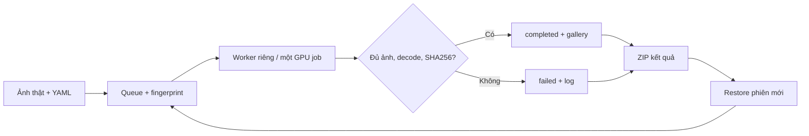

# KAGGLE SD IMAGE BENCHMARK

- **Motivation/Background**: So sánh các checkpoint và phương pháp trong danh mục đã thảo luận, theo từng nhóm trên Kaggle.
- **Purpose**: Bàn giao hàng đợi inference thật, ghi nhận lỗi và khôi phục kết quả; phân biệt rõ phần đã kiểm thử với phần chưa chạy GPU.
- **Overview Pipeline**: Chuẩn bị ảnh → lập queue → worker riêng từng cấu hình → kiểm tra artifacts → gallery/log → xuất ZIP → restore/resume.
- **Detailed Plan**: Phạm vi, cách chạy, resume, bằng chứng kiểm thử, giới hạn và nguồn tham khảo.
- **References**: [Notebook](../../notebooks/SD_ALL_BENCHMARK_KAGGLE.ipynb), [suite](../../configs/generation/sd_all_benchmark.yaml), [catalog](../../configs/generation/sd_benchmark_catalog.yaml), [pilot](KAGGLE_SD_IMAGE_DEMO.md).
- **Created**: 2026-11-09T14:20:00+07:00
- **Last Updated**: 2026-11-09T14:20:00+07:00

## Phạm vi và cách đếm

Đây là benchmark **ảnh**, dùng pretrained, không fine-tune. **32 cấu hình sinh ảnh** gồm 18 cấu hình checkpoint và 14 cấu hình reference; mở rộng theo mode thành **44 tác vụ cho mỗi ảnh nguồn** ở cấu hình mặc định. Mỗi case reference tạo một ảnh; checkpoint tạo một ảnh cho mỗi mode được hỗ trợ. Mặc định `source_limit: 1`, chuẩn bị ba ảnh thật để có cặp source/target khác nhau.

Danh mục có **31 mục tham khảo**: 9 mục model nền, 7 mục checkpoint tùy biến, 12 mục phương pháp/conditioning, 3 công cụ thực thi. Một số mục gộp nhiều phiên bản nên số cấu hình khác số mục. Diffusers, ComfyUI và AUTOMATIC1111 là công cụ; chúng không được tính như ba thuật toán sinh ảnh hay ba thí nghiệm đã hoàn thành.

- Checkpoints: SD 1.4, SD 1.5, SDXL, SD 1.5 Inpainting, SDXL Inpainting, SD 3.5 Medium/Large/Large Turbo, SDXL Turbo/Lightning; Realistic Vision 5.1, DreamShaper 8, RealVisXL 5, Juggernaut XL 9, DreamShaper XL Lightning, epiCRealism, AbsoluteReality 1.81/1.6525.
- Reference: ControlNet Canny, IP-Adapter, IP-Adapter-FaceID SD1.5/PlusV2 SDXL, InstantID, PhotoMaker v1, Face-Adapter, REFace, Arc2Face, PuLID v1/v1.1, FastComposer, FlashFace, ConsistentID SD1.5.
- **T2I** không có danh tính nguồn. **img2img/inpainting** chỉnh ảnh nhưng không tự bảo đảm đổi danh tính. **Reference generation** giữ danh tính để sinh chân dung mới. **Face swapping** nhận source identity và target ảnh riêng; hai case ở đây là Face-Adapter và REFace. ControlNet Canny/IP-Adapter thường không chuyên bảo toàn danh tính. Không xếp hạng chung các tác vụ như thể tương đương.

## Chạy trên Kaggle

1. Import notebook; bật GPU + Internet, gắn source bundle `SD_ALL_BENCHMARK_KAGGLE.zip` dạng ZIP hoặc Dataset đã giải nén.
2. Notebook chỉ cài `requirements/notebook.txt` vào kernel. Cả native Diffusers lẫn adapter được cài/chạy trong venv worker; giữ cặp CUDA torch/torchvision của Kaggle. Chuẩn bị ba ảnh từ Drive bằng module hiện có; xem preview và mask.
3. Chạy cell plan, sau đó cell batch. `GROUP="all"`, `MAX_JOBS=2` mặc định; chạy lại cell để tiếp tục các case còn pending. Dùng `GROUP="checkpoints"` hoặc `"methods"` để tách nhóm; `CASE_IDS=["sd15", "sd15_inpaint"]` để thử đúng hai case trước.
4. Xem `index.html` và `cases/<case_id>_<hash>/worker.log`. Case thành công có `gallery.html`, PNG, manifest, summary và technical QA. Download ZIP kết quả sau mỗi batch hoặc Save Version với outputs.

CLI tương đương, chạy từ root repo:

```bash
python -m src.pipelines.prepare_image_demo
python -m src.pipelines.sd_all_benchmark --plan-only
python -m src.pipelines.sd_all_benchmark --group checkpoints --max-jobs 2
python -m src.pipelines.sd_all_benchmark --cases sd15 sd15_inpaint --max-jobs 2
python -m src.pipelines.sd_all_benchmark --group methods --max-jobs 2
```

Các checkpoint gated cần tài khoản đã chấp nhận điều khoản và `HF_TOKEN` qua Kaggle Secrets/environment. Không lưu token trong cell, config hoặc Git. Mô hình public/free download vẫn có license khác nhau; InsightFace và một số weights giới hạn nghiên cứu phi thương mại. Dùng ảnh được phép xử lý.

## Resume và retry



Queue lưu ở `experiments/runs/sd_all_benchmark/queue.json`. Fingerprint gồm YAML case/pilot, hash ảnh nguồn và mã nguồn `src/`. Đổi các nội dung này tạo lượt mới. Chỉ skip case completed khi đủ số ảnh mong đợi, `is_mock=false`, PNG decode được và SHA256 khớp. Case checkpoint còn có resume từng ảnh; case reference chạy lại cả case nếu dở dang. Trạng thái running từ phiên trước được đổi thành interrupted để thử lại.

Failed được giữ nguyên và bỏ qua ở lượt thường. Đọc log rồi dùng `retry_failed=True` hoặc CLI `--retry-failed`. Lỗi dependency, gated/access, OOM, timeout và execution được lưu riêng; không biến chúng thành điểm chất lượng thấp. `MAX_JOBS` đếm số lượt thử, gồm cả lượt thất bại. Khóa OS ngăn hai runner cùng sửa queue; timeout hoặc ngắt worker sẽ kết thúc nhóm tiến trình con trên Linux/Kaggle.

Notebook gọi `export_results` và `restore_results` trong [archive module](../../src/pipelines/sd_benchmark_archive.py). ZIP loại venv, vendor repo, model cache và scratch. Restore chỉ vào thư mục trống, kiểm tra đường dẫn ZIP, chuyển các đường dẫn artifacts sang thư mục mới. **Working storage của Kaggle không tự bền qua phiên mới**: cần lưu ZIP/outputs và gắn lại chúng. Chuẩn bị lại đúng ảnh nguồn và dùng cùng source bundle để giữ fingerprint. Model và môi trường sẽ cài/tải lại.

## Dependency và provenance

Bản cũ đã cài `huggingface-hub==0.36.0` và `protobuf<6` trực tiếp vào kernel, xung đột với Gradio/TensorFlow/Google packages trên Kaggle mới. Bản sửa bỏ trần protobuf và chuyển cả native checkpoint vào venv. Nếu đã chạy cell cũ: lưu kết quả, tạo session Kaggle mới và dùng notebook/ZIP mới; restart riêng kernel không hoàn tác các gói pip đã thay. Không nâng/hạ hàng loạt gói trong kernel để chữa từng cảnh báo. Venv dùng `--system-site-packages` để kế thừa torch nên pip có thể vẫn báo xung đột với ứng dụng hệ thống không sử dụng; mọi cài đặt nằm trong venv, không thay kernel. Worker tắt tích hợp TensorFlow/Flax của Transformers vì benchmark dùng PyTorch.

Native checkpoints dùng AutoPipeline theo mode; Lightning sử dụng UNet/scheduler/steps riêng. Không thay checkpoint bị lỗi bằng model khác. Optional backends dùng venv theo phương pháp, kế thừa CUDA torch; Face-Adapter và FastComposer có profile API cũ riêng. FastComposer cài `facenet-pytorch` không kéo lại torch; đây là profile tương thích thử nghiệm, phải kiểm tra bằng lượt chạy thật. Các profile mới chưa được chứng minh tương thích đầy đủ trên Kaggle hiện tại.

Các repo phương pháp được pin commit trong YAML. REFace dùng `inference_swap_selected.py`, không dùng script Flask demo. Arc2Face giữ recognition weights riêng khi khởi tạo InsightFace. PuLID v1 dùng SDXL Base + Lightning UNet đúng constructor upstream; không ghi nhầm thành DreamShaper XL.

Mỗi case lưu config, seed, source/target snapshots, kích thước yêu cầu/kích thước native, prompt thực tế và provenance. Native checkpoints/Lightning UNet được resolve Hub commit trước load. Reference workers ghi upstream commit, package versions và các snapshot/download metadata quan sát được. **Các download phụ do upstream tự thực hiện chưa được pin toàn bộ**; provenance không phải cam kết môi trường hoàn toàn tái lập. CLI phụ có namespace riêng, tránh nhầm `src` của REFace với `src` của coursework.

Mỗi worker chạy tuần tự và thoát để giải phóng GPU. Mặc định dọn `_model_cache` và `_runtime` sau case; dùng `keep_model_cache=True` nếu muốn giữ để debug. Venv và vendor assets vẫn chiếm disk trong run directory, không được đóng vào ZIP kết quả. SD3.5 Large có thể vượt VRAM/RAM/disk Kaggle; CPU offload không bảo đảm chạy được và không ghép hai GPU thành một vùng VRAM.

## Bằng chứng và giới hạn

- Unit/regression: 11 smoke checks và 62 tests toàn bộ đã pass; bao phủ catalog, kết quả thiếu/hỏng/mock, batch, explicit retry, skip kết quả hợp lệ, khôi phục ZIP khác thư mục, chống ghi đè/traversal, khóa queue và timeout/nonzero exit. Đây là kiểm thử orchestration, không phải bằng chứng chất lượng generator.
- Integration thật trên CPU: `hf-internal-testing/tiny-stable-diffusion-torch`, AutoPipeline, 64×64, 2 steps, ba ảnh thật × ba mode = 9 PNG; chạy lại resume 9/9. Artifact cục bộ ở `experiments/runs/tiny_sd_auto_validation/`. Fixture nhỏ không đại diện chất lượng SD đầy đủ; safety checker không có trong config fixture upstream, không bị wrapper vô hiệu hóa.
- **Chưa chạy 32 cấu hình trên Kaggle GPU.** Tất cả case có `gpu_validation: not_run` trong config. Danh mục đầy đủ không có nghĩa mọi backend đã cài/load/infer thành công.
- Technical QA chỉ kiểm tra đọc ảnh, kích thước, hash và Laplacian variance thực. Chưa có ID similarity, pose/expression preservation, perceptual quality, FID/KID đủ mẫu, đánh giá người hay hiệu quả bổ sung data cho detector. Không gọi bộ dữ liệu này là đã đạt success criteria; không dùng detector chưa huấn luyện để kết luận hard samples.
- Cấu hình khác nhau về model, resolution, steps, scheduler và conditioning. Đây là screening output baseline; thời gian thực tế gồm load/download/QA, không phải benchmark inference thuần có điều kiện kiểm soát.

## Nguồn tham khảo

### 1. Nội bộ

[Pilot](KAGGLE_SD_IMAGE_DEMO.md), [queue](../../src/pipelines/sd_all_benchmark.py), [reference backends](../../src/models/diffusion/reference_backends.py), [suite](../../configs/generation/sd_all_benchmark.yaml).

### 2. Framework chính thức

[Diffusers AutoPipeline](https://huggingface.co/docs/diffusers/v0.35.1/en/api/pipelines/auto_pipeline), [IP-Adapter integration](https://huggingface.co/docs/diffusers/v0.35.1/en/using-diffusers/ip_adapter).

### 3. Model cards

[SDXL-Lightning](https://huggingface.co/ByteDance/SDXL-Lightning), [SDXL Turbo](https://huggingface.co/stabilityai/sdxl-turbo), [SD3.5 Large Turbo](https://huggingface.co/stabilityai/stable-diffusion-3.5-large-turbo), [toàn bộ nguồn checkpoint trong catalog](../../configs/generation/sd_benchmark_catalog.yaml).

### 4. Upstream phương pháp

[REFace](https://github.com/Sanoojan/REFace), [Face-Adapter](https://github.com/FaceAdapter/Face-Adapter), [PuLID](https://github.com/ToTheBeginning/PuLID), [Arc2Face](https://github.com/foivospar/Arc2Face), [FastComposer](https://github.com/mit-han-lab/fastcomposer), [FlashFace](https://github.com/ali-vilab/FlashFace), [ConsistentID](https://github.com/JackAILab/ConsistentID), [PhotoMaker](https://github.com/TencentARC/PhotoMaker), [InstantID](https://github.com/instantX-research/InstantID), [IP-Adapter](https://github.com/tencent-ailab/IP-Adapter).

## Failure diagnostics in the notebook

The dashboard expands the last 12 KB of each failed case worker.log and its setup exception. The no-completed-results cell displays this dashboard instead of only a generic message. Pending cases have not necessarily run. This improves diagnosis; the actual cause still requires the failing runtime log.
