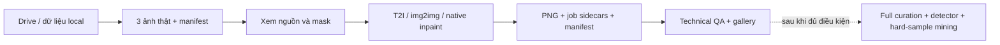

# KAGGLE SD IMAGE DEMO — T2I, IMG2IMG & INPAINTING

- **Motivation/Background**: Chạy thử Phase 1 thật trên ảnh của nhóm, loại bỏ đường sinh ảnh ngẫu nhiên và fallback mock trong baseline.
- **Purpose**: Hướng dẫn demo pretrained trên Kaggle, ghi rõ bằng chứng đã kiểm tra và phần chưa triển khai.
- **Overview Pipeline**: Drive/local sources → chọn 3 ảnh → xem mask → ba native Diffusers pipelines → PNG + manifest + technical QA + gallery.
- **Detailed Plan**: Chuẩn bị môi trường, dữ liệu, inference, kiểm tra artifacts, giới hạn và bước tiếp theo.
- **References**: [DEFINE](../PURPOSE.md), [Phase 1](../phases/PHASE_01_DIFFUSION_SYNTHESIS_SPEC.md), [notebook](../../notebooks/SD_IMAGE_DEMO_KAGGLE.ipynb), [config](../../configs/generation/kaggle_image_demo.yaml).
- **Created**: 2026-11-09T13:24:35+07:00
- **Last Updated**: 2026-11-09T13:24:35+07:00

---

## 1. Phạm vi đã chốt

Demo **ảnh**, pretrained **T2I, img2img, inpainting**, chạy GPU trên Kaggle. Không so sánh các adapter danh tính trong lần đầu này. Không train generator. Không gọi bộ phân loại chưa huấn luyện là baseline dinoViT.

Nhánh triển khai: `demo/sd-image-kaggle`, xuất phát từ image baseline `55617d5`. Các file logic nằm trong `src/`, config trong `configs/generation/`, notebook chỉ gọi modules hoặc script.



Sơ đồ vector của luồng này có trong [bản HTML](KAGGLE_SD_IMAGE_DEMO.html).

## 2. Chạy trên Kaggle

1. Tạo Kaggle Notebook Python, bật **GPU** và **Internet**.
2. Upload gói `SD_IMAGE_DEMO_KAGGLE.zip` được bàn giao thành một **Kaggle Dataset riêng tư**, rồi attach Dataset vào notebook. Gói này chỉ chứa code/config/docs/notebook, không chứa weights hay ảnh thật.
3. Import [SD_IMAGE_DEMO_KAGGLE.ipynb](../../notebooks/SD_IMAGE_DEMO_KAGGLE.ipynb).
4. Chạy phần môi trường và chuẩn bị dữ liệu. Notebook giải nén source rồi chỉ cài [requirements/notebook.txt](../../requirements/notebook.txt) vào kernel; [launcher](../../src/pipelines/sd_demo_launcher.py) cài/chạy model trong venv worker, giữ torch/torchvision CUDA. Nếu đã chạy cell cũ cài generation.txt vào kernel, lưu outputs và tạo session Kaggle mới; restart kernel không hoàn tác pip. Không còn ép protobuf xuống dưới 6.
5. Xem contact sheet nguồn/mask. Mask trắng là vùng sửa. Nếu lệch vùng miệng, sửa `mask_box_xyxy_normalized` hoặc thêm `mask_path` cho từng ảnh vào manifest trước khi inference.
6. Chạy inference, xem gallery và tải ZIP artifacts ở cell cuối. Thời gian thật và GPU peak memory được ghi sau chạy; chưa có số đo tốc độ Kaggle trong báo cáo này.

Các lệnh tương đương, chạy từ root repo:

```bash
python -m pip install -r requirements/notebook.txt
python -m src.pipelines.prepare_image_demo --config configs/generation/kaggle_image_demo.yaml
python -m src.pipelines.sd_demo_launcher --config configs/generation/kaggle_image_demo.yaml
# Runner hiện có cũng gọi đúng config demo:
bash scripts/run_pipeline.sh generate configs/generation/kaggle_image_demo.yaml
```

Config demo là YAML độc lập, không phải Hydra master `configs/config.yaml`. Các lệnh `mine`, `train`, `eval` cũ không tự được chạy bởi demo này.

## 3. Đầu vào và cấu hình

- Nguồn người dùng: [thư mục Drive raw](https://drive.google.com/drive/folders/1Uj8nGCi2qzuUwUrjAQaWHVSu7MAbdaZL). Manifest đọc được gồm **4.000 bản ghi, đều label=0**, ảnh FFHQ/CelebA-HQ. Chỉ tải manifest nhỏ và **3 ảnh FFHQ có nhóm tuổi người lớn theo metadata**.
- Ba ảnh đã tải kiểm tra đường dữ liệu: `ffhq_00002`, `ffhq_00009`, `ffhq_00017`. Đây là mẫu tiện lợi từ public listing, không đại diện toàn bộ dataset; metadata tuổi không phải kết quả xác minh tuổi.
- Không thấy checkpoint detector ở cấp root listing. Không suy luận rằng detector tồn tại hoặc tương thích khi chỉ có ảnh thật và metadata. Muốn nối Phase 2 phải có kiến trúc, preprocessing, class mapping và checkpoint bộ phân loại phù hợp.
- SD mặc định: `stable-diffusion-v1-5/stable-diffusion-v1-5` cho T2I/img2img; `stable-diffusion-v1-5/stable-diffusion-inpainting` cho inpainting. Chưa chuyển sang Realistic Vision hoặc adapter nào. Có thể đổi config sau pilot.
- Mặc định **512×512, 30 bước, CFG 7.5, strength 0.55, seed 42**, một biến thể mỗi chế độ/ảnh, dự kiến **9 output** khi tất cả job hoàn tất.
- RGB float32 `(3,H,W)` trong `[0,1]`; mask `(1,H,W)` trong `[0,1]`, `1=edit`. Inference CUDA dùng fp16, CPU dùng fp32. Checkpoint revision được resolve thành Hub SHA trước chạy và lưu trong config.
- Ảnh FFHQ đã là crop khuôn mặt. Demo EXIF-correct rồi resize; không chạy lại landmark alignment. Mask mặc định là ellipse ROI thủ công theo tọa độ tương đối, **không phải mask đã được detector xác nhận**.

Nếu Drive bị giới hạn/quota hoặc public listing không đủ ảnh: attach bản dữ liệu local vào Kaggle, giữ JSONL có `image_id`, `label=0`, `file_path`, chỉnh `data.input_manifest` và `data.root` trong YAML, rồi bỏ qua bước tải Drive. Đường dẫn có thể tương đối với root dữ liệu hoặc thư mục manifest.

## 4. Kết quả sau một lần chạy

Thư mục runtime mặc định: `experiments/runs/sd_image_demo/`, được Git bỏ qua.

- `input_preview.png`: ảnh nguồn và mask để kiểm tra trước inference.
- `generated_manifest.jsonl`: chỉ các job đã hoàn tất, có provenance, checkpoint/revision, seed, hash, nhãn, chế độ và trạng thái QA.
- `images/`: output PNG, source/mask snapshots và JSON sidecar với `running / completed / failed`.
- `resolved_config.json`, `environment.json`: cấu hình thực dùng, packages, phần cứng và revision source nếu có Git.
- `technical_qa.json`: decode, kích thước và **Laplacian variance thật trên ảnh uint8**. `manual_qa=pending`, landmarks/CLIP chưa chấm.
- `gallery.html`: bản xem ảnh tự chứa ảnh nhúng, xem được sau khi tải riêng HTML.
- `summary.json`: tổng output, thời gian toàn run và GPU peak allocated bytes; `detector_evaluated=false`, `full_curation_evaluated=false`.

Summary tách `newly_generated` và `resumed`; wall time của lần resume không phải tốc độ inference.

Resume kiểm tra job hash và SHA256 output trước khi bỏ qua job. Đổi nguồn, mask, seed/config hoặc revision tạo job khác. Run chưa hoàn tất giữ artifacts trước lỗi và ném lỗi ra ngoài. Không chạy đồng thời hai tiến trình ghi chung run directory.

`source_real_id=null` cho T2I vì ảnh gốc **không phải điều kiện danh tính**. `anchor_source_id` chỉ phục vụ bố trí pilot. Mọi sample là `demo_only`; chưa phải split train/validation/test, chưa bảo đảm identity-disjoint để nghiên cứu detector.

## 5. Sửa gì và kiểm chứng đến đâu

- Img2img gọi `StableDiffusionImg2ImgPipeline`, không pha ảnh nguồn với ảnh T2I độc lập.
- Inpainting gọi `StableDiffusionInpaintPipeline`, đưa ảnh và mask vào denoising; composite cuối chỉ để giữ nguyên vùng ngoài mask. Không gọi thao tác ghép T2I là inpainting.
- Model được load lazily theo mode batch, chỉ một pipeline resident, giải phóng khi đổi mode. First-job timing bao gồm load; chưa phải latency steady-state.
- Model lỗi tải hoặc inference sẽ fail rõ. Mock chỉ dùng nếu gọi trực tiếp bằng `model_name="mock_sd"`, bị cấm trong runner demo thật. Safety checker của model đầy đủ được giữ nguyên; sample bị reject không ghi ảnh đen thành dữ liệu hợp lệ.
- Dữ liệu Drive: đã download/verify ba ảnh và manifest. Không commit ảnh hoặc weights vào Git.
- Unit/regression: kiểm tra real routing, source thật, settings, mask, không fallback, safety rejection, provenance và hash resume.
- Integration CPU: đã chạy ba native pipelines với fixture công khai `hf-internal-testing/tiny-stable-diffusion-torch`, output `(3,64,64)`. **Model tiny kiểm tra wiring, không kiểm chứng chất lượng khuôn mặt, safety hoặc hiệu năng của checkpoint đầy đủ.** Fixture này không có safety checker trong cấu hình gốc. Một fixture tiny khác có mismatch kích thước safety encoder, nên không dùng để suy diễn chất lượng SD.
- **Chưa chạy Kaggle GPU / SD checkpoint đầy đủ trong phiên này.** Cần chạy notebook, kiểm tra ảnh và lưu artifacts trước khi công bố demo GPU thành công.

## 6. Phần tiếp theo của flow chưa thuộc demo này

Full curation cần detector mặt/landmarks và CLIP thật đã hiệu chỉnh ngưỡng. Code curation cũ còn proxy CLIP và pass-through manifest, vì vậy demo không gọi nó rồi tuyên bố đã qua cổng lọc ba tầng.

Phase 2 cần checkpoint detector đã học thật/giả và đúng preprocessing. Một backbone pretrained DINO không tự là detector deepfake. Lớp `DinoViTBackbone` hiện tại của baseline cũng không tự tải weights DINO chính thức.

Phase 3 chỉ dùng dữ liệu train để fine-tune. Mẫu dùng huấn luyện không được dùng lại làm bằng chứng cải thiện trên test. Khai phá khó, chọn ngưỡng và chấm cuối cần tách tập theo nhóm danh tính/nguồn; không đếm lại mẫu khó như một bản ghi mới nếu đã nằm trong synthetic manifest.

## References & Technical Documentation

### Official API Docs

- [Diffusers 0.35.1 img2img](https://huggingface.co/docs/diffusers/v0.35.1/en/api/pipelines/stable_diffusion/img2img).
- [Diffusers 0.35.1 inpainting](https://huggingface.co/docs/diffusers/v0.35.1/en/api/pipelines/stable_diffusion/inpaint).
- [SD 1.5](https://huggingface.co/stable-diffusion-v1-5/stable-diffusion-v1-5), [inpainting checkpoint](https://huggingface.co/stable-diffusion-v1-5/stable-diffusion-inpainting).

### Technical Standards

- [JSON Lines](https://jsonlines.org/): manifest UTF-8.
- [Pillow ImageOps](https://pillow.readthedocs.io/en/stable/reference/ImageOps.html): EXIF orientation/RGB.

### CV Conventions

- RGB CHW float32, mask trắng là vùng sửa; pilot mask không phải segmentation/landmarks.
- [FFHQ dataset](https://github.com/NVlabs/ffhq-dataset): kiểm tra quyền dùng dữ liệu và từng nguồn ảnh; không suy rộng quyền thương mại từ link tải công khai.

### Internal Architecture Links

- [Engine](../../src/models/diffusion/stable_diffusion_engine.py), [generation](../../src/pipelines/generate_deepfake_images.py), [Drive prep](../../src/pipelines/prepare_image_demo.py), [demo runner](../../src/pipelines/sd_image_demo.py).
- [Input I/O](../../src/data/sd_demo_data.py), [regression tests](../../tests/test_sd_image_demo.py), [project scope](../PURPOSE.md).

## Verification record

- `python -m pytest tests -m smoke -q`: 10 smoke tests passed.
- `python -m pytest tests -q`: 51 tests passed.
- Ruff on modified Python modules/tests: passed.
- Isolated generation environment: `pip check` reported no broken requirements.
- CPU end-to-end integration with the tiny fixture: 3 real Drive sources, 9 outputs, `mock_outputs=0`. This does not validate full SD image quality or Kaggle GPU performance.
- Gallery: all embedded images decoded in headless Edge. Report: inline SVG and mobile width checked.
