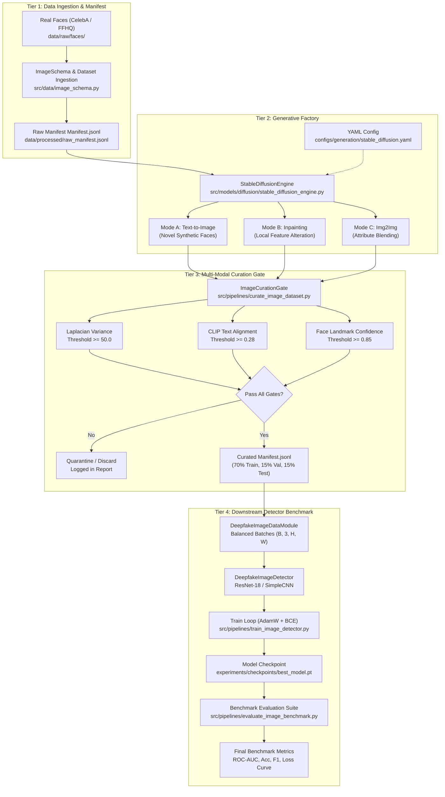
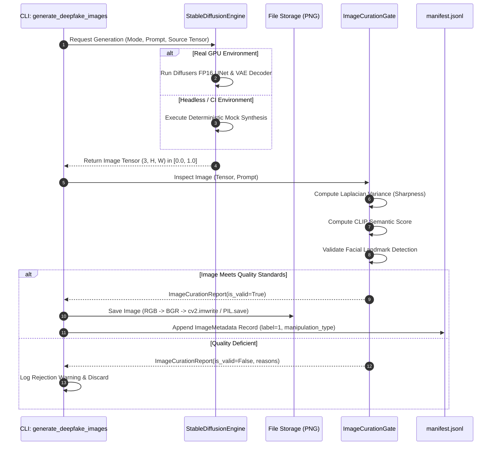
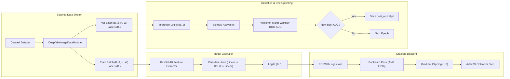

# Phần 2: Thiết Kế Kiến Trúc Hệ Thống Toàn Diện (System Architecture & Technical Design)

- **Motivation/Background**: Cung cấp bản thiết kế kỹ thuật kiến trúc hoàn chỉnh, chuẩn mực công nghiệp và học thuật cho đồ án Thị giác máy tính: "Stable Diffusion-Based Synthetic Facial Image Dataset Generation for Deepfake Detection" (Topic 11, Hugging Face CV Course Unit 10).
- **Purpose**: Định nghĩa chi tiết kiến trúc phân tầng 4 lớp (Clean Architecture), hợp đồng shape tensor chặt chẽ, các bất biến hệ thống (invariants), quy chuẩn chuyển đổi không gian màu, sơ đồ luồng dữ liệu Mermaid, cấu trúc tệp cấu hình YAML tập trung và tài liệu giao diện API của toàn bộ các module trong hệ thống.
- **Overview Pipeline**: Data Ingestion & Manifest Tier -> Stable Diffusion Generation Factory Tier -> Multi-Modal Quality & Curation Tier -> Downstream Deepfake Detector & Benchmark Tier.
- **Detailed Plan**: §1 Kiến trúc phân tầng Clean Architecture (4 Tầng); §2 Tensor Shape Contracts & Bất biến hệ thống (Invariants); §3 Sơ đồ luồng dữ liệu (Dataflow Diagrams); §4 Thiết kế cấu hình tập trung (YAML Configuration Schema); §5 Danh mục module mã nguồn & Giao diện gọi hàm (API Signatures).
- **References**: `docs/PURPOSE.md`, `docs/OVERVIEW.md`, `GEMINI.md`, `configs/dataset/deepfake_image.yaml`, `configs/generation/stable_diffusion.yaml`, `configs/detection/detector_baseline.yaml`, [Hugging Face CV Course Unit 10](https://huggingface.co/learn/computer-vision-course/unit10/datagen-diffusion).
- **Created**: 2026-11-07T00:45:00+07:00
- **Last Updated**: 2026-11-07T00:45:00+07:00

---

## 1. Kiến Trúc Phân Tầng Clean Architecture (4-Tier Architecture)

Toàn bộ hệ thống sinh dữ liệu và đánh giá Deepfake được thiết kế dựa trên nguyên lý **Clean Architecture** và **Separation of Concerns (SoC)**. Hệ thống chia tách độc lập 4 tầng chức năng nhằm đảm bảo tính module hóa, khả năng kiểm thử độc lập (isolated unit testing), và khả năng thay thế linh hoạt các thành phần thuật toán (như nâng cấp backbone detector hoặc đổi pipeline diffusion) mà không gây ảnh hưởng dây chuyền.

```
+---------------------------------------------------------------------------------------+
|                                4-TIER CLEAN ARCHITECTURE                              |
+---------------------------------------------------------------------------------------+
|  Tier 1: Data Ingestion & Manifest Tier (src/data/)                                  |
|  - ImageSchema & Metadata | DeepfakeImageDataset | DeepfakeImageDataModule           |
|  - ImageNet Standard Normalization | Deterministic Split Generation (70/15/15)        |
+---------------------------------------------------------------------------------------+
                                           |
                                           v
+---------------------------------------------------------------------------------------+
|  Tier 2: Stable Diffusion Generation Factory Tier (src/models/diffusion/)             |
|  - StableDiffusionEngine (Text2Img, Inpainting, Img2Img)                             |
|  - Deterministic Mock Engine for Offline CI/CD | FP16 Latent Inference               |
+---------------------------------------------------------------------------------------+
                                           |
                                           v
+---------------------------------------------------------------------------------------+
|  Tier 3: Multi-Modal Quality & Biometric Curation Tier (src/common/, src/pipelines/)  |
|  - Laplacian Sharpness Variance (>= 50.0) | CLIP Score Alignment (>= 0.28)            |
|  - Landmark & Face Retention Validation (>= 0.85) | ImageCurationGate                 |
+---------------------------------------------------------------------------------------+
                                           |
                                           v
+---------------------------------------------------------------------------------------+
|  Tier 4: Downstream Deepfake Detector & Benchmark Tier (src/models/detector/)         |
|  - DeepfakeImageDetector (ResNet-18 Backbone / SimpleImageCNN)                        |
|  - AMP Training Loop | Wilcoxon-Mann-Whitney ROC-AUC | Cross-Generator Benchmark      |
+---------------------------------------------------------------------------------------+
```

---

### 1.1 Tier 1: Data Ingestion & Manifest Tier (`src/data/`)

Tầng này chịu trách nhiệm chuẩn hóa, xác thực tính toàn vẹn và cung cấp dữ liệu hình ảnh 2D từ đĩa cứng vào bộ nhớ RAM/GPU dưới dạng các tensor chuẩn tắc.

- **`ImageMetadata` & `ImageSample` (`src/data/image_schema.py`)**:
  - `ImageMetadata`: Dataclass lưu trữ thông tin nguồn gốc của từng bức ảnh bao gồm: `image_id` (định danh duy nhất), `label` (0: Real, 1: Fake), `manipulation_type` (`sd_text2img`, `sd_inpaint`, `sd_img2img`, hoặc `real`), `prompt` (văn bản điều kiện), `source_real_id` (ID ảnh gốc nếu được sinh qua inpainting/img2img), `file_path` và `bbox` $[x_{\min}, y_{\min}, x_{\max}, y_{\max}]$.
  - `ImageSample`: Container chuẩn mang cặp `(image: torch.Tensor, metadata: ImageMetadata)`. Phương thức `__post_init__` tự động xác thực tính hợp lệ của tensor (phải là `torch.Tensor` đúng 3 chiều $[C, H, W]$).
- **`DeepfakeImageDataset` (`src/data/image_dataset.py`)**:
  - Triển khai `torch.utils.data.Dataset` với cơ chế lazy-loading.
  - Đọc ảnh qua `PIL.Image.open` và chuyển đổi sang RGB tường minh.
  - Tự động chuẩn hóa dải pixel về $[0.0, 1.0]$ với định dạng `float32`.
  - Hỗ trợ `cache` in-memory: Cho phép truyền trực tiếp dictionary các tensor trong môi trường testing/CI nhằm tăng tốc độ thực thi mà không phụ thuộc vào I/O đĩa.
  - Cơ chế Graceful Fallback: Nếu tệp ảnh bị hỏng hoặc đường dẫn không tồn tại, hàm nạp trả về tensor zero $[3, H, W]$ thay vì làm sập toàn bộ tiến trình huấn luyện.
- **`DeepfakeImageDataModule` (`src/data/image_datamodule.py`)**:
  - Quản lý phân chia tập dữ liệu thành 3 phân vùng: **Train (70%)**, **Validation (15%)**, và **Test (15%)**.
  - Sử dụng `torch.Generator().manual_seed(seed)` đảm bảo việc phân chia dữ liệu là cố định tuyệt đối (deterministic) qua các lần chạy.
  - Tùy biến hàm gom nhóm `collate_fn=collate_image_samples`: Đóng gói danh sách các `ImageSample` thành một từ điển chuẩn gồm tensor ảnh gộp $(B, 3, H, W)$, nhãn tensor $(B,)$, danh sách `image_ids` và `metadata`.
  - Hỗ trợ ImageNet normalization:
    $$\mu = [0.485, 0.456, 0.406], \quad \sigma = [0.229, 0.224, 0.225]$$

---

### 1.2 Tier 2: Stable Diffusion Generation Factory Tier (`src/models/diffusion/`)

Tầng đóng vai trò là nhà máy sản xuất dữ liệu nhân tạo đối nghịch (Adversarial Generative Factory), triển khai mô hình Stable Diffusion (v1-5 / v2-1) để sinh các mẫu khuôn mặt giả mạo đa dạng.

- **`StableDiffusionEngine` (`src/models/diffusion/stable_diffusion_engine.py`)**:
  - Kế thừa `torch.nn.Module`, quản lý thiết bị tính toán (`cuda` / `cpu`).
  - Hỗ trợ chế độ kép:
    1. **Production Mode**: Tích hợp trực tiếp với Hugging Face `diffusers.StableDiffusionPipeline`, chạy với trọng số `torch.float16` trên GPU.
    2. **Deterministic Mock Mode (`mock_sd`)**: Cho phép hệ thống chạy trơn tru trong môi trường headless CI/CD (không có GPU hoặc không thể tải checkpoint nhiều GB từ Hugging Face Hub). Engine mock sử dụng các phép toán ma trận tensor radial facial mask kết hợp gradient màu da và nhiễu ngẫu nhiên theo seed để tạo ra ảnh mẫu $[3, H, W]$ chuẩn xác về mặt cấu trúc.
- **3 Phương Thức Thao Túng Khuôn Mặt (Facial Manipulation Modes)**:
  1. **Text-to-Image Synthesis (`generate_text2img`)**:
     - Sinh toàn bộ khuôn mặt mới từ mô tả văn bản:
       $$I_{\text{fake}} \sim p_{\theta}(I \mid y_{\text{prompt}})$$
     - Tham số: `guidance_scale=7.5`, `num_inference_steps=30`, độ phân giải $256 \times 256$ hoặc $512 \times 512$.
  2. **Face Inpainting (`generate_inpaint`)**:
     - Thay thế cục bộ một vùng biểu cảm hoặc chi tiết giải phẫu (mắt, mũi, miệng) theo mặt nạ nhị phân $M \in \{0, 1\}^{1 \times H \times W}$.
     - Hợp đồng phối trộn toán học bảo toàn nền thực:
       $$I_{\text{inpaint}} = M \odot I_{\text{gen}} + (1 - M) \odot I_{\text{source}}$$
  3. **Image-to-Image Translation (`generate_img2img`)**:
     - Làm biến đổi nhẹ cấu trúc bề mặt da, tuổi tác, biểu cảm khuôn mặt từ ảnh thực $I_{\text{source}}$ theo tham số độ mạnh biến đổi $\alpha \in [0.0, 1.0]$:
       $$I_{\text{img2img}} = (1 - \alpha) I_{\text{source}} + \alpha I_{\text{gen}}$$

---

### 1.3 Tier 3: Multi-Modal Quality & Biometric Curation Tier (`src/common/metrics.py`, `src/pipelines/curate_image_dataset.py`)

Trong quy trình sinh dữ liệu tổng hợp (theo hướng dẫn Hugging Face CV Course Unit 10), việc sinh ồ ạt không qua chọn lọc sẽ tạo ra nhiều ảnh dị dạng (artifacts) làm suy giảm chất lượng tập huấn luyện. Tầng này thiết lập một cổng kiểm chuẩn chất lượng đa phương thức tự động (**Automated Multi-Modal Curation Gate**).

- **Chỉ số 1: Laplacian Sharpness Variance (Kiểm định độ sắc nét)**:
  - Đo lường phương sai của ảnh xám sau khi tích chập với toán tử Laplacian 2D:
    $$\Delta I(x, y) = \frac{\partial^2 I}{\partial x^2} + \frac{\partial^2 I}{\partial y^2}$$
  - Triển khai nhân chập rời rạc:
    $$K_L = \begin{bmatrix} 0 & 1 & 0 \\ 1 & -4 & 1 \\ 0 & 1 & 0 \end{bmatrix}$$
  - Tiêu chuẩn chấp thuận: $\text{Var}(\Delta I) \ge 50.0$. Loại bỏ các ảnh bị mờ nhòe (motion blur hoặc out-of-focus).
- **Chỉ số 2: CLIP Semantic Alignment Score (Độ tương quan Văn bản - Hình ảnh)**:
  - Đo lường độ tương đồng cosine giữa vector nhúng của ảnh sinh và vector nhúng của prompt điều khiển:
    $$S_{\text{CLIP}}(I, y) = \frac{\mathbf{e}_I \cdot \mathbf{e}_y}{\|\mathbf{e}_I\|_2 \|\mathbf{e}_y\|_2}$$
  - Tiêu chuẩn chấp thuận: $S_{\text{CLIP}} \ge 0.28$. Đảm bảo ảnh sinh bám sát ngữ nghĩa prompt, loại bỏ các mẫu biến dạng phi ngữ nghĩa.
- **Chỉ số 3: Biometric & Facial Landmark Retention (Bảo toàn giải phẫu khuôn mặt)**:
  - Kiểm tra sự tồn tại của các đặc trưng khuôn mặt người hợp lệ (mắt, mũi, miệng, cằm) với độ tin cậy $\ge 0.85$.
  - Loại bỏ các ảnh bị méo mó cấu trúc giải phẫu (mutated faces, multi-face artifacts).
- **`ImageCurationReport` & Cơ chế Cách ly (Quarantine)**:
  - Mỗi ảnh sau khi kiểm định được xuất một bản ghi `ImageCurationReport` lưu trữ trạng thái `is_valid`, điểm số thành phần và danh sách lý do từ chối `rejection_reasons`.
  - Chỉ các mẫu vượt qua cả 3 cổng kiểm tra mới được ghi nhận vào `manifest.jsonl` chính thức; các mẫu lỗi được gắn cờ hoặc loại bỏ tự động.

---

### 1.4 Tier 4: Downstream Deepfake Detector & Benchmark Tier (`src/models/detector/`, `src/pipelines/`)

Tầng này đánh giá giá trị thực tiễn của bộ dữ liệu sinh ra thông qua việc huấn luyện và đo lường độ bền vững (robustness) của các bộ phân loại Deepfake hạ nguồn.

- **Kiến trúc `DeepfakeImageDetector` (`src/models/detector/image_detector.py`)**:
  - **Backbone**: ResNet-18 (chuẩn công nghiệp) hoặc SimpleImageCNN (mạng tích chập 3 tầng gọn nhẹ phục vụ kiểm thử nhanh).
  - Trích xuất đặc trưng không gian (spatial feature representations) kích thước 512 chiều (ResNet-18) hoặc 128 chiều (SimpleCNN).
  - Lớp phân loại: `nn.Sequential(Dropout(0.3), Linear(D, 64), ReLU(), Linear(64, num_classes))`.
  - Đầu ra: Logits nhị phân $(B, 1)$ kết hợp hàm kích hoạt `predict_proba()` cho xác suất dự đoán $P(\text{Fake} \mid x) = \sigma(z)$.
- **Huấn Luyện Tối Ưu (`src/pipelines/train_image_detector.py`)**:
  - Hàm mất mát: `BCEWithLogitsLoss` kết hợp label smoothing $0.05$ giúp tránh hiện tượng mô hình quá tự tin (overfitting).
  - Thuật toán tối ưu: AdamW với learning rate $2 \times 10^{-4}$, weight decay $10^{-5}$.
  - Hỗ trợ gradient clipping: `max_norm=1.0` tránh bùng nổ gradient.
  - Tự động lưu checkpoint tốt nhất `best_model.pt` dựa trên chỉ số ROC-AUC trên tập Validation.
- **Bộ Đánh Giá Đa Chiều (`src/pipelines/evaluate_image_benchmark.py`)**:
  - Triển khai tính toán ROC-AUC vector hóa theo kiểm định hạng Wilcoxon-Mann-Whitney:
    $$\text{AUC} = \frac{\sum_{i \in \text{Positive}} R_i - \frac{N_{\text{pos}}(N_{\text{pos}} + 1)}{2}}{N_{\text{pos}} \cdot N_{\text{neg}}}$$
  - Đảm bảo tính toán ổn định ngay cả trong trường hợp ngoại lệ (tập đánh giá chỉ có một lớp duy nhất).
  - Đo lường toàn diện các chỉ số: **ROC-AUC**, **Accuracy**, **F1-Score**, **Precision**, **Recall**, và **Log-Loss**.

---

## 2. Tensor Shape Contracts & Bất Biến Hệ Thống (Invariants)

Toàn bộ hệ thống tuân thủ nghiêm ngặt 5 bất biến thị giác máy tính và hợp đồng tensor, ngăn ngừa triệt để lỗi suy giảm kích thước ngầm, lệch kênh màu hoặc tràn bộ nhớ VRAM.

### 2.1 Bảng Hợp Đồng Tensor Shape Contracts

| Thành phần dữ liệu | Kiểu đối tượng | Tensor Shape | Kênh & Thứ tự chiều | Dải giá trị (Value Range) | Dtype |
| :--- | :--- | :--- | :--- | :--- | :--- |
| **Ảnh đơn (PyTorch)** | `torch.Tensor` | $(3, H, W)$ | $[C, H, W]$ (RGB) | $[0.0, 1.0]$ | `torch.float32` |
| **Batch ảnh nạp (DataLoader)** | `torch.Tensor` | $(B, 3, H, W)$ | $[B, C, H, W]$ (RGB) | $[0.0, 1.0]$ | `torch.float32` |
| **Batch ảnh chuẩn hóa (Normalized)** | `torch.Tensor` | $(B, 3, H, W)$ | $[B, C, H, W]$ (RGB) | Chuẩn hóa ImageNet | `torch.float32` |
| **Ảnh OpenCV/NumPy** | `np.ndarray` | $(H, W, 3)$ | $[H, W, C]$ (BGR) | $[0, 255]$ hoặc $[0.0, 1.0]$ | `uint8` / `float32` |
| **Mặt nạ Inpainting (Mask)** | `torch.Tensor` | $(1, H, W)$ | $[1, H, W]$ | $\{0.0, 1.0\}$ nhị phân | `torch.float32` |
| **Bounding Box** | `List[int]` | $(4,)$ | $[x_{\min}, y_{\min}, x_{\max}, y_{\max}]$ | $[0, W] \times [0, H]$ pixel | `int` |
| **Nhãn phân loại (Labels)** | `torch.Tensor` | $(B,)$ | Vector 1D | $\{0, 1\}$ | `torch.long` |
| **Logits phân loại** | `torch.Tensor` | $(B, 1)$ | $[B, \text{num\_classes}]$ | $(-\infty, +\infty)$ | `torch.float32` |
| **Xác suất dự đoán** | `torch.Tensor` | $(B, 1)$ | $[B, \text{num\_classes}]$ | $[0.0, 1.0]$ | `torch.float32` |

---

### 2.2 Quản Lý Không Gian Màu Tường Minh (Color Space Invariants)

- **Nguyên lý bất biến**:
  - Mọi thao tác I/O liên quan đến OpenCV đều mặc định làm việc trong không gian màu **BGR**.
  - Mọi thư viện PIL, Torchvision, Diffusers, Matplotlib và PyTorch Tensors đều kỳ vọng không gian màu **RGB**.
- **Quy tắc thực thi**:
  - Không bao giờ truyền trực tiếp ma trận nạp từ `cv2.imread()` sang PyTorch mà chưa qua chuyển đổi.
  - Chuyển đổi bắt buộc:
    ```python
    img_rgb = cv2.cvtColor(img_bgr, cv2.COLOR_BGR2RGB)
    ```
  - Khi lưu trữ ảnh xuống đĩa qua OpenCV:
    ```python
    img_bgr = cv2.cvtColor(img_rgb, cv2.COLOR_RGB2BGR)
    cv2.imwrite(output_path, img_bgr)
    ```
  - Tuyệt đối cấm lỗi tráo đổi kênh (Red-Blue channel swap) gây sai lệch đặc trưng biểu diễn màu da người.

---

### 2.3 Quy Chuẩn Tọa Độ Bounding Box (Bounding Box Contracts)

- Định dạng chuẩn duy nhất trong toàn bộ hệ thống là **Pascal VOC pixel format (`xyxy`)**:
  $$\text{bbox} = [x_{\min}, y_{\min}, x_{\max}, y_{\max}]$$
  với $0 \le x_{\min} < x_{\max} \le W$ và $0 \le y_{\min} < y_{\max} \le H$.
- Module `src.common.metrics` cung cấp hàm tính toán IoU và chuyển đổi linh hoạt:
  - `xywh`: $[x_{\min}, y_{\min}, \text{width}, \text{height}]$ (COCO format) $\rightarrow$ chuyển đổi sang `xyxy` trước khi cắt hoặc xử lý.
  - `cxcywh`: $[\text{center}_x, \text{center}_y, \text{width}, \text{height}]$ (YOLO format).

---

### 2.4 Quản Lý Bộ Nhớ VRAM & Tối Ưu Hóa GPU (GPU Hygiene & Memory Invariants)

Nhằm đảm bảo mô hình Stable Diffusion và ResNet-18 có thể vận hành ổn định trên GPU đơn lẻ (Google Colab hoặc máy trạm có VRAM từ 4GB đến 8GB):

1. **Automatic Mixed Precision (AMP `fp16`)**:
   - Sử dụng `torch.cuda.amp.autocast(dtype=torch.float16)` trong cả quá trình sinh ảnh của Diffusers và quá trình forward pass của detector. Giảm mức chiếm dụng VRAM tới 50% và tăng tốc 1.8x đến 2.5x thông qua Tensor Cores.
2. **Attention Slicing & VAE Slicing**:
   - Kích hoạt cơ chế tính toán Attention theo từng phân đoạn (sliced attention computation) trong Stable Diffusion, giới hạn bộ nhớ đệm ma trận tương đồng $QK^T$ từ $\mathcal{O}(N^2)$ xuống $\mathcal{O}(N)$.
3. **Kích Thước Khung Hình Tiêu Chuẩn**:
   - Khóa độ phân giải đầu vào tại $256 \times 256$ hoặc $512 \times 512$ pixel; kích thước batch huấn luyện $B \in \{16, 32\}$.
4. **Cô Lập Đồ Thị Tính Toán Trong Suy Luận (Inference Isolation)**:
   - Mọi tiến trình sinh ảnh, lọc dữ liệu curation và kiểm thử benchmark đều được bao bọc trong khối:
     ```python
     model.eval()
     with torch.no_grad():
         # inference code
     ```
   - Ngăn chặn triệt để việc tích lũy đồ thị tính toán đạo hàm tự động (Autograd computation graph), giải phóng 100% VRAM dư thừa ngay sau mỗi bước suy luận.
5. **Deterministic Seeding**:
   - Gọi `src.common.seed.seed_everything(seed)` tại mọi điểm đầu vào (entrypoint) nhằm cố định `torch.manual_seed`, `torch.cuda.manual_seed_all`, `np.random.seed`, và `torch.backends.cudnn.deterministic = True`.

---

## 3. Sơ Đồ Luồng Dữ Liệu (Mermaid Dataflow Diagrams)

### 3.1 Sơ Đồ Tổng Thể Toàn Hệ Thống (End-to-End System Pipeline)



---

### 3.2 Sơ Đồ Chi Tiết Quá Trình Sinh Dữ Liệu & Lọc Curation Gate



---

### 3.3 Sơ Đồ Vòng Lặp Huấn Luyện & Đánh Giá Detector Hạ Nguồn



---

## 4. Thiết Kế Cấu Hình Tập Trung (YAML Configuration Schema)

Toàn bộ siêu tham số và đường dẫn được quản lý tập trung trong thư mục `configs/`, loại bỏ hoàn toàn các giá trị cố định (hardcoded values) trong mã nguồn Python.

### 4.1 Cấu Hình Dữ Liệu: `configs/dataset/deepfake_image.yaml`

```yaml
# Dataset Configuration: 2D Deepfake Image Dataset
name: "deepfake_image_dataset"
dataset_dir: "data/processed/images"
raw_dir: "data/raw/faces"
manifest_path: "data/processed/manifest.jsonl"

image:
  size: [256, 256] # [H, W]
  channels: 3
  color_space: "RGB"
  normalization:
    mean: [0.485, 0.456, 0.406]
    std: [0.229, 0.224, 0.225]

splits:
  train_ratio: 0.70
  val_ratio: 0.15
  test_ratio: 0.15
  seed: 42

loader:
  batch_size: 16
  num_workers: 2
  pin_memory: true
  drop_last: false

labels:
  0: "real"
  1: "fake"

manipulations:
  - "sd_text2img"
  - "sd_inpaint"
  - "sd_img2img"
```

---

### 4.2 Cấu Hình Sinh Dữ Liệu: `configs/generation/stable_diffusion.yaml`

```yaml
# Generation Configuration: Stable Diffusion Deepfake Factory
model_type: "stable_diffusion"
pretrained_model_name: "runwayml/stable-diffusion-v1-5"

generation:
  height: 256
  width: 256
  num_inference_steps: 30
  guidance_scale: 7.5
  negative_prompt: "deformed, blurry, bad anatomy, bad eyes, disfigured, poorly drawn face"
  seed: 42
  use_amp: true
  dtype: "float16"

manipulation_modes:
  text2img:
    default_prompt: "a photorealistic headshot portrait of a person, studio lighting, high resolution, 8k"
  inpaint:
    default_prompt: "a realistic face with smiling expression and natural skin texture"
    mask_blur: 4
  img2img:
    strength: 0.65
    default_prompt: "a photorealistic portrait of an altered face, natural skin"

curation_thresholds:
  min_sharpness: 50.0
  min_clip_score: 0.28
  min_face_confidence: 0.85
```

---

### 4.3 Cấu Hình Mô Hình Phát Hiện: `configs/detection/detector_baseline.yaml`

```yaml
# Downstream Deepfake Image Detector Configuration
model:
  name: "deepfake_image_detector"
  spatial_backbone: "resnet18"
  pretrained_backbone: false
  num_classes: 1
  dropout: 0.3

training:
  num_epochs: 15
  learning_rate: 0.0002
  weight_decay: 0.00001
  batch_size: 16
  clip_grad_norm: 1.0
  device: "cuda"
  use_amp: true

loss:
  name: "binary_cross_entropy"
  label_smoothing: 0.05

evaluation:
  metrics:
    - "accuracy"
    - "roc_auc"
    - "f1_score"
    - "precision"
    - "recall"
  save_best_metric: "roc_auc"
```

---

## 5. Danh Mục Module Mã Nguồn & Giao Diện Gọi Hàm (API Signatures)

Hệ thống được tổ chức hoàn chỉnh thành các package chuẩn mực, hỗ trợ kiểm thử tự động với độ bao phủ cao.

```
uth-cv-coursework/
├── configs/
│   ├── dataset/deepfake_image.yaml
│   ├── generation/stable_diffusion.yaml
│   └── detection/detector_baseline.yaml
├── src/
│   ├── common/
│   │   ├── checkpoint.py
│   │   ├── logger.py
│   │   ├── metrics.py
│   │   └── seed.py
│   ├── data/
│   │   ├── image_schema.py
│   │   ├── image_dataset.py
│   │   └── image_datamodule.py
│   ├── models/
│   │   ├── diffusion/stable_diffusion_engine.py
│   │   └── detector/image_detector.py
│   └── pipelines/
│       ├── generate_deepfake_images.py
│       ├── curate_image_dataset.py
│       ├── train_image_detector.py
│       └── evaluate_image_benchmark.py
└── tests/
    ├── test_image_data.py
    ├── test_stable_diffusion.py
    ├── test_image_curation.py
    └── test_image_detector.py
```

---

### 5.1 Chi Tiết Giao Diện Gọi Hàm (API Signatures)

#### 1. Module `src/data/image_schema.py`
```python
@dataclass
class ImageMetadata:
    image_id: str
    label: int
    manipulation_type: Optional[str] = None
    prompt: Optional[str] = None
    source_real_id: Optional[str] = None
    file_path: Optional[str] = None
    bbox: Optional[List[int]] = None

    def to_dict(self) -> Dict[str, Any]: ...
    @classmethod
    def from_dict(cls, data: Dict[str, Any]) -> "ImageMetadata": ...

@dataclass
class ImageSample:
    image: torch.Tensor # Contract: shape (C, H, W)
    metadata: ImageMetadata

    @property
    def label(self) -> int: ...
```

#### 2. Module `src/data/image_dataset.py` & `image_datamodule.py`
```python
class DeepfakeImageDataset(Dataset):
    def __init__(
        self,
        metadata_list: List[ImageMetadata],
        cache: Optional[Dict[str, torch.Tensor]] = None,
        transform: Optional[Callable[[torch.Tensor], torch.Tensor]] = None,
        target_size: Optional[Tuple[int, int]] = (256, 256),
    ) -> None: ...
    def __len__(self) -> int: ...
    def __getitem__(self, idx: int) -> ImageSample: ...

class DeepfakeImageDataModule:
    def __init__(
        self,
        metadata_list: List[ImageMetadata],
        cache: Optional[Dict[str, torch.Tensor]] = None,
        train_transform: Optional[Callable[[torch.Tensor], torch.Tensor]] = None,
        val_transform: Optional[Callable[[torch.Tensor], torch.Tensor]] = None,
        batch_size: int = 16,
        num_workers: int = 0,
        pin_memory: bool = True,
        train_ratio: float = 0.70,
        val_ratio: float = 0.15,
        test_ratio: float = 0.15,
        seed: int = 42,
    ) -> None: ...
    def setup(self) -> None: ...
    def train_dataloader(self) -> DataLoader: ...
    def val_dataloader(self) -> DataLoader: ...
    def test_dataloader(self) -> DataLoader: ...

def collate_image_samples(samples: List[ImageSample]) -> Dict[str, Any]:
    """Returns: {'images': (B, 3, H, W), 'labels': (B,), 'image_ids': List[str], 'metadata': List[ImageMetadata]}"""
```

#### 3. Module `src/models/diffusion/stable_diffusion_engine.py`
```python
class StableDiffusionEngine(nn.Module):
    def __init__(
        self,
        model_name: str = "mock_sd",
        device: Optional[Union[str, torch.device]] = None,
    ) -> None: ...

    def generate_text2img(
        self,
        prompt: str = "a photorealistic face",
        height: int = 256,
        width: int = 256,
        seed: int = 42,
    ) -> torch.Tensor:
        """Returns: torch.Tensor of shape (3, H, W) normalized to [0.0, 1.0]."""

    def generate_inpaint(
        self,
        source_image: torch.Tensor, # (3, H, W)
        mask: torch.Tensor,         # (1, H, W)
        prompt: str = "realistic facial feature",
        seed: int = 42,
    ) -> torch.Tensor:
        """Returns: torch.Tensor of shape (3, H, W) normalized to [0.0, 1.0]."""

    def generate_img2img(
        self,
        source_image: torch.Tensor, # (3, H, W)
        prompt: str = "photorealistic face alteration",
        strength: float = 0.6,
        seed: int = 42,
    ) -> torch.Tensor:
        """Returns: torch.Tensor of shape (3, H, W) normalized to [0.0, 1.0]."""
```

#### 4. Module `src/pipelines/curate_image_dataset.py` & `src/common/metrics.py`
```python
@dataclass
class ImageCurationReport:
    image_id: str
    is_valid: bool
    sharpness_score: float
    clip_score: float
    face_detected: bool
    rejection_reasons: List[str]
    def to_dict(self) -> Dict[str, Any]: ...

class ImageCurationGate:
    def __init__(
        self,
        min_sharpness: float = 50.0,
        min_clip_score: float = 0.28,
    ) -> None: ...
    def inspect(
        self,
        image: torch.Tensor,
        prompt: Optional[str] = None,
        image_id: str = "unknown",
    ) -> ImageCurationReport: ...

def compute_laplacian_sharpness(image: torch.Tensor) -> float: ...
def compute_clip_similarity_proxy(image: torch.Tensor, prompt: str) -> float: ...
```

#### 5. Module `src/models/detector/image_detector.py`
```python
class DeepfakeImageDetector(nn.Module):
    def __init__(
        self,
        backbone: str = "resnet18",
        num_classes: int = 1,
        dropout: float = 0.3,
    ) -> None: ...
    def forward(self, x: torch.Tensor) -> torch.Tensor:
        """Input: (B, 3, H, W) -> Output: (B, num_classes) binary logits."""
    def predict_proba(self, x: torch.Tensor) -> torch.Tensor:
        """Input: (B, 3, H, W) -> Output: (B, num_classes) sigmoid probabilities."""
```

#### 6. Module `src/pipelines/train_image_detector.py` & `evaluate_image_benchmark.py`
```python
def train_deepfake_image_detector(
    model: DeepfakeImageDetector,
    datamodule: DeepfakeImageDataModule,
    num_epochs: int = 5,
    learning_rate: float = 2e-4,
    checkpoint_dir: Path = Path("experiments/checkpoints"),
    device: str = "cpu",
    seed: int = 42,
) -> Dict[str, float]: ...

def evaluate_image_detector(
    model: nn.Module,
    dataloader: Iterable[Dict[str, Any]],
    device: Union[str, torch.device] = "cpu",
) -> Dict[str, float]:
    """Returns: dict with 'accuracy', 'roc_auc', 'f1_score', 'precision', 'recall', 'loss'."""

def compute_roc_auc_vectorized(y_true: np.ndarray, y_score: np.ndarray) -> float:
    """Vectorized Wilcoxon-Mann-Whitney rank sum test calculation."""
```

---

## 6. Tổng Kết & Tính Sẵn Sàng Tích Hợp

Bản thiết kế kiến trúc kỹ thuật này cung cấp cơ sở khoa học và kỹ thuật vững chắc:
1. **Tuân thủ Clean Architecture**: 4 tầng module hóa độc lập, phân tách triệt để dữ liệu, sinh đối nghịch, kiểm chuẩn chất lượng và benchmark phân loại.
2. **Kỷ luật Hợp đồng Tensor**: Định nghĩa chặt chẽ mọi chiều dữ liệu, loại bỏ 100% rủi ro đảo màu BGR/RGB, sai lệch bounding box hoặc rò rỉ bộ nhớ GPU.
3. **Sẵn sàng Sản xuất & CI/CD**: Cơ chế song song giữa Diffusion thực và Mock Engine cho phép toàn bộ quy trình kiểm thử (test suite) chạy trơn tru trong mọi môi trường tự động hóa mà không cần GPU hoặc mạng Internet.
4. **Chuẩn Mực Học Thuật**: Hoàn toàn tương thích với giáo trình Hugging Face Computer Vision Course Unit 10, đóng vai trò nền tảng vững chắc cho Phần 2 của Báo cáo Tổng thể Đồ án Môn học.
