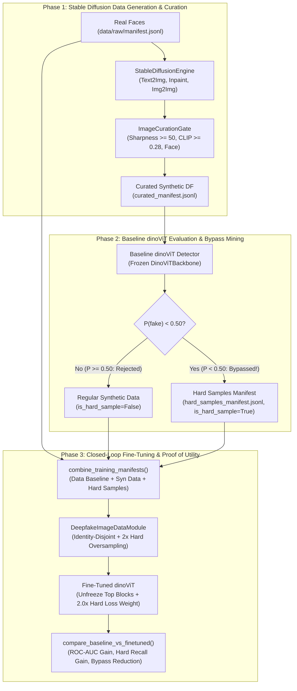

# Phần 2: Thiết Kế Kiến Trúc Hệ Thống Toàn Diện (System Architecture & Technical Design)

- **Motivation/Background**: Cung cấp bản thiết kế kỹ thuật kiến trúc hoàn chỉnh cho đồ án Thị giác máy tính: "Stable Diffusion-Based Synthetic Facial Dataset Generation with DINO ViT Hard-Sample Mining for Deepfake Detection" (Topic 11, Hugging Face CV Course Unit 10).
- **Purpose**: Định nghĩa chi tiết kiến trúc phân tầng 4 lớp (Clean Architecture), hợp đồng shape tensor, cơ chế `DinoViTBackbone`, luồng khai phá mẫu khó (`mine_hard_samples.py`) và tinh chỉnh có trọng số (`train_image_detector.py`).
- **Overview Pipeline**: Tier 1 Data & Identity-Disjoint Schema -> Tier 2 Stable Diffusion Generation & Curation -> Tier 3 Baseline `dinoViT` & Hard-Sample Mining -> Tier 4 Fine-Tuned `dinoViT` & Proof-of-Utility Benchmark.
- **Detailed Plan**: §1 Kiến trúc phân tầng Clean Architecture (4 Tầng); §2 Tensor Shape Contracts & Bất biến hệ thống; §3 Sơ đồ luồng dữ liệu khép kín (Mermaid Dataflow); §4 Thiết kế cấu hình YAML; §5 Danh mục API Signatures.
- **References**: `docs/PURPOSE.md`, `docs/OVERVIEW.md`, `GEMINI.md`, `configs/dataset/deepfake_image.yaml`, `configs/generation/stable_diffusion.yaml`, `configs/detection/detector_baseline.yaml`.
- **Created**: 2026-11-07T00:45:00+07:00
- **Last Updated**: 2026-11-08T17:52:00+07:00

---

## 1. Kiến Trúc Phân Tầng Clean Architecture (4-Tier Closed-Loop Architecture)

```text
+---------------------------------------------------------------------------------------+
|                        4-TIER CLOSED-LOOP CLEAN ARCHITECTURE                          |
+---------------------------------------------------------------------------------------+
|  Tier 1: Data Ingestion, Hard-Sample Schema & Identity-Disjoint Tier (src/data/)      |
|  - ImageMetadata (is_hard_sample, baseline_score, data_source) & ImageSample          |
|  - DeepfakeImageDataset & DeepfakeImageDataModule (Identity-Disjoint + Oversampling)  |
+---------------------------------------------------------------------------------------+
                                           |
                                           v
+---------------------------------------------------------------------------------------+
|  Tier 2: Phase 1 Stable Diffusion Factory & Curation Tier (src/models/diffusion/)     |
|  - StableDiffusionEngine (sd_text2img, sd_inpaint, sd_img2img)                        |
|  - ImageCurationGate (Laplacian Sharpness >= 50.0, CLIP >= 0.28, Face Retention)      |
+---------------------------------------------------------------------------------------+
                                           |
                                           v
+---------------------------------------------------------------------------------------+
|  Tier 3: Phase 2 Baseline dinoViT Benchmark & Hard-Sample Miner (src/pipelines/)      |
|  - DinoViTBackbone (Patch Embed 16x16 + Positional Interpolation + Self-Attention)    |
|  - mine_hard_samples.py: P(fake) >= 0.50 (Reject) vs P(fake) < 0.50 (Bypass -> Hard)  |
+---------------------------------------------------------------------------------------+
                                           |
                                           v
+---------------------------------------------------------------------------------------+
|  Tier 4: Phase 3 Closed-Loop Fine-Tuning & Proof-of-Utility Benchmark                 |
|  - combine_training_manifests (Data Baseline + Synthetic Data + Hard Samples)         |
|  - Weighted Hard-Sample BCE Loss (weight=2.0) + Unfreeze Top ViT Blocks               |
|  - compare_baseline_vs_finetuned (ROC-AUC Gain, Hard-Sample Recall, Bypass Drop)      |
+---------------------------------------------------------------------------------------+
```

---

## 2. Tensor Shape Contracts & Bất Biến Kỹ Thuật

| Thành phần | Tensor Shape | Không gian màu / Ý nghĩa | Dải giá trị | Dtype |
| :--- | :--- | :--- | :--- | :--- |
| **Ảnh đơn (`ImageSample.image`)** | `(3, H, W)` | RGB | `[0.0, 1.0]` | `torch.float32` |
| **Batch DataLoader (`images`)** | `(B, 3, H, W)` | RGB | `[0.0, 1.0]` / ImageNet norm | `torch.float32` |
| **Nhãn phân loại (`labels`)** | `(B,)` | `0`: Real, `1`: Fake | `{0, 1}` | `torch.int64` |
| **Cờ mẫu khó (`is_hard_sample`)** | `(B,)` | `True` nếu vượt qua Baseline | `{False, True}` | `torch.bool` |
| **Đặc trưng `DinoViTBackbone`** | `(B, 192)` | L2-normalized `[CLS]` token | `[-1.0, 1.0]` | `torch.float32` |
| **Logits dự đoán** | `(B, 1)` | Log-odds | `(-inf, +inf)` | `torch.float32` |

---

## 3. Sơ Đồ Luồng Dữ Liệu Khép Kín Toàn Diện (Mermaid Dataflow)



---

## 4. Danh Mục Module Mã Nguồn & Giao Diện API Cốt Lõi

1. **`src/data/image_schema.py`**:
   - `ImageMetadata(image_id, label, manipulation_type, prompt, source_real_id, file_path, bbox, is_hard_sample, baseline_score, data_source)`
   - `ImageSample(image: torch.Tensor, metadata: ImageMetadata)`
2. **`src/data/image_datamodule.py`**:
   - `DeepfakeImageDataModule(..., hard_sample_oversample_factor=2, identity_disjoint=True)`
3. **`src/models/detector/image_detector.py`**:
   - `DinoViTBackbone(patch_size=16, embed_dim=192, depth=4, num_heads=4)`
   - `DeepfakeImageDetector(backbone="dino_vit", num_classes=1, dropout=0.3, freeze_extractor=False)`
   - `.freeze_backbone()`, `.unfreeze_backbone(unfreeze_last_n_blocks=2)`, `.predict_proba(x)`
4. **`src/pipelines/mine_hard_samples.py`**:
   - `mine_hard_samples(model, synthetic_metadata, cache, bypass_threshold=0.5, ...) -> HardSampleMiningReport`
5. **`src/pipelines/train_image_detector.py`**:
   - `combine_training_manifests(baseline_manifest, synthetic_manifest, hard_sample_manifest) -> List[ImageMetadata]`
   - `train_deepfake_image_detector(model, datamodule, num_epochs, learning_rate, hard_sample_loss_weight=2.0, ...)`
6. **`src/pipelines/evaluate_image_benchmark.py`**:
   - `evaluate_image_detector(model, dataloader, device, threshold=0.5) -> Dict[str, float]`
   - `compare_baseline_vs_finetuned(baseline_model, finetuned_model, dataloader, device) -> Dict[str, Any]`
