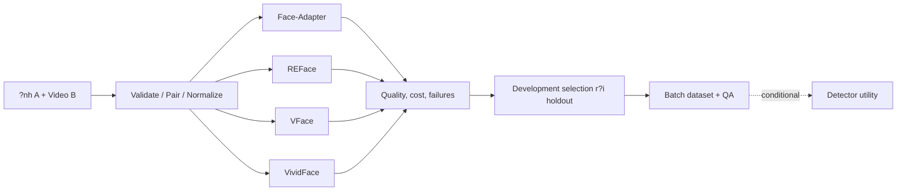

# SD video ? DEFINE & DESIGN master report

- **Motivation/Background**: C?n ??c t? SD-video nh?t qu?n tr??c benchmark pretrained.
- **Purpose**: T?ng h?p ph?m vi, t?i li?u, thi?t k? v? tr?ng th?i b?ng ch?ng.
- **Overview Pipeline**: DEFINE -> DESIGN -> Pretrained benchmark -> Selection -> Dataset -> Conditional detector.
- **Detailed Plan**: C?c m?c b?n d??i tr?nh b?y scope, ki?n tr?c, protocol, milestones v? gi?i h?n.
- **References**: [Lifecycle](../../.agents/AI_FIRST_LIFECYCLE.md), [DEFINE](../PURPOSE.md), [DESIGN](../phases/SD_VIDEO_SYSTEM_DESIGN.md).
- **Created**: 2026-11-07T14:12:25+07:00
- **Last Updated**: 2026-11-07T14:54:10+07:00

---

[STATUS: ACTIVE]

## 1. Executive summary

Nh?nh sd-video t? main scaffold b6ba329. Ch? kh?o s?t pretrained d?a tr?n SD: Face-Adapter, REFace, VFace, VividFace. Ch?a c? k?t qu? GPU ho?c model chi?n th?ng. Kh?ng cherry-pick image baseline v? c?c tuy?n b? AUC m? ph?ng.

B?i to?n: ?nh A + video B -> video B mang danh t?nh A, gi? chuy?n ??ng/bi?u c?m/b?i c?nh. Pretrained baseline tr??c; c?i thi?n c?u h?nh r?i kh?a ?? sinh dataset. Fine-tune t?y failure hypothesis v? upstream support, kh?ng b?t bu?c.

## 2. DEFINE ? B?y tr? c?t

- **Project name:** x?y d?ng v? ??nh gi? pipeline sinh d? li?u video deepfake b?ng ph??ng ph?p d?a tr?n Stable Diffusion.
- **Problem:** ch?a bi?t quality/cost/temporal stability c?a ?ng vi?n tr?n c?ng inputs v? Kaggle; c?n evidence tr??c sinh h?ng lo?t.
- **Users:** nh?m ?? ?n, ng??i ??nh gi?, nghi?n c?u detector v? sau trong gi?i h?n gi?y ph?p.
- **Outputs:** clips, provenance manifests, resolved configs, logs, metrics/QA v? dataset card.
- **Features:** data integrity, b?n adapters, benchmark, batch/resume v? export; detector utility conditional.
- **Constraints:** pilot 5s/10 FPS/50 frames, m?t ng??i; crop 512 khi h? tr?; env ri?ng, source kh?ng ch?a weights/video.
- **Success criteria:** benchmark trung th?c, artifact t?i l?p v? selection c? evidence; kh?ng ??t s?n AUC/ID similarity ho?c latency gi?.

[DEFINE ??y ??](../PURPOSE.md). ??y l? scope theo ng??i d?ng, ch?a ph?i rubric ho?c ph? duy?t gi?ng vi?n.

## 3. DESIGN ? B?y th?nh ph?n

Ki?n tr?c Data -> Backend -> Evaluation -> Selection -> Dataset -> Conditional detector. Modules v? folder mapping theo skeleton; interfaces ch?a RGB/tensor/coordinate v? job lifecycle. Preprocessing theo backend, kh?ng b?t m?i model c?ng tracker/mask/crop ho?c frame count n?i b?.

[DESIGN chi ti?t](../phases/SD_VIDEO_SYSTEM_DESIGN.md) bao g?m architecture system, modules, folder structure, dataflow, interfaces/API, milestones v? risk mitigation. VFace d?ng REFace, n?n kh?ng g?i b?n backend l? b?n backbone ??c l?p.

## 4. Evaluation hai phase

**Phase 1:** ID-to-source v? ID-to-target, pose/expression preservation, valid-region motion-compensated warping + motion fidelity, QA, failure/coverage, time v? GPU/host memory. Kh?ng g?i random pooling l? ArcFace/CLIP/FVD th?t; PSNR to?n m?t so ng??i ??ch kh?ng ph?i objective khi ??i ID.

**Phase 2, c? ?i?u ki?n:** detector D0 baseline, D1 augmentation/oversampling control v? D2 SD augmentation, c?ng budget v? test ??c l?p. Report clip ROC-AUC/AP/TPR@FPR, secondary metrics, grouping v? uncertainty. Generator ??p kh?ng t? ch?ng minh dataset h?u ?ch. [Protocol](../experiments/SD_VIDEO_BASELINE_PROTOCOL.md).

## 5. Milestones v? gates

M0 t?i li?u -> M1 input integrity -> M2 upstream feasibility -> M3 pilot comparison -> M4 development/holdout selection -> M5 dataset -> M6 optional detector -> M7 release. Pilot 3 pairs ? 4 backends = t?i ?a 12 clips; sample size cu?i v? budget ch?t sau pilot, kh?ng c? throughput d? ?o?n nh? k?t qu? ?o. [Roadmap v? DoD](../progress/SD_VIDEO_ROADMAP.md).

## 6. Open decisions v? tr?ng th?i evidence

GPU Kaggle th?c, dependency/VRAM/latency t?ng backend; to?n b? file ph? tr? v? licenses; quy?n input/output; danh s?ch identities/pairs; development/holdout size; operating thresholds v? dataset budget ch?a ?o. Public README ch? l? ?i?u ki?n kh?o s?t, kh?ng ch?ng minh ?? ch?y.

Source v?n skeleton, kh?ng c?ng b? command video gi? g?i module ch?a c?. [HTML slides](SD_VIDEO_DEFINE_AND_DESIGN_SLIDES.html) l? b?n tr?c quan offline c?a ??c t?, kh?ng ph?i b?o c?o th?c nghi?m. Results ch? ?i?n t? run artifacts sau implementation.

---

## References & Technical Documentation

### Official API Docs

[Diffusers](https://huggingface.co/docs/diffusers/index), [PyTorch](https://docs.pytorch.org/docs/stable/index.html).

### Technical Standards

[JSON Lines](https://jsonlines.org/), [FFmpeg](https://ffmpeg.org/ffmpeg.html).

### CV Conventions

[Face-Adapter](https://github.com/FaceAdapter/Face-Adapter), [REFace](https://github.com/Sanoojan/REFace), [VFace](https://github.com/Sanoojan/VFace), [VividFace](https://github.com/deepcs233/VividFace).

### Internal Architecture Links

[DEFINE](../PURPOSE.md), [DESIGN](../phases/SD_VIDEO_SYSTEM_DESIGN.md), [PROTOCOL](../experiments/SD_VIDEO_BASELINE_PROTOCOL.md), [ROADMAP](../progress/SD_VIDEO_ROADMAP.md).
